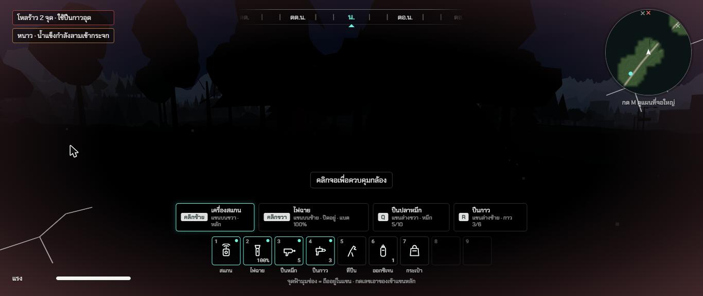
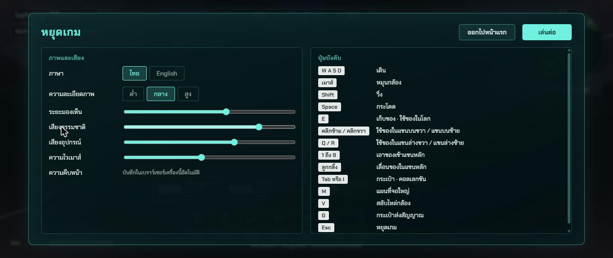

# รอบสอง ช่วง 0 · ตรวจทานด้วยเอเจนต์ 3 ตัว แก้ข้อที่ยืนยันแล้ว

วันที่ 23 ต.ค. 2569 · ผล **ผ่าน** · รายงานรวม `docs/BUGHUNT-2026-10-23.md`

## ทำอะไรไป
- **เอเจนต์ 3 ตัว** (พี่กันอนุมัติ 3 ใช้ 3 ยิงพร้อมกันครั้งเดียว) ตรวจคนละมุม ห้ามแก้โค้ด ห้ามเปิดเบราว์เซอร์
  | ตัว | ตรวจ | พบ | ไฟล์ |
  |---|---|---|---|
  | 1 กติกาและข้อมูล | กระเป๋า แขน สแกน ร่างกาย สัตว์ บันทึก ตาย เกิดใหม่ | 28 ข้อ + เรื่องขยายแมพ 13 ข้อ | `docs/bughunt-2026-10-23/1-rules.md` |
  | 2 โลกและฟิสิกส์ | ภูมิประเทศ ของชน ตึก ถ้ำ ตัวละคร สัตว์ กล้อง หน่วยความจำ | 54 ข้อ | `docs/bughunt-2026-10-23/2-world.md` |
  | 3 หน้าจอ ภาษา ปุ่ม เสียง | กฎภาษา ปุ่มตามสกิล button-feedback หน้าจอซ้อน เสียง มอคอัป | 40 ข้อ | `docs/bughunt-2026-10-23/3-ui.md` |
- **แคลร์รวมเป็นเลขชุดเดียว 135 ข้อ** ตามสกิล audit-report แล้วแก้ทันที **74 ข้อ** แก้ครึ่งทาง 7 ข้อ · ข้อที่ช่วงถัดไปจะรื้อทำใหม่ทั้งชิ้น (ภูมิประเทศ ถ้ำ เมือง สัตว์ กล้อง) **ย้ายไปแก้ในช่วงนั้น 53 ข้อ** เพราะแก้ตอนนี้ก็ถูกรื้อทิ้ง
- ของที่แก้ใหญ่ ๆ
  - **ของไม่หายอีก** กระเป๋าใกล้ยานหยิบคืนได้ · เปิดสองแท็บไม่บันทึกทับกัน · ตายระหว่างไถลไม่ตายซ้ำ · ปิดแท็บตอนจอตายไม่ย้อนเวลา · เก็บชิ้นพิเศษก่อนสแกนยังได้บันทึกส่วนตัว · ชนิดที่มีไม่ถึง 3 ชิ้นปลดความจริงได้
  - **ความสูง** บันทึกเก็บความสูงแล้ว โหลดในถ้ำอยู่ในถ้ำ · ซาก กระเป๋า หมึก อยู่ชั้นที่ยืนจริง (`WorldGround.groundAt`)
  - **ตัวละคร** แบกหนักเดินช้าและเหนื่อย · ไถลมีความเร็วสูงสุด 12 ม./วินาที · ปีนไม่ทะลุหินต้นไม้
  - **หน่วยความจำ** ตัวคืนหน่วยความจำกลาง `src/render/dispose.ts` (สัตว์ กระเป๋า ซาก โมเดลในคอลเลกชัน)
  - **หน้าจอ** ป้ายสถานะค้างมุมซ้ายบน (โหลร้าว ออกซิเจนลด หนาว) ตามมอคอัปหน้า 3 · ป้าย "คลิกจอเพื่อควบคุมกล้อง" · Tab เลื่อนปุ่มได้นอกเกม · เปลี่ยนภาษาแล้ววาดใหม่ทุกจุด · คำที่มีช่องใส่ตัวเลข (`tf`) · เลขรุ่นอ่านจาก `package.json`
  - **เสียง** ปรับระดับเสียงทันที · ลดเป็น 0 แล้วเงียบรวมเสียงก้อง · ออกหน้าแรกหรือสลับแท็บเสียงเงียบ
- เทสใหม่ `tests/bughunt-r2.test.ts` · รวมทั้งหมด 120 เทส

## เล่นทดสอบ (ในโครมของพี่กัน)
| ทดสอบ | ผล |
|---|---|
| วางกระเป๋าห่างกลางยาน 5.8 ม. แล้วหยิบคืน (ข้อ 16) | ป้ายขึ้น "หยิบกระเป๋า" กด E แล้วกลับเข้าแถบ ✅ |
| ตายเพราะก๊าซในถ้ำแรก (ข้อ 17) | ซากอยู่พื้นถ้ำ 17.5 ม. ไม่ใช่ผิวเขา 42.9 ม. ✅ |
| ตายแล้วอ่านบันทึกทันที (ข้อ 19) | ได้ร่างถัดไปที่จุดเกิดแล้ว ✅ |
| บันทึกในถ้ำที่สอง ปิดเปิดหน้าใหม่ (ข้อ 88) | กลับมาที่ 12.5 ม. ในถ้ำ ไม่ตก ไม่ร้าว ✅ |
| ตายแล้วเกิดใหม่ (ข้อ 91) | ไม่ตายซ้ำ ✅ |
| หลังตายกด Esc ที่หน้ายาน (ข้อ 55) | ออกเดินทางด้วยแขน 4 ข้าง ของ 7 ชิ้น ✅ |
| ป้ายสถานะ โหลร้าว + หนาว (ข้อ 64) | ขึ้นค้างมุมซ้ายบน ✅ |
| อีกแท็บบันทึกใหม่กว่า (ข้อ 13) | แท็บนี้หยุดบันทึก ขึ้นคำเตือน ✅ |
| วาร์ป 20 จุด นับรูปทรงบนการ์ดจอ (ข้อ 97) | คงที่ 711 ตลอด ✅ |
| typecheck · test (120 ข้อ) · build | ผ่าน ✅ |

| ป้ายสถานะ + คลิกจอเพื่อควบคุมกล้อง | เสียล็อกเมาส์แล้วหยุดเกม (ถูกต้อง) |
|---|---|
|  |  |

## บั๊กที่เจอระหว่างทดสอบ
| บั๊ก | สถานะ |
|---|---|
| แคลร์เผลอรันโครมแบบไม่มีหน้าต่างบนเครื่องพี่กัน (ผิดสกิล testing-proof 5.6) | หยุดทันที ปิดโปรแกรมที่ค้าง ใส่ตัวกันใน `playwright.config.ts` ให้รันได้เฉพาะเครื่องคลาวด์ จดในบันทึกคำด่า |
| หน้าต่างโครมถูกย่อ ภาพไม่ออก ปุ่มไม่เข้า | คืนเฉพาะหน้าต่างทดสอบด้วยคำสั่งของวินโดวส์ เปิดแท็บใหม่ ไม่แตะหน้าต่างระบบงานโรงพยาบาล |

## แคลร์ตัดสินเอง
- ข้อที่ช่วงถัดไปรื้อทำใหม่ทั้งชิ้น ไม่แก้ตอนนี้ (ตารางลำดับในรายงานรวม)
- ไม่ย้ายโฟกัสเข้าหน้าต่างตอนเปิด (ข้อ 48) เพราะ Space จะไปกดปุ่มแทนกระโดด
- หมีดุ 30 วินาที (ข้อ 12) · ไถลจากการเดินเจ็บตามความเร็ว (ข้อ 93)

## รอพี่กันเคาะ
- ข้อ 3 กระเป๋าซ้อนรับของเพิ่มได้ไหม · ข้อ 12 หมีดุนานเท่าไร · ข้อ 93 ไถลเจ็บแบบไหน · ข้อ 39 ข้อยกเว้นภาษา
- ข้อ 58 ถึง 61 ฟังเสียงจริง · ข้อ 51 52 ล็อกเมาส์จริง
