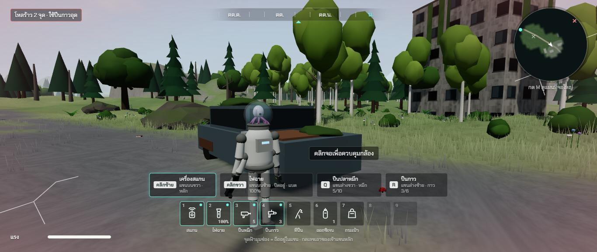
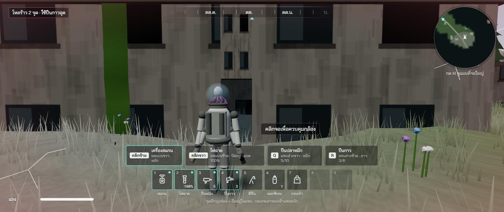
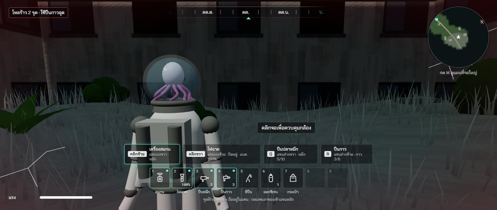
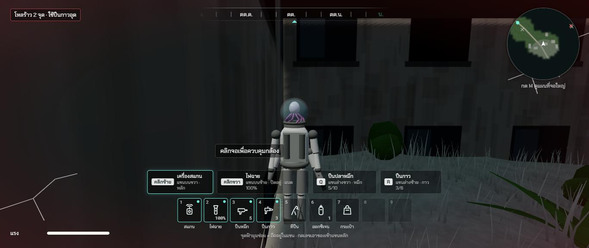
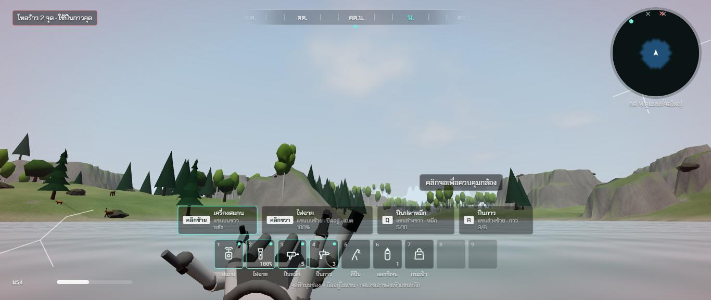
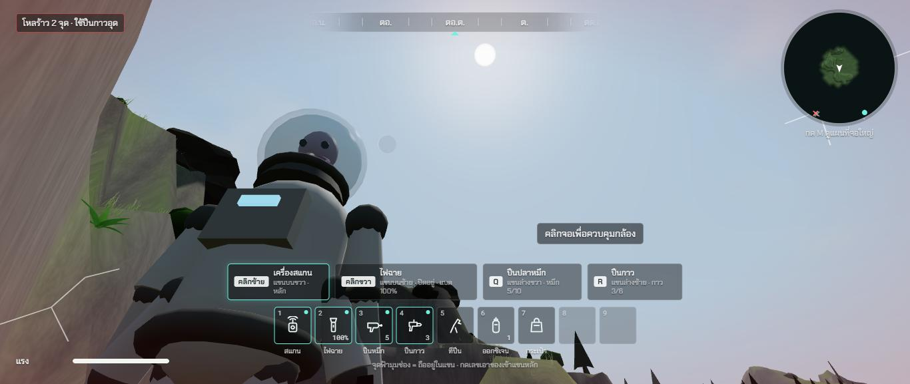
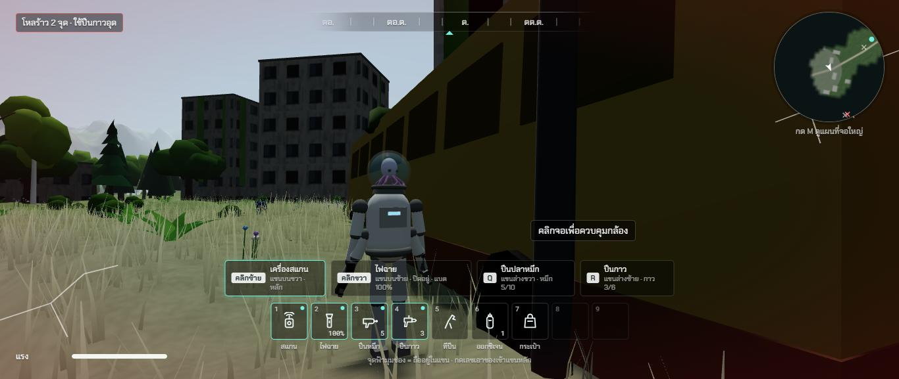
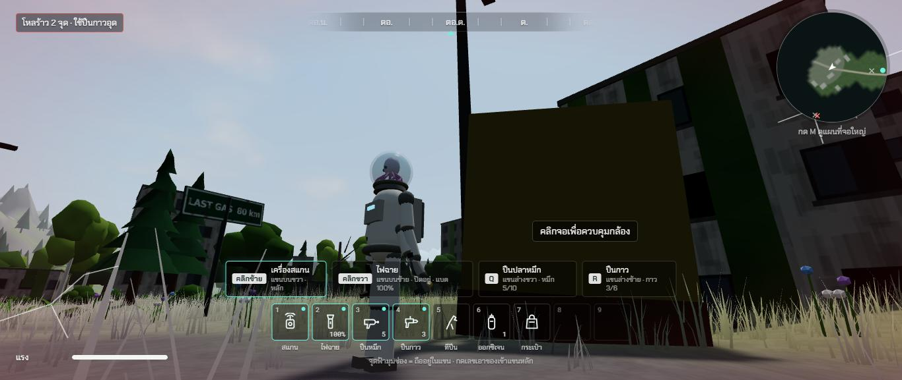

# รอบสอง ช่วง 2 · สัดส่วนของจริง เอเลี่ยนสูง 1.5 ม.

วันที่ 23 ต.ค. 2569 · ผล **ผ่าน**

## ทำอะไรไป
- **ไฟล์ค่าขนาดของจริงกลาง** `src/config/scale.ts` โมเดล ตัวชน กล้อง อ่านจากที่นี่ที่เดียว
  | ของ | เดิม | ตอนนี้ |
  |---|---|---|
  | เอเลี่ยน (ถึงยอดโหล) | **2.07 ม.** (ในเอกสารเขียน 1.8 แต่โมเดลจริงสูงกว่า) | **1.5 ม.** ย่อทั้งตัวตามสัดส่วนเดิม |
  | กลางโหล (เช็กก๊าซ จมน้ำ) | 1.70 / 1.75 ม. เขียนตายตัวหลายที่ | 1.34 ม. ค่าเดียว |
  | ลึกแค่ไหนต้องว่าย | 1.3 ม. | 0.95 ม. (ราวอก) |
  | รถเก๋ง | ยาว 4.2 ล้อยื่นนอกตัวรถ | 4.5 × 1.8 × 1.45 ม. |
  | รถบัส | 10 × 2.5 × 2.95 ม. | 12 × 2.5 × 3.2 ม. |
  | เสาไฟถนน | 6 ม. | 8 ม. |
  | ตู้ไปรษณีย์ | 1.68 ม. | 1.27 ม. (ตู้จริงแบบอเมริกา) |
  | ตึก | ชั้นละ 3.2 ม. | ชั้นละ 3.0 ม. |
  | ประตูตึกหลบหนาว | ช่องกว้าง 3.2 ม. | 0.9 × 2.1 ม. มีคานเหนือประตู |
  | ระยะรอบยาน | เลขตายตัว | คิดจากรัศมีตัวยาน |
  - ตัวชนของรถ รถบัส เสาไฟ ตู้ไปรษณีย์ ปรับตามขนาดใหม่
  - สัตว์ เทียบกับข้อมูลช่วง 1 แล้วใกล้ของจริงอยู่แล้ว ไม่ต้องแก้ (กวางไหล่ราว 1.25 · หมาป่า 0.84 · หมี 1.46 ม.)
- **กล้องแบบ RDR2 ตามตัวใหม่** จุดหมุนจาก 1.55 เหลือ 1.2 ม. · ไหล่ 0.58 → 0.45 · ระยะเดิน 3.3 → 2.7 วิ่ง 4.1 → 3.3 เล็ง 1.55 → 1.2 ม.
  - **ชิดผนังด้านไหล่ ไหล่หดเข้าหาตัว** กล้องไม่เข้าไปในผนัง (ข้อ 103 ในรายงานตรวจ)
  - **ว่ายน้ำแล้วเงยกล้อง กล้องไม่มุดน้ำ** (ข้อ 104)
  - **หลังชิดเนินแล้วเงย กล้องยกขึ้นเหนือดิน** ไม่มองทะลุภูเขา (ข้อ 105)
  - ไม่สร้างของใหม่ทุกเฟรม (ข้อ 106)
- **ป้ายกดปุ่มย้ายไปข้างตัวละคร** ฝั่งตรงข้ามไหล่กล้อง (เดิมอยู่กลางจอ ตัวเตี้ยลงแล้วทับตัวพอดี) · สลับไหล่ด้วย V ป้ายย้ายฝั่งตาม
- เทสใหม่ `tests/scale.test.ts` วัดโมเดลจริงเทียบค่าใน `scale.ts` (ตัวละคร กลางโหล รถ รถบัส เสาไฟ ตู้ไปรษณีย์) · รวม 123 เทส

## เล่นทดสอบ (ในโครมของพี่กัน)
| ทดสอบ | ผล |
|---|---|
| วัดความสูงตัวละครในเกม | 1.50 ม. ✅ |
| ยืนข้างรถเก๋ง | ยอดโหลสูงกว่าหลังคารถนิดเดียว ตรงกับคนเตี้ยข้างรถจริง ✅ |
| เดินเข้าประตูตึกหลบหนาว 0.9 × 2.1 ม. | เดินผ่านได้ เกมนับว่าอยู่ใต้หลังคา ✅ |
| ชิดผนังในตึก ไหล่ขวาและไหล่ซ้าย | กล้องอยู่ในห้องทั้งสองข้าง ไม่เข้าเนื้อผนัง ✅ |
| ว่ายกลางทะเลสาบ เงยกล้อง 4 มุม | กล้องต่ำสุด 2.40 ม. (ผิวน้ำ 2.0) · กลางโหล 2.04 ม. พ้นน้ำ ✅ |
| หลังชิดเนินชันแล้วเงย 3 มุม | กล้องเหนือดินทุกมุม ✅ |
| ยืนข้างรถบัส ข้างเสาไฟ | รถบัสสูงเกินหัว เสาไฟสูงพ้นจอ ✅ |
| ปีนผนังตึกด้วยที่ปีน | ปีนถึงหลังคา 12.6 ม. เดินบนหลังคาได้ ✅ |
| คอนโซล | ไม่มีข้อผิดพลาด ✅ |
| typecheck · test (123 ข้อ) · build | ผ่าน ✅ |

| ข้างรถเก๋ง | หน้าประตู 0.9 × 2.1 ม. | ในตึก |
|---|---|---|
|  |  |  |

| ชิดผนังด้านไหล่ | ว่ายน้ำ กล้องเหนือน้ำ | หลังชิดเนิน เงยกล้อง |
|---|---|---|
|  |  |  |

| ข้างรถบัส 12 ม. | เสาไฟ 8 ม. กับป้ายถนน |
|---|---|
|  |  |

## บั๊กที่เจอ
| บั๊ก | สถานะ |
|---|---|
| ป้ายกดปุ่มกลางจอทับตัวละครที่เตี้ยลง | แก้แล้ว ย้ายไปข้างตัวฝั่งตรงข้ามไหล่กล้อง |
| ล้อรถยื่นนอกตัวรถ รถกว้างเกินของจริง 22 ซม. | แก้แล้ว (เทสจับได้) |
| ลดระยะก้าวขึ้นเป็น 0.45 ม. แล้วเดินขึ้นพื้นสะพานไม่ได้ | คืนค่าเดิม 0.6 ม. ไว้ก่อน ช่วง 3 สร้างสะพานใหม่แล้วค่อยลด |
| สะพานเดินขึ้นไม่ได้ทั้งสองฝั่ง ขอบพื้นสะพานสูงกว่าตลิ่ง 0.78 กับ 3.3 ม. | มีมาก่อนช่วงนี้ (ข้อ 79 ในรายงานตรวจ) ช่วง 3 ย้ายแม่น้ำกับสะพานใหม่ |
| หญ้าขึ้นในตึก | ช่วง 5 ทำหญ้าใหม่ จะไม่ขึ้นในตึก |
| ตัวช่วยวาร์ปวางตัวบนหลังคาเมื่อวาร์ปเข้าตึก | ไม่ใช่บั๊กของเกม ทดสอบใหม่ด้วยการเดินเข้าประตูจริง |

## แคลร์ตัดสินเอง
- **ย่อโมเดลทั้งตัว** ตามสัดส่วนเดิม ไม่ปั้นใหม่ (ช่วง 13 ทำโมเดลละเอียดขึ้นอีกรอบ)
- ความเร็วเดิน วิ่ง และกระโดดคงเดิม (กระโดดสูงราว 1 ม. ตามแผน) · ระยะเอื้อมหยิบคงเดิม
- ตึกหลบหนาวใช้ประตูขนาดจริง 0.9 ม. (เดิมเป็นช่องกว้างแบบโรงรถ 3.2 ม.)
- ตู้ไปรษณีย์ใช้ขนาดตู้สีน้ำเงินแบบอเมริกา เพราะเมืองในเกมใช้ป้ายภาษาอังกฤษ
- ว่ายน้ำแล้วเงยกล้องสุด กล้องเข้ามาใกล้ตัว (เหมือนตอนหลังชิดเนิน) แทนการมุดน้ำ

## รอพี่กันเคาะ
- ไม่มี
