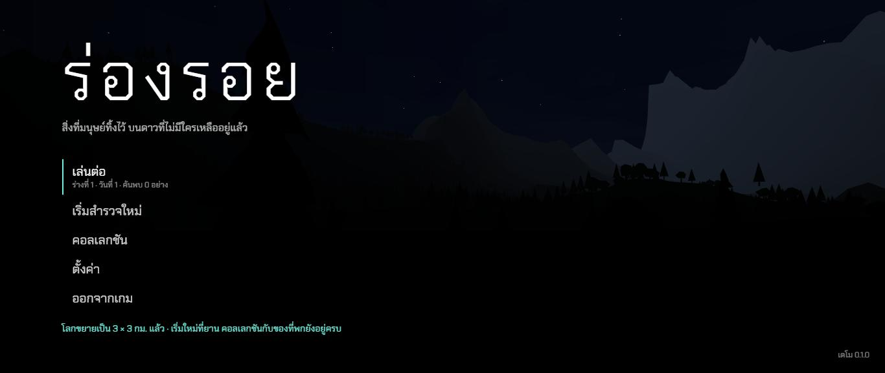
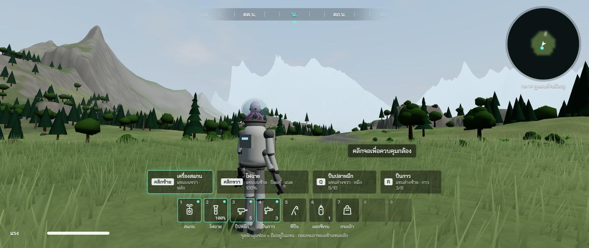
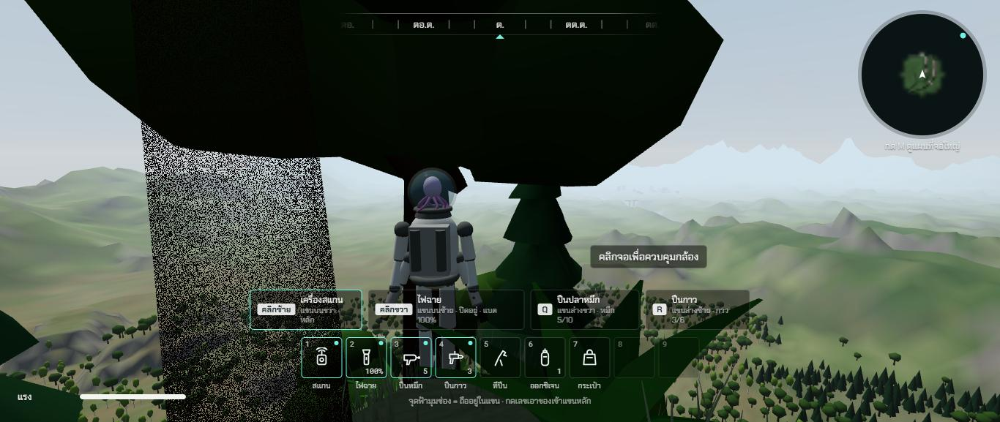
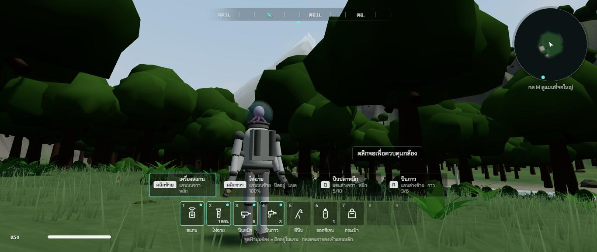
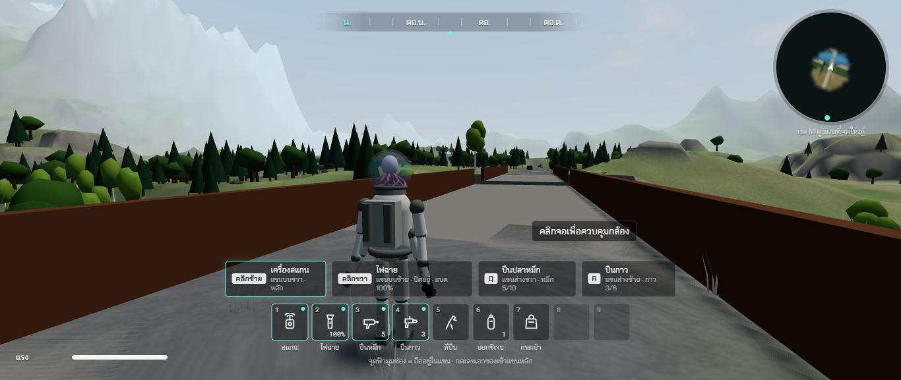
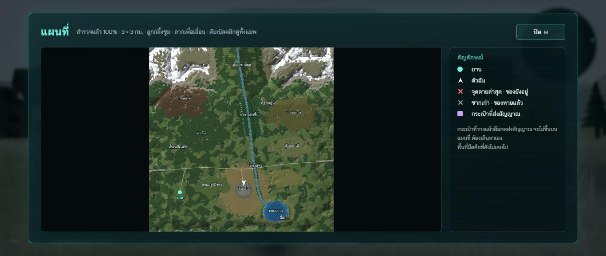
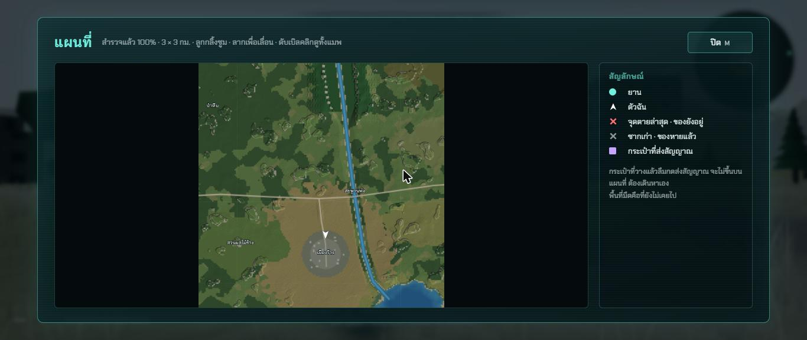
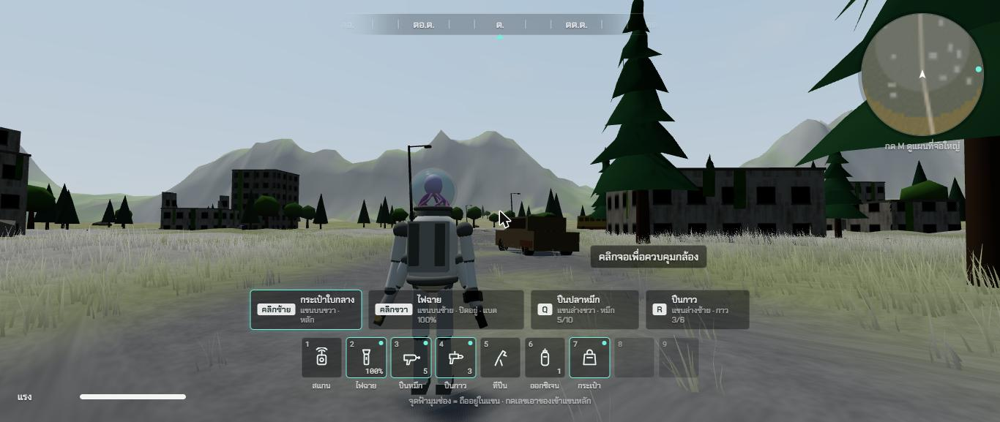

# รอบสอง ช่วง 3 · แมพ 3 × 3 กม. ภูเขาสูง

วันที่ 23 ต.ค. 2569 · ผล **ผ่าน** (ภาพต่อวินาทีจริงรอพี่กันลอง เพราะหน้าต่างโครมถูกบังระหว่างทดสอบ)

## ทำอะไรไป
- **โลก 3 × 3 กม.** (เดิม 1 × 1) ผังใหม่ใน `src/world/layout.ts` ตามที่อนุมัติไว้
  | ที่ | ตำแหน่ง |
  |---|---|
  | เทือกเขาหิมะ | ทิศเหนือทั้งแนว ยอดสูงสุด **783 ม.** · เหนือ 550 ม. เป็นหิมะ (4.9% ของแมพ) · ทุ่งหญ้าบนเขา หน้าผาหิน |
  | ป่าสนยักษ์ | ตีนเขาตะวันตกเฉียงเหนือ |
  | ป่าทึบ (ป่าลึกมีสัตว์ดุ) | ตะวันตก · ถ้ำเหมืองเก่าในหน้าผากลางป่า |
  | หุบป่าดิบชื้น | แม่น้ำไหลในหุบลึก 55 ถึง 75 ม. ท้องหุบกว้างราว 75 ม. ต่อฝั่ง ผาชันสองข้าง |
  | ป่าผลัดใบ · ทุ่งดอกไม้ · ทุ่งหญ้าสูง | ตะวันออก บนเนินคลื่น |
  | ถนนหลวง | ตะวันตกถึงตะวันออก 3 กม. รถร้าง 19 คัน · สะพานพังข้ามแม่น้ำตรงจุดตัดจริง |
  | ทุ่งจอดยาน | ตะวันตกเฉียงใต้ ห่างเมืองราว 1 กม. มีถนนเล็กขึ้นถนนหลวง |
  | ป่าที่เคยเป็นไร่ | ระหว่างยานกับเมือง (ช่วง 4 ใส่แถวสวนผลไม้) |
  | เมือง | ในหุบริมแม่น้ำ ไร่นารอบเมือง (ช่วง 8 วางผังเมืองใหม่) |
  | ทะเลสาบ · ที่ลุ่มน้ำ | ทิศใต้ |
  | ถ้ำหินปูน | ตีนเทือกเขาเหนือ |
- **สร้างภูมิประเทศใน Web Worker** (`src/world/terrainGen.ts` `src/world/terrain.worker.ts`) ราว 5 วินาที หน้าเว็บไม่ค้าง มี **หน้ารอพร้อมแถบความคืบหน้า** ก่อนหน้าแรก · เบราว์เซอร์ที่ไม่มี Worker สร้างในเธรดหลักแทน
- **แผนที่ชนิดพื้นที่ 16 แบบ** ทุก 8 ม. (น้ำ ชายฝั่ง ทุ่งหญ้า ทุ่งดอกไม้ ทุ่งหญ้าสูง ไร่ ที่ลุ่ม เมือง ป่าสนยักษ์ ป่าดิบชื้น ป่าผลัดใบ สวนผลไม้ร้าง ป่าทึบ บนเขา หิน หิมะ) ทุกระบบอ่านจากที่นี่ที่เดียว · สีพื้นผสมขอบไม่เป็นขั้นบันได · หิมะไม่เกาะหน้าผาชัน
- **พื้นแบบแผ่นหลายระดับ** (`src/render/TerrainMesh.ts`) แผ่นใหญ่ 3 กม. แตกเป็นแผ่นเล็กเมื่อเข้าใกล้ จนเล็กสุด 93.75 ม. ห่างจุดละ 1.95 ม. · มองเห็นภูเขาถึงขอบแมพ · สร้างแผ่นเมื่อต้องใช้ 2 แผ่นต่อเฟรม เริ่มเล่น เกิดใหม่ วาร์ป สร้างครบทันที · คืนหน่วยความจำแผ่นเก่า
- **มองไกล 5 กม.** หมอกบางลง ฟ้าใสเห็นภูเขาไกล 1.5 กม. หมอกเช้ายังหนา
- **ถมแอ่งปิดบนบก** ทุกจุดมีทางลงไปถึงน้ำหรือขอบแมพ ไม่มีหลุมที่ติดตลอดไป (ข้อ 69)
- **ต้นไม้ หิน หญ้า พืชเล็ก อ่านชนิดพื้นที่** ป่าดิบชื้นแน่นสุด ทุ่งโล่งมีไม้เดี่ยว บนเขาโปร่ง หิมะไม่มีพืช · ต้นไม้ทั้งแมพ 42,909 ต้น หิน 12,441 ก้อน (ช่วง 4 เปลี่ยนเป็นต้นไม้ 19 ชนิด)
- **แผนที่** ภาพแผนที่ 1 จุดต่อ 4 ม. สีตามชนิดพื้นที่ มีหิมะ เส้นชั้นความสูง · แผนที่ใหญ่ซูม 1 2 4 8 เท่า ลากเลื่อน ดับเบิลคลิกดูทั้งแมพ · **ชื่อที่ 13 แห่ง** ขึ้นเฉพาะที่เคยไป · ป้าย "ร่างที่ N" "กระเป๋า" · ตารางเปิดแผนที่ 375 × 375 ช่อง
- **บันทึกรุ่น 2** บันทึกจากโลก 1 กม. ย้ายมาโลกใหม่ เก็บคอลเลกชัน ของที่พก ร่างที่ เวลา · ตำแหน่ง ซาก กระเป๋า แผนที่ เริ่มใหม่ที่ยาน · หน้าแรกบอกคนเล่น
- **รหัสของในโลกผูกกับตำแหน่ง** (เช่น `teddy@-118,512`) เปลี่ยนผังแล้วของที่เก็บไม่งอกคืน
- สัตว์เกิดได้ทั้งแมพ (เดิมติดกลาง 1 กม.)
- เทสใหม่ `tests/terrain.test.ts` (ภูเขา หิมะ ชนิดพื้นที่ครบ ไม่มีแอ่งปิด สะพาน แผนที่ถึง 4 มุม) · `tests/terrainmesh.test.ts` (แผ่นพื้นไม่สร้างวนไม่จบ ไม่เกินเพดาน) · รวม 132 เทส

## เล่นทดสอบ (ในโครมของพี่กัน)
| ทดสอบ | ผล |
|---|---|
| เปิดหน้าเว็บ | หน้ารอ "กำลังปั้นภูเขา หุบเขา แม่น้ำ" มีแถบความคืบหน้า แล้วเข้าหน้าแรก ✅ |
| ใส่บันทึกรุ่น 1 แล้วเปิดใหม่ | ย้ายเป็นรุ่น 2 ร่าง เวลา ของ 7 ชิ้นครบ หน้าแรกบอกว่าโลกขยายแล้ว ✅ |
| ยืนที่ทุ่งจอดยานมองทิศเหนือ | เห็นเทือกเขาหิมะทั้งแนว ✅ |
| ตีนเขามองลงทิศใต้ | เห็นหุบ เนิน ป่า ไกลหลายกิโล ✅ |
| ท้องหุบป่าดิบชื้น | ป่าทึบ ผาหุบ ยอดหิมะข้างหลัง ✅ |
| เดินจากถนนขึ้นสะพาน | ขึ้นได้ราบ พื้นสะพาน 24.73 ม. เท่าคันดิน ✅ |
| แผนที่ใหญ่ทั้งแมพ ซูมที่เมือง | ชื่อที่ครบ ซูม 2 เท่าตรงจุดใต้เมาส์ ✅ |
| ในเมือง | ตึก รถ เสาไฟ ภูเขาข้างหลัง ✅ |
| จำนวนที่การ์ดจอวาด (ระดับกลาง) | พื้น 182,000 สามเหลี่ยม จากแผ่น 52 แผ่น · ทั้งฉาก 840,000 สามเหลี่ยม 430 ครั้งวาด · เวลาฝั่งเครื่อง 5 มิลลิวินาทีต่อภาพ |
| typecheck · test (132 ข้อ) · build | ผ่าน ✅ |

| หน้ารอสร้างโลก | หน้าแรกหลังย้ายบันทึก | ทุ่งจอดยาน เทือกเขาหิมะ |
|---|---|---|
|  |  |  |

| ตีนเขามองลงทิศใต้ | ท้องหุบป่าดิบชื้น | ขึ้นสะพาน |
|---|---|---|
|  |  |  |

| แผนที่ใหญ่ 3 × 3 กม. | ซูมที่เมือง | เมืองที่ย้ายมาใหม่ |
|---|---|---|
|  |  |  |

## บั๊กที่เจอ
| บั๊ก | สถานะ |
|---|---|
| ตัวเก็บแผ่นพื้นทิ้งแผ่นแม่ที่ใช้อยู่ วาดได้แค่แผ่นใหญ่สุดแผ่นเดียว พื้นใกล้ตัวหยาบ | แก้แล้ว มีเทส ภาพก่อนแก้ `00-bug-coarse-terrain-before-fix.jpg` |
| วาดแผ่นพื้นพร้อมกัน 211 แผ่น หนักเกิน | แก้แล้ว ลดระยะแตกแผ่น แผ่นไกลใช้ช่องน้อยลง เหลือ 52 แผ่น |
| ภูเขาชันเกินจริง หน้าผากินพื้นที่ 16% หิมะแทบไม่มี | แก้แล้ว สันเขาชั้นความถี่น้อยลง ฐานเทือกสูงขึ้น (หน้าผา 6% หิมะ 4.9%) |
| สะพานไม่อยู่ตรงจุดที่ถนนตัดแม่น้ำ ปลายสะพานต่างจากคันดิน 24 ม. แล้ว 3.4 ม. | แก้แล้ว คำนวณจุดตัดจริง ถนนสองฝั่งสูงเท่ากัน (เทสจับได้) |
| หุบป่าดิบชื้นเป็นร่องแคบ 50 ม. ไม่มีที่ให้ป่าขึ้น | แก้แล้ว ท้องหุบกว้างราว 75 ม. ต่อฝั่ง |
| เฟิร์น พุ่มไม้ หญ้า ขึ้นบนหิมะ | แก้แล้ว ภาพก่อนแก้ `00-bug-plants-on-snow-before-fix.jpg` |
| ข้อความ "โลกขยายแล้ว" ไม่ขึ้น เมื่อหน้าแรกถูกวาดซ้ำ | แก้แล้ว จำไว้จนกว่าจะกดเล่น |
| หมุนลูกกลิ้งบนแผนที่ใหญ่ตอนแคลร์หยุดเกมทดสอบ ของในแขนหลักเปลี่ยน | ไม่ใช่บั๊กของคนเล่น (ตอนเล่นจริงเกมล้างค่าลูกกลิ้งทุกเฟรมระหว่างเปิดแผนที่) เกิดเพราะแคลร์หยุดลูปเกมไว้ |
| ต้นไม้ไกลโผล่เป็นวงที่ระยะ 420 ม. เมื่อมองไกลขึ้น | ช่วง 4 ทำต้นไม้ไกลเป็นภาพแบน (ข้อ 113) |

## แคลร์ตัดสินเอง
- ผิวน้ำทั้งแมพระดับเดียว แม่น้ำจึงกัดหุบลงถึงระดับน้ำตลอดสาย · น้ำตกทำในช่วง 6 เป็นลำธารสาขาตกลงหุบ
- ขอบแมพทุกด้านเป็นสันเขา แทนกำแพงล่องหนกลางทุ่ง
- บันทึกเก่าย้ายมาแบบเก็บของที่พกด้วย (ไม่ใช่แค่คอลเลกชัน)
- ระดับกลาง แผ่นพื้นละเอียดสุดคลุมราว 190 ม. รอบตัว · ระดับสูงคลุมกว้างขึ้น

## รอพี่กันเคาะ
- **ภาพต่อวินาทีบนเครื่องนี้** วัดไม่ได้ระหว่างที่หน้าต่างโครมถูกบัง (วาดได้แค่ 1 ภาพต่อวินาที) · ฉากหนักขึ้นจากเดิมราว 10% (ส่วนใหญ่เป็นต้นไม้ไกล) ช่วง 4 จะลดด้วยต้นไม้ไกลเป็นภาพแบน
- ลูกกลิ้งเมาส์จริงบนแผนที่ใหญ่ (ตัวคุมของแคลร์ส่งลูกกลิ้งเข้าหน้าเว็บไม่ได้ ใช้วิธียิงเหตุการณ์ลูกกลิ้งตรงแทน)
