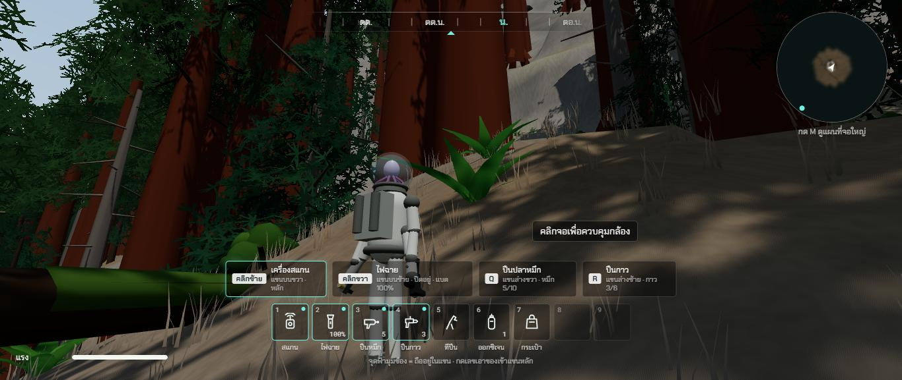
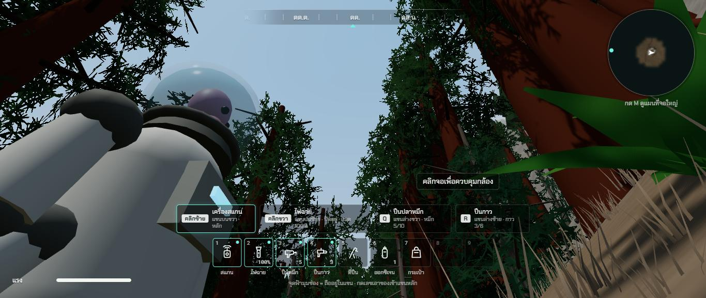
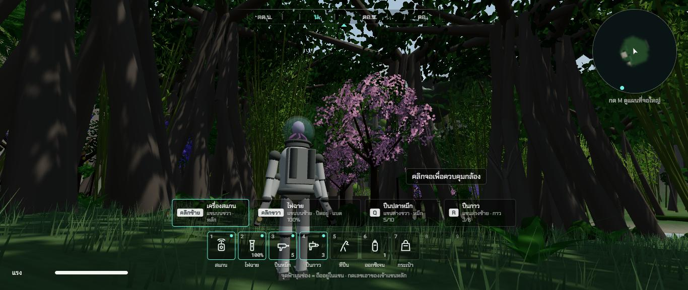
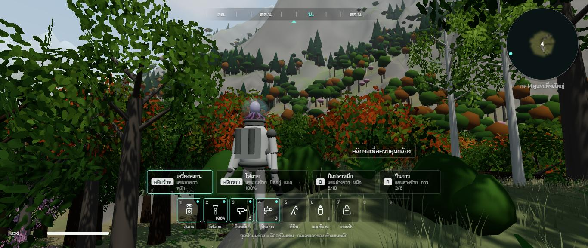
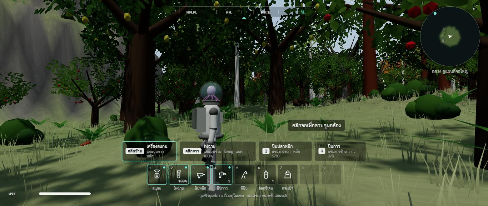
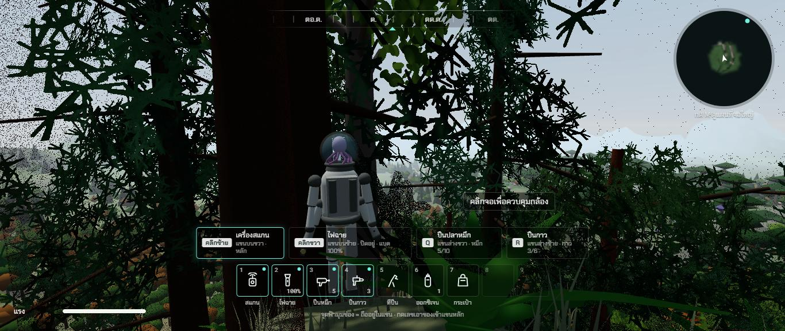

# รอบสอง ช่วง 4 · ต้นไม้ 19 ชนิดกับป่า 5 แบบ

วันที่ 23 ต.ค. 2569 · ผล **ผ่าน**

## ทำอะไรไป
- **ต้นไม้ 19 ชนิด + ต้นตายยืนต้น 2 แบบ** (`src/world/trees.ts` ตาราง · `src/render/models/trees.ts` ปั้นรูปร่าง) ความสูงจากตารางในไฟล์อ้างอิงหัวข้อ 2
  | กลุ่ม | ชนิด (ความสูงในเกม) | รูปร่าง |
  |---|---|---|
  | สน | สนสก็อต 18 ถึง 30 · **สนยักษ์ 55 ถึง 85** · สปรูซ 28 ถึง 42 · เฟอร์ 28 ถึง 42 ม. | ลำต้นโล่งยอดเป็นก้อน · ลำต้นแดงอวบมาก โคนบาน · กรวยกิ่งห้อย · กรวยเป็นชั้นสมมาตร |
  | ไม้ใบกว้าง | โอ๊ก 15 ถึง 24 · เบิร์ช 14 ถึง 22 · เมเปิล 18 ถึง 28 · บีช 20 ถึง 30 ม. | พุ่มแผ่ · ลำต้นขาว พุ่มโปร่ง · ใบส้มแดง · ลำต้นสูงเปลือกเทา |
  | ริมน้ำ | หลิวย้อย 12 ถึง 20 · อัลเดอร์ 14 ถึง 24 ม. | กิ่งห้อยเป็นม่าน · ลำต้นสูง |
  | ป่าดิบชื้น | ไทร 24 ถึง 34 · ยางนา 34 ถึง 50 · เต่าร้าง 7 ถึง 13 · เฟินต้น 3.5 ถึง 7 · ไผ่ยักษ์ 14 ถึง 24 ม. | รากพันเป็นตาข่าย · ลำต้นตรง พูพอน พุ่มกลมบนยอด · ใบรวมยอด · ใบขนนก · กอลำชิดกัน |
  | มีดอก | นางพญาเสือโคร่ง (ชมพู) · จาคารันดา (ม่วง) 8 ถึง 15 ม. | ดอกเต็มพุ่ม มองไกลยังเห็นสี |
  | มีผล | แอปเปิล (ผลแดง) 4 ถึง 8 · มะม่วง (ผลเหลืองเขียว) 10 ถึง 18 ม. | |
- **ใบเป็นแผ่นภาพโปร่งใส** ลายใบ 7 แบบวาดลง canvas ตอนเปิดเกม (เข็มสน ใบกว้าง ดอก ใบขนนกปาล์ม เฟิน ใบไผ่ กิ่งห้อยหลิว) · ไม่มีภาพจากข้างนอก
- **4 ระดับตามระยะ** ใกล้ (ไม่เกิน 75 ม. กิ่งเต็ม) · กลาง (180 ม. กิ่งน้อย แผ่นใบใหญ่) · ไกล (420 ม. ลำต้นกับก้อนพุ่ม) · ไกลมาก (1.1 กม. รูปทึบ 8 สามเหลี่ยม) · ตัวเลขของระดับกลาง ระดับต่ำสูงปรับตาม
- **ป่า 5 แบบ** ชนิดต้นตามชนิดพื้นที่: ป่าสนยักษ์ · หุบป่าดิบชื้น · ป่าผลัดใบ · **ป่าที่เคยเป็นไร่ปลูกเป็นแถว** (แอปเปิลกับมะม่วง แถวห่าง 8 ม. ต้นห่าง 6.5 ม. บางต้นตาย บางช่องว่าง เบิร์ชขึ้นแทรกกลางแถว) · ป่าทึบทั่วไป · ริมน้ำเป็นหลิวกับอัลเดอร์ · ในเมืองเบิร์ช เมเปิล จาคารันดา
- ต้นตาย 5 ถึง 10% ของป่า · ทั้งแมพ ต้นไม้ราว 45,000 ต้น
- **ขอนไม้ล้ม ตอไม้ ต้นล้มทั้งราก** มีมอสด้านบน ในป่าเท่านั้น · ชนได้ ยืนบนได้ กระโดดข้ามได้
- **เงาใบไหวตามใบ** และเว้นช่องโปร่งของลายใบ (ข้อ 116)
- **ยืนบนหิน ขอนไม้ ตอไม้ได้** ไม่จมแล้วถูกดีดออก (ข้อ 72)
- ต้นไม้ไม่ขึ้นในตึก (ข้อ 74) · ตัวหาของชนเร็วขึ้น (ข้อ 76) · ลำต้นชนตามขนาดจริงของแต่ละชนิด
- **ซ่อนของที่ไกลเกินมองเห็น** ตึก รถ เสาไฟ ของชิ้นเล็ก (ครั้งวาดที่ตีนเขาจาก 1,144 เหลือ 292)
- เทสใหม่ `tests/trees.test.ts` (ครบ 19 ชนิด ความสูง ป่าแต่ละแบบ แถวสวน ขอนไม้ ปั้นโมเดลทุกชนิดทุกระดับ ยืนบนหิน) · รวม 141 เทส

## เล่นทดสอบ (ในโครมของพี่กัน)
| ทดสอบ | ผล |
|---|---|
| ป่าสนยักษ์ | ลำต้นแดงอวบสูงลิ่ว แผ่นใบเข็มสน ขอนไม้ล้ม ต้นสนตาย พื้นใบสนสีน้ำตาลแดง ✅ |
| เงยมองเรือนยอดสนยักษ์ | ใบเข็มสนเป็นชั้น มีช่องฟ้า ✅ |
| หุบป่าดิบชื้น | รากไทรพัน กอไผ่ ดอกชมพู ดอกม่วง มืดชื้น ✅ |
| ป่าผลัดใบ | เมเปิลใบส้มแดง เบิร์ชลำต้นขาว ✅ |
| สวนผลไม้ร้าง | แอปเปิลผลแดง มะม่วงผลเหลือง ไม้ป่าขึ้นแทรก ✅ |
| ตีนเขามองไกล | ป่าบนเขาไกลเป็นรูปทรงง่าย ไม่โผล่เป็นวง ✅ |
| จำนวนที่การ์ดจอวาด (ระดับกลาง ตีนเขา) | ต้นไม้ ใกล้ 132 กลาง 478 ไกล 3,012 ไกลมาก 7,657 ต้น · ทั้งฉาก 650,000 สามเหลี่ยม 292 ครั้งวาด |
| typecheck · test (141 ข้อ) · build | ผ่าน ✅ |

| ป่าสนยักษ์ | เงยมองสนยักษ์ | หุบป่าดิบชื้น |
|---|---|---|
|  |  |  |

| ป่าผลัดใบ | สวนผลไม้ร้าง | ป่าผสมบนตีนเขา |
|---|---|---|
|  |  |  |

## บั๊กที่เจอ
| บั๊ก | สถานะ |
|---|---|
| แถวสวนผลไม้เริ่มไม่ตรงกลางสวน | แก้แล้ว (เทสจับได้) |
| ตัวชนใช้อาร์เรย์เดียวกันซ้อนกันระหว่างดันตัวกับหาพื้น | แก้แล้ว แยกอาร์เรย์ต่อฟังก์ชัน (เจอตอนอ่านโค้ดก่อนเล่น) |
| ตึก รถ ของในเมืองไกล 1.5 กม. วาดทุกเฟรม ครั้งวาด 1,144 ครั้ง | แก้ครึ่งทาง ซ่อนของไกล (ข้อ 117) |

## แคลร์ตัดสินเอง
- ข้อความสแกนต้นไม้ใหม่ใช้ข้อความของต้นสน โอ๊ก เบิร์ช ต้นไม้ตาย ไปก่อน (`scanKind`) · ช่วง 12 เขียนข้อความสแกนครบทุกชนิดสองภาษาจากข้อมูลในไฟล์อ้างอิง
- ผลไม้เป็นก้อนเหลี่ยมเล็กในพุ่ม เห็นเฉพาะระยะใกล้
- **ซากรถในป่าย้ายไปทำในช่วง 10** พร้อมถนนเก่าที่ป่ากลืน (รถอยู่ตามแนวถนนเก่าจะมีเหตุผลกว่า)
- แสงลอดเรือนยอดเป็นลำ ทำในช่วง 7 พร้อมแสงอาทิตย์ขึ้นตกกับหมอก
- ต้นไม้วางทั้งแมพครั้งเดียวตอนเปิดเกม (ราว 1 วินาที) ยังไม่แบ่งเป็นช่อง

## รอพี่กันเคาะ
- ไม่มี
