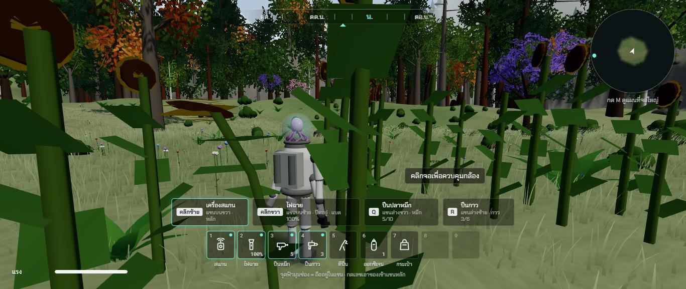
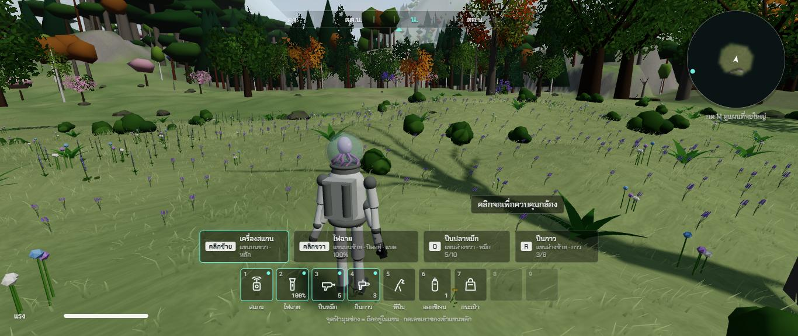
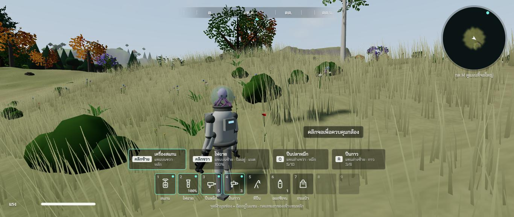

# รอบสอง ช่วง 5 · หญ้าสูง ทุ่งดอกไม้ 13 ชนิด ลมพริ้ว

วันที่ 23 ต.ค. 2569 · ผล **ผ่าน**

## ทำอะไรไป
- **หญ้าสูงตามชนิดพื้นที่** (`src/world/flowers.ts` `grassHeightAt`) ทุ่งหญ้าสูง 0.75 ถึง 1.35 ม. ถึงเอวถึงอกเอเลี่ยน · ไร่ร้างบางแปลงหญ้าขึ้นสูง · ทุ่งหญ้าทั่วไปสลับดงสูงดงเตี้ย · ทุ่งดอกไม้หญ้าเตี้ยกว่าดอก · บนเขาหญ้าเตี้ย หิมะไม่มีหญ้า
- **คลื่นลมพัดข้ามทุ่ง** แถบลมแรงเคลื่อนข้ามทุ่งตามทิศลม หญ้าในแถบลู่ลงและสว่างขึ้น (เห็นด้านหลังใบ) ระหว่างแถบหญ้าไหวเบา ๆ
- **หญ้าลู่หลบตัวละคร** ตอนเดินผ่าน (หญ้าในรัศมีราว 1 ม. แหวกออก)
- **หญ้าแบ่งเป็นช่อง 16 ม.** สร้างช่องใหม่ไม่เกิน 3 ช่องต่อเฟรม เก็บช่องเดิมไว้ · เดิมจัดใหม่ทั้งหมดทุก 6 ม. ในเฟรมเดียว กระตุกตอนวิ่ง (ข้อ 111) · หญ้าไกลค่อย ๆ หดจนกลืนกับสีพื้น · หญ้าไม่ขึ้นในตึก
- **ดอกไม้ 13 ชนิด** (`src/render/models/flowers.ts`) ป๊อปปี้ ลูพิน ทานตะวัน เดซี่ คอร์นฟลาวเวอร์ ลาเวนเดอร์ ฟอกซ์โกลฟ บลูเบลล์ กุหลาบป่า แดนดิไลออน บัตเตอร์คัพ กล้วยไม้ บัวสาย
  | ที่ | ดอกไม้ |
  |---|---|
  | ทุ่งดอกไม้ (ตะวันออก) | แปลงราว 60 ม. ขอบไม่เรียบ แปลงละชนิด (ป๊อปปี้ ลูพิน ทานตะวัน คอร์นฟลาวเวอร์ ลาเวนเดอร์ เดซี่ บัตเตอร์คัพ) ระหว่างแปลงมีดอกเล็กปน |
  | ทุ่งหญ้า ทุ่งหญ้าสูง บนเขา | เดซี่ แดนดิไลออน บัตเตอร์คัพ คอร์นฟลาวเวอร์ ป๊อปปี้ กระจาย |
  | ไร่ร้าง | ป๊อปปี้ คอร์นฟลาวเวอร์ |
  | สวนผลไม้ร้าง | กุหลาบป่า ฟอกซ์โกลฟ |
  | ป่าผลัดใบ | บลูเบลล์ ฟอกซ์โกลฟ |
  | หุบป่าดิบชื้น | กล้วยไม้ |
  | น้ำนิ่ง | บัวสาย (ช่วง 6 วางบนผิวน้ำ) |
  - **ทานตะวันหันทิศตะวันออก** ตามข้อมูลดอกแก่ในไฟล์อ้างอิง
- **สแกนดอกไม้ เฟิร์น เห็ดได้** หมวดพืชในคอลเลกชันครบได้แล้ว (ข้อ 8 และ 63)
- **เสียงหญ้าเสียดสีกลางทุ่ง** ดังตามลมกระโชก
- เทสใหม่ `tests/flowers.test.ts` (13 ชนิด ทุ่งเป็นแปลงชนิดเดียว ทานตะวันหันตะวันออก หญ้าสูงถึงอก) · รวม 147 เทส

## เล่นทดสอบ (ในโครมของพี่กัน)
| ทดสอบ | ผล |
|---|---|
| ทุ่งทานตะวัน | ทานตะวันสูงพ้นหัวตัวละคร ดอกหันทางเดียวกันทั้งแปลง ✅ |
| แปลงลาเวนเดอร์ | หญ้าเตี้ย ช่อดอกม่วงทั่วแปลง ✅ |
| ทุ่งหญ้าสูง | หญ้าถึงเอวถึงอก สีเหลืองอมเขียว หญ้ารอบตัวแหวกออก ✅ |
| จำนวนที่วาด (ระดับกลาง ทุ่งหญ้าสูง) | หญ้า 15,428 กอ ดอกไม้ 455 ต้น ใน 31 ช่อง · ทั้งฉาก 875,000 สามเหลี่ยม |
| typecheck · test (147 ข้อ) · build | ผ่าน ✅ |

| ทุ่งทานตะวัน | แปลงลาเวนเดอร์ | ทุ่งหญ้าสูงถึงอก |
|---|---|---|
|  |  |  |

## บั๊กที่เจอ
| บั๊ก | สถานะ |
|---|---|
| ดงดอกไม้ปนหลายชนิดในดงเดียว | แก้แล้ว แบ่งเป็นแปลงชนิดเดียว (เทสจับได้) |
| ดอกไม้จมอยู่ในหญ้าที่สูงกว่าดอก | แก้แล้ว ทุ่งดอกไม้หญ้าเตี้ย ภาพก่อนแก้ `00-bug-flowers-hidden-in-tall-grass.jpg` |
| ฉากหนักถึง 2.3 ล้านสามเหลี่ยม (ลาเวนเดอร์ปั้นจากลูกกลม ใบหญ้าแบ่งช่องเกิน) | แก้แล้ว ช่อดอกเป็นแท่งเดียว ก้านเบาลง ใบหญ้ากลับเป็น 2 ช่อง เหลือ 0.9 ถึง 1.1 ล้าน |
| ใบทานตะวันเป็นสี่เหลี่ยมแข็ง | แก้แล้ว เป็นรูปใบ |

## แคลร์ตัดสินเอง
- ทานตะวันในเกมสูง 1.8 ถึง 2.6 ม. (แหล่งอ้างอิงราว 3 ม.) ไม่ให้บังทุ่งทั้งหมด
- ภาพนิ่งเห็นคลื่นลมไม่ชัด ต้องดูตอนเล่น (แถบสว่างเคลื่อนข้ามทุ่ง)

## รอพี่กันเคาะ
- ทั้งฉากยังราว 0.9 ถึง 1.1 ล้านสามเหลี่ยมที่ระดับกลาง · ระดับต่ำสำหรับเครื่องนี้จัดใหม่ในช่วง 13 · ความลื่นจริงรอพี่กันลอง
