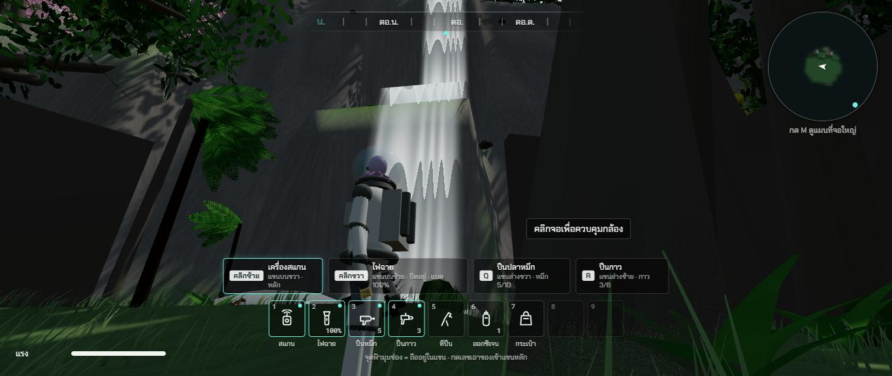
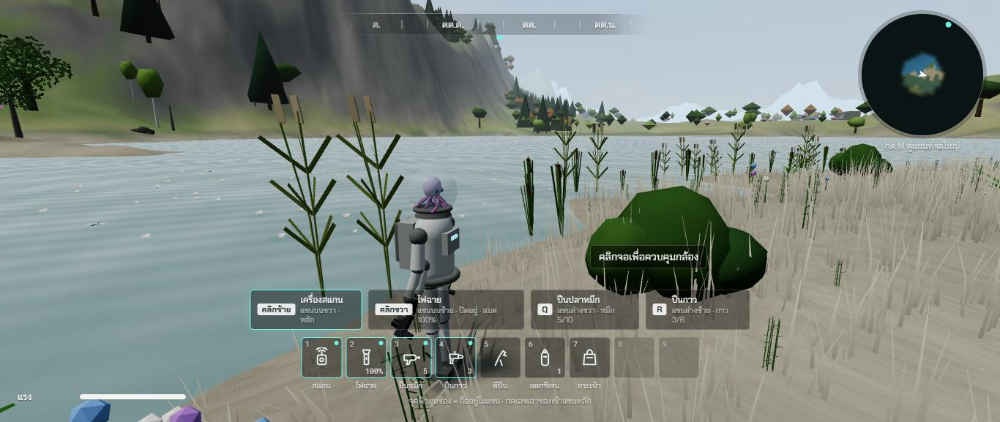

# รอบสอง ช่วง 6 · แม่น้ำมีชีวิต

วันที่ 23 ต.ค. 2569 · ผล **ผ่าน**

## ทำอะไรไป
- **ผิวน้ำไหลตามทิศแม่น้ำ** แผนที่ทิศน้ำไหลทั้งแมพ (`src/world/water.ts` `flowField`) ลายคลื่นเลื่อนตามสายน้ำจากเหนือลงใต้ ในหุบผาชันไหลแรงกว่า มีริ้วฟอง · ทะเลสาบกับแอ่งน้ำนิ่ง
- **พืชริมน้ำ** (ข้อมูลจากไฟล์อ้างอิงหัวข้อ 3) ธูปฤาษีช่อสีน้ำตาล 0.8 ถึง 2.4 ม. กับอ้อ 1.5 ถึง 3 ม. ขึ้นในน้ำตื้น · หญ้าหางม้า 0.3 ถึง 0.9 ม. บนตลิ่ง · **หินกลมท้องน้ำ** มีตะไคร่ ตามริมแม่น้ำที่น้ำไหล · **บัวสาย** ในน้ำนิ่ง (ทะเลสาบ แอ่งในที่ลุ่ม)
- **ขอนไม้ขวางน้ำ** ล้มจากตลิ่งยื่นลงแม่น้ำ ช่วงที่ไหลผ่านป่า
- **น้ำตก** ลำธารสาขาตกจากที่ราบสูงลงหุบป่าดิบชื้น สูงราว 67 ม. สายน้ำไหลแนบตามแนวหน้าผาจริง ผ่านชั้นหินกลางผา ริ้วน้ำเลื่อนลง ฟองกับละอองที่ตีนน้ำตก ตีนน้ำตกเป็นแอ่งโล่ง · **เสียงน้ำดังขึ้นใกล้น้ำตก**
- **ฝูงปลา** (`src/render/Fish.ts`) เทราต์สีน้ำตาลในแม่น้ำ ฝูงละ 6 ตัว หันหัวทวนน้ำ · ปลาไนในทะเลสาบ ฝูงละ 8 ตัว ว่ายช้า · ลำตัวส่ายตอนว่าย · บางตัว **กระโดดพ้นน้ำ** ทุก 12 ถึง 37 วินาที · เข้าใกล้ 6 ม. ฝูงหนี · สแกนได้ · ปลาถ้ำไม่มีตาทำในช่วง 11 พร้อมแอ่งน้ำในถ้ำ
- **แมลงปอ** บินเร็วเป็นช่วงแล้วหยุดลอยนิ่งเหนือผิวน้ำกับตลิ่ง กลางวันเท่านั้น
- ปลาตัวเดี่ยวในระบบสัตว์เดิมย้ายมาอยู่ในระบบฝูงปลา
- เทสใหม่ `tests/water.test.ts` (ทิศน้ำไหล ทะเลสาบนิ่ง น้ำตกสูงกว่า 25 ม. ฝูงปลาอยู่ในน้ำลึก พืชริมน้ำครบ 5 แบบ) · รวม 154 เทส

## เล่นทดสอบ (ในโครมของพี่กัน)
| ทดสอบ | ผล |
|---|---|
| น้ำตกในหุบป่าดิบชื้น | สายน้ำสองชั้นแนบผา ไหลผ่านชั้นหินลงหุบ ✅ |
| ริมทะเลสาบ | ธูปฤาษี 47 อ้อ 40 หญ้าหางม้า 196 บัวสาย 154 ต้น ในรัศมี 40 ม. · หาดทราย · แมลงปอ 9 ตัว ✅ |
| ฝูงเทราต์ | วาด 6 ตัว สแกนได้ 6 ตัว · เดินเข้าใกล้ ฝูงหนีไป 2 ม. ใน 2 วินาที · ใน 40 วินาทีมีปลากระโดดพ้นน้ำ ✅ |
| typecheck · test (154 ข้อ) · build | ผ่าน ✅ |

| น้ำตก | ริมทะเลสาบ |
|---|---|
|  |  |

## บั๊กที่เจอ
| บั๊ก | สถานะ |
|---|---|
| ต้นไม้ในหุบบังน้ำตกมิด | แก้แล้ว ตีนน้ำตกเป็นแอ่งโล่ง 18 ม. |
| แผ่นน้ำตกตั้งตรงที่ตีนผา ส่วนบนลอยห่างผาเอียง | แก้แล้ว สายน้ำไหลแนบแนวผาจริง ภาพก่อนแก้ `00-bug-waterfall-floating-off-cliff.jpg` |
| สายน้ำตกจบที่ชั้นหินกลางผา ไม่ถึงท้องหุบ | แก้แล้ว ไหลผ่านชั้นลงจนถึงท้องหุบ |
| ปลาอยู่ใต้ผิวน้ำที่ทึบ 86% มองจากฝั่งเห็นยาก | ช่วง 13 ทำน้ำใสขึ้นตรงน้ำตื้นตอนจัดภาพระดับสูง |

## แคลร์ตัดสินเอง
- ผิวน้ำทั้งแมพยังเป็นแผ่นเดียวระดับเดียว น้ำตกจึงเป็นลำธารสาขาตกจากผาลงแม่น้ำ (แม่น้ำสายหลักไม่มีช่วงตก)
- ปลาวาดเฉพาะฝูงที่อยู่ในรัศมี 110 ม.

## รอพี่กันเคาะ
- ไม่มี
