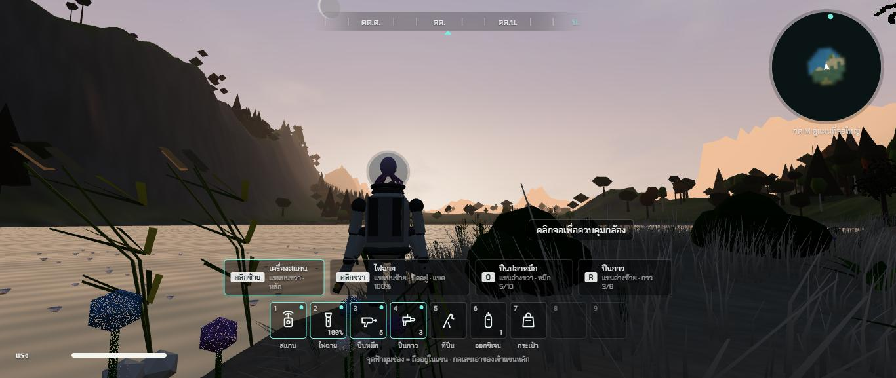
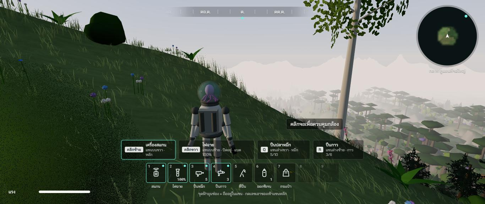
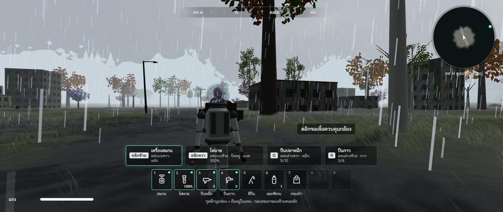

# รอบสอง ช่วง 7 · ฟ้าและอากาศ อาทิตย์ขึ้นตก หมอกเช้า ฝน

วันที่ 23 ต.ค. 2569 · ผล **ผ่าน** (เสียงฝนกับฟ้าร้องรอพี่กันฟัง)

## ทำอะไรไป
- **อากาศตามเวลา** (`src/core/weather.ts`) แบ่งวันเป็นช่วงละ 0.3 วัน (ราว 7 นาทีจริง) สุ่มว่าฝนตกไหม ราว 1 ใน 4 ของเวลา ผลเดิมทุกครั้งที่เวลาเดิม · ฝนเริ่มและหยุดค่อยเป็นค่อยไปราวสองนาที · เมฆครึ้มมาก่อนฝนกับค้างหลังฝน · ฝนหนักมีฟ้าร้อง
- **แสงพระอาทิตย์ขึ้นตก** ขอบฟ้าฝั่งดวงอาทิตย์เรืองแดงส้มกว้าง แสงอุ่น เงายาว (ใช้มุมพลบจากไฟล์อ้างอิงหัวข้อ 7) · ฟ้าครึ้มแล้วแสงพลบจางลง
- **หมอกเช้าในหุบ** แผ่นหมอกลอยต่ำที่ความสูง 9 15 22 ม. พื้นสูงกว่าแผ่นบังไว้ จึงเห็นหมอกเฉพาะในหุบ · หนาสุดหลังอาทิตย์ขึ้น จางหายราว 9 โมง · **ขึ้นไปบนเขาอากาศใส** มองลงไปเห็นหมอกคลุมหุบ ยอดไม้โผล่
- **ฝน** (`src/render/Rain.ts`) สายฝนรอบกล้อง 3,200 สาย ตกราว 8 ถึง 10 ม./วินาที (เม็ด 3 มม. ตามแหล่งอ้างอิง) เอียงตามลม · ละอองกระเด็นเป็นวงบนพื้นรอบตัว · ใต้หลังคาหรือในถ้ำไม่เห็นสายฝน
- **ฟ้าครึ้มเทา** แดดอ่อนลง 70% เงาจาง หมอกฝน · **ฟ้าแลบ** สว่างวาบ แล้วฟ้าร้องตามมา 0.4 ถึง 3.4 วินาที
- **พื้นเปียก** สีเข้มขึ้น มีแสงสะท้อนฟ้าตอนมองเฉียง ราว 40 วินาทีเปียกเต็ม แห้งช้าราว 3 นาทีหลังฝนหยุด
- **หยดน้ำบนโหลแก้ว** เกาะตอนอยู่กลางฝน ไหลลงช้า ๆ แห้งเมื่อเข้าที่ร่ม
- **เสียงฝน** ซ่าทั่วไป ใต้หลังคาทึบลงเหมือนฝนตกบนหลังคา ในถ้ำลึกแทบไม่ได้ยิน · **เสียงฟ้าร้อง** ต่ำครืนราว 4 วินาที
- ไฟฉายไม่ชาร์จแดดตอนฝนตกหรือเมฆครึ้ม (ข้อ 130) · ฝนไม่ทำให้หนาวตามแผน
- แก้ข้อ 114 (ฟ้าสร้างสีใหม่ทุกเฟรม) 118 (หยุดเกมในถ้ำแล้วสว่าง) 120 (เงาแดดกระตุกทุก 4 ม.)
- เทสใหม่ `tests/weather.test.ts` (เวลาเดิมอากาศเดิม ฝนราว 1 ใน 4 เปลี่ยนไม่เกิน 1.5% ต่อวินาที ฝนหนักมีฟ้าร้อง) · รวม 159 เทส
- ตัวช่วยทดสอบ `__remnant.weatherForce = 1` บังคับฝน · `undefined` กลับตามเวลา

## เล่นทดสอบ (ในโครมของพี่กัน)
| ทดสอบ | ผล |
|---|---|
| 17:51 ริมทะเลสาบมองตะวันตก | ฟ้าชมพูส้ม ภูเขาสีส้มอุ่น ต้นไม้เป็นเงาดำ ✅ |
| 06:36 บนเนิน 236 ม. มองลงหุบ | อากาศใสบนเนิน หุบข้างล่างหมอกขาว ยอดไม้โผล่ ✅ |
| 14:00 บังคับฝนในเมือง 30 วินาที | สายฝนรอบตัว ถนนเปียกเข้ม ความเปียก 0.89 หยดน้ำบนโหล 0.90 ฟ้าครึ้ม แดดเหลือ 0.63 ✅ |
| typecheck · test (159 ข้อ) · build | ผ่าน ✅ |

| พระอาทิตย์ตกริมทะเลสาบ | หมอกเช้าในหุบ | ฝนในเมือง |
|---|---|---|
|  |  |  |

## บั๊กที่เจอ
| บั๊ก | สถานะ |
|---|---|
| หมอกเช้าหนาทั้งแมพ ยืนบนเขาก็มองไม่เห็นอะไร | แก้แล้ว หมอกเช้าบางลงเมื่ออยู่สูง เห็นหมอกในหุบจากข้างบน |
| สายฝนไม่ขึ้นเลย (แผ่นหน้าเดียวหันด้านหลังเข้ากล้อง การ์ดจอไม่วาด) | แก้แล้ว วาดสองหน้า สายฝนหนาขึ้นให้เห็นบนจอ ภาพก่อนแก้ `00-bug-rain-invisible-wet-too-shiny.jpg` |
| พื้นเปียกสะท้อนแสงจ้าจนดูเหมือนน้ำค้างแข็ง | แก้แล้ว ลดแสงสะท้อน เพิ่มความเข้ม |
| สายฝนที่ชิดกล้องดูเป็นแท่งหนา | ช่วง 13 ปรับขนาดตามระยะตอนจัดภาพระดับใหม่ |

## แคลร์ตัดสินเอง
- ฝนราว 1 ใน 4 ของเวลา ช่วงละราว 7 นาทีจริง
- ฝนมีผลแค่ภาพกับเสียง (ตามแผน) ยกเว้นไฟฉายชาร์จแดดไม่ได้
- ฟ้าแลบไม่มีสายฟ้าเป็นเส้น เป็นแสงวาบทั้งฟ้า

## รอพี่กันเคาะ
- ฟังเสียงฝนกับฟ้าร้อง (แคลร์ฟังไม่ได้)
- ความถี่ฝนราว 1 ใน 4 ของเวลา มากหรือน้อยไป
