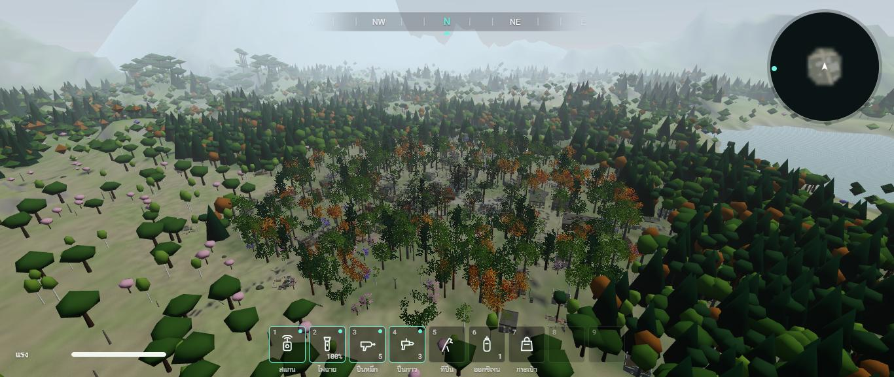
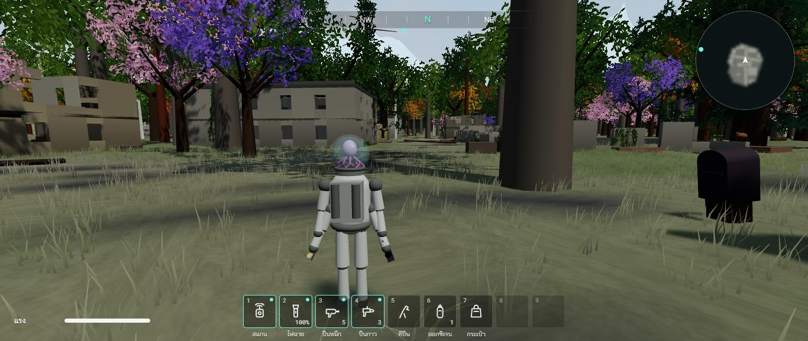
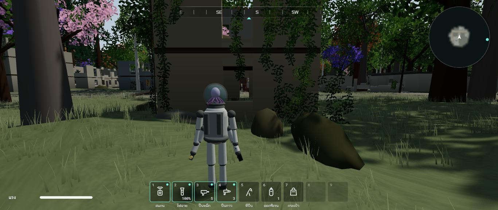
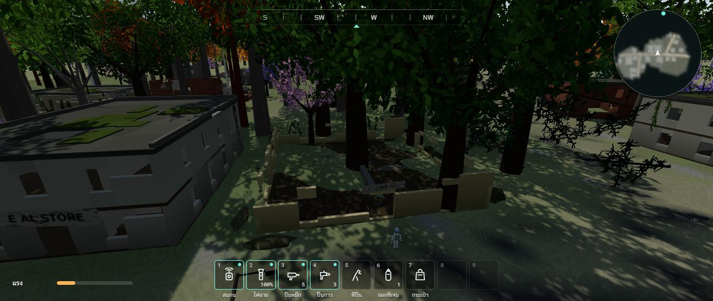
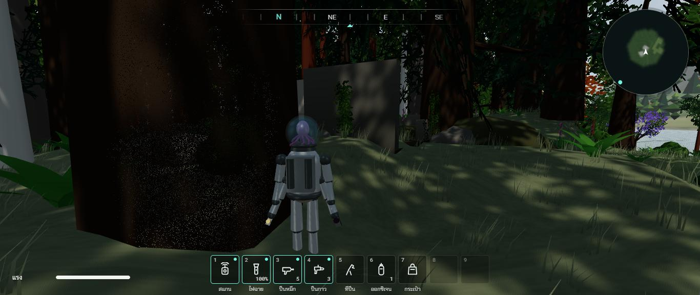
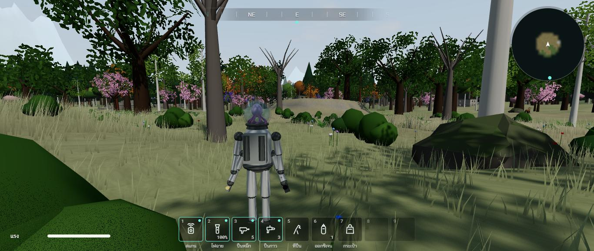

# รอบสอง ช่วง 8 · เมืองที่มีจริง กลายเป็นเมืองเก่าพันปีที่ป่ากลืน

วันที่ 23 ต.ค. 2569 · ผล **ผ่าน** (ภาพหนักขึ้นมาก ต้องจัดระดับภาพในช่วง 13)

## ทำอะไรไป
- **รอบแรก** ทำเมืองผังตารางตามแผน ถนนเหนือใต้ 4 สาย ตัดตะวันออกตะวันตก 5 สาย ตึกเรียงสองฝั่ง (ภาพ `03-town-aerial-grid.jpg`) · พี่กันทักระหว่างทำ 3 ข้อความ (ยกไว้ใน `docs/DESIGN.md` ส่วน 0.1) ว่าเมืองร้างมาพันปีแล้ว ต้องมีต้นไม้ ผุพัง ไม่เป็นระเบียบ ไม่สมมาตร เริ่มจากทุ่งหญ้า เข้าเมือง แล้วป่าที่กลืนเมือง · **แคลร์รื้อผังตารางทิ้งทำใหม่ทั้งหมด**
- **ถนนคดเคี้ยว 7 เส้น** (`src/world/layout.ts` `TOWN_STREETS`) ถนนสายหลักเหนือใต้คดตามหุบ ต่อจากถนนเข้าเมือง · ถนนตัดกลางเมืองจากทุ่งนาเก่าฝั่งตะวันตกไปทางแม่น้ำ · ถนนสายรอง · ซอยออกไปในป่า 4 ซอย
- **เขตของเมือง** (`src/world/townZone.ts`) ขอบไม่กลม ยืดตามถนนสายหลัก เว้าแหว่ง · ใจกลางเมือง (ร้านค้า ตึกราชการ) · ย่านบ้าน · ถัดออกไปฝั่งตะวันตกเป็น **ทุ่งนาเก่า** (ทุ่งหญ้ามีพุ่มไม้กับไม้เดี่ยว ทางเดินจากยานเข้าเมือง) · ฝั่งอื่นเป็น **ป่าที่กลืนบ้านรอบนอก**
- **ตึก 114 หลัง 15 ชนิด** บ้านเดี่ยว ทาวน์เฮาส์ ร้านค้า ร้านอาหาร ร้านขายของชำ ร้านฮาร์ดแวร์ ไปรษณีย์ คลินิก สถานีตำรวจ สถานีดับเพลิง โรงเรียน โบสถ์ โกดัง โมเต็ล ปั๊มน้ำมัน · เรียงตามแนวถนน หันประตูเข้าถนน ขนาดไม่เท่ากัน ระยะถอยร่นไม่เท่ากัน วางเบี้ยวนิด ๆ มีที่ดินว่าง ว่างมากขึ้นเมื่อห่างใจกลาง (`src/world/townPlan.ts`)
- **ผุพังสามระดับ** (นับจริงในเกม) ยังมีหลังคาแต่รั่วเป็นรู 16 หลัง · หลังคาหาย ชั้นบนพัง 50 หลัง · เหลือแต่ตอผนังกับกองซาก 48 หลัง · ตึกปูนหนา (โบสถ์ โรงเรียน สถานีตำรวจ ไปรษณีย์ คลินิก สถานีดับเพลิง โกดัง) ทนกว่าบ้าน · ผนังเป็นรูโหว่ ขอบบนแหว่ง ผนังห้องพังง่ายกว่าผนังนอก · กระจกแทบไม่เหลือ · พื้นเป็นดินกับใบไม้
- **ซากบ้านในป่ารอบนอก 28 หลัง** หันไปคนละทาง (ถนนเก่าจมดินไปแล้ว) ส่วนใหญ่เหลือแต่ตอผนัง
- **ที่ว่างในเมือง** สวนกลางเมือง (ทางเดินปูนแตกเป็นแผ่น น้ำพุหินแห้ง ตีนม้านั่งปูน) · สุสาน (ป้ายหลุมศพหิน บางป้ายล้ม บางป้ายจมดิน เสาประตูหิน รั้วเหล็กผุหายแล้ว) · ซากสนามเด็กเล่น (ตอเสาสนิม ขอบกระบะทรายปูน) · หอส่งน้ำคอนกรีตสูงราว 23 ม. ชื่อเมือง PINE VALLEY บนถัง
- **ต้นไม้** ในเมืองหนาแน่นขึ้นห้าเท่า เป็นป่าผสมแบบป่ารอบ ๆ (โอ๊ก บีช เบิร์ช เมเปิล สน) มีต้นไม้ประดับที่คนเคยปลูกเหลือบ้าง · **ต้นไม้ขึ้นในซากที่หลังคาหาย 61 ต้นใน 45 หลัง** ทะลุผนัง · ต้นไม้ไม่ขึ้นในตึกที่ยังมีหลังคา หน้าประตู ทางเดินเข้าตึก ช่องบันได ในรถ (`src/world/town.ts` `treeBlocked`)
- **ถนนพันปี** ยางมะตอยเหลือเป็นแผ่นแตกราวหนึ่งในสาม ที่เหลือดินกลบหญ้าขึ้น · ต้นไม้ขึ้นบนแนวถนนได้ บางกว่าข้างทาง · ใช้กับถนนทุกเส้นทั้งแมพ (`src/world/scatter.ts` `pavedLeft`)
- **พื้นในเมือง** ไม่ราบเรียบแล้ว ดินตะกอนกับซากทับถมเป็นลอนต่ำราว 1 ม.
- **ของข้างถนน** รถ รถบัส สนิมกิน กระจกหายหมด จมดินครึ่งล้อ เอียง · เสาไฟเหล็กราว 7 ใน 10 ล้มนอนกับพื้น (ไม่มีตัวชน) ที่ยังยืนก็เอียง · ป้ายกับตู้ไปรษณีย์เอียง สนิม · รถจอดริมถนนในเมือง เสาไฟทุกราว 36 ม. ตู้ไปรษณีย์ริมถนนสายหลัก
- **ป่าทั่วแมพหนาขึ้น** (ตามคำสั่ง "ทุกอย่างให้มองว่านี่คือโลกอีกพันปี") ทุ่งหญ้า 0.07 → 0.2 · ทุ่งหญ้าสูง 0.04 → 0.12 · ทุ่งดอกไม้ 0.03 → 0.08 (ยังเปิดพอเห็นทุ่ง) · ทุ่งนาเก่า 0.02 → 0.14 · ที่ลุ่ม 0.12 → 0.2 · ริมน้ำ 0.06 → 0.12 · เมือง 0.1 → 0.5 · บนเขา 0.12 → 0.18 · ต้นไม้ทั้งแมพ 51,445 ต้น
- **เถาวัลย์ไม่เหลี่ยมแล้ว** เส้นเถาโค้งห้อยจากขอบผนัง ใบเป็นแผ่นภาพโปร่งใสแบบเดียวกับใบไม้ของต้นไม้ ไหวตามลม · ไม้เลื้อยคลุมผนังเป็นผืน · กองซากเป็นเนินขรุขระมีมอส (เดิมเป็นกล่อง) · มอสบางราบไปกับหลังคา
- **ป้ายภาษาอังกฤษ** ซีด ตัวอักษรหายไปราวหนึ่งในสาม คราบดินกับตะไคร่ · ซากที่เหลือแต่ตอผนังไม่มีป้าย
- **วาดเบาลง** ผนังทั้งเมืองรวมเป็นก้อนละ 128 ม. · ของในห้องวาดเมื่อเข้าใกล้ 28 ม. (เดิมวาดของในห้อง 180 ชิ้นทั้งเมือง ครั้งวาดขึ้นถึง 900) · รถกับเสาไฟรวมชิ้นส่วนวัสดุเดียวกัน · เถาวัลย์ ใบไม้เลื้อย กองซาก ซ่อนเมื่อไกลเกิน 280 ม. · เสาไฟ ป้าย ตู้ไปรษณีย์ไกลเกิน 260 ม. ไม่วาด
- **หน้าจอโล่ง** (คำสั่งเพิ่มระหว่างทำ) เอาการ์ดแขนคลิกซ้าย คลิกขวา Q R กับบรรทัด "จุดฟ้ามุมช่อง..." ออก · บนจอเกมไม่บอกปุ่มเลย (ป้ายกดปุ่ม ป้าย "กด M ดูแผนที่จอใหญ่" ข้อความเปิดกระเป๋า ป้ายคลิกจอ) ปุ่มทั้งหมดอยู่ในหน้าตั้งค่า · เข็มทิศเป็น N NE E SE S SW W NW ทั้งสองภาษา
- เทสใหม่ `tests/town.test.ts` 7 ข้อ: 80 ถึง 120 หลัง ครบทุกชนิด · ไม่ล้ำถนน ไม่ทับกัน ไม่ทับที่ว่าง · ตึกริมถนนหันประตูเข้าถนน ทิศกระจายมากกว่า 6 ทิศ · ผุพังครบสามระดับ ซากในป่าเกิน 15 หลัง · เดินเข้าได้ทุกหลัง (ข้อสามข้อหลังอยู่ในรายงานช่วง 9) · รวม 168 เทส

## เล่นทดสอบ (ในโครมของพี่กัน)
| ทดสอบ | ผล |
|---|---|
| มองเมืองจากมุมสูงตอนสิบโมง | เมืองจมอยู่ในป่า ซากตึกโผล่ระหว่างต้นไม้ ทุ่งนาเก่าทางตะวันตก ป่าทึบทางเหนือกับตะวันออก ✅ |
| ยืนกลางถนนสายหลัก | ถนนกลายเป็นทุ่งหญ้า ซากตึกสองข้าง ต้นไม้ขึ้นริมถนน ตู้ไปรษณีย์สนิม เสาไฟล้ม ✅ |
| ยืนหน้าผนังซากทาวน์เฮาส์ | เถาวัลย์ห้อยเป็นม่านใบไม้ กองซากเป็นเนินมอส ✅ |
| มองลงในซากร้านขายของชำที่หลังคาหาย | ต้นไม้ใหญ่ขึ้นกลางห้อง ผนังแหว่ง พื้นดิน ✅ |
| เดินในป่าตะวันออกเฉียงใต้ | ตอผนังซากบ้านอยู่ระหว่างต้นไม้ใหญ่ เฟิร์น ✅ |
| เดินจากทุ่งนาเก่าเข้าหาเมือง | หญ้าสูง พุ่มไม้ ไม้เดี่ยว ต้นตาย เห็นขอบเมืองที่ต้นไม้รก ✅ |
| นับในเกม | ตึก 114 หลัง · ผุพัง 16 / 50 / 48 · ที่ว่าง 4 แห่ง · ต้นไม้ในซาก 61 ต้น ✅ |
| ภาพหนักแค่ไหน (หน้าต่างโครมถูกบัง วัดภาพต่อวินาทีไม่ได้) | กลางเมือง 646 ครั้งวาด 1.37 ล้านสามเหลี่ยม · ทุ่งนาเก่า 480 ครั้ง 1.24 ล้าน · ข้างยาน 465 ครั้ง 1.01 ล้าน (ก่อนช่วงนี้ราว 0.7 ถึง 1.1 ล้าน) 🔶 |
| typecheck · test (168 ข้อ) · build | ผ่าน ✅ |

| เมืองพันปีจากมุมสูง | ถนนสายหลักกลางเมือง | เถาวัลย์กับกองซาก |
|---|---|---|
|  |  |  |

| ต้นไม้ขึ้นในซากที่หลังคาหาย | ซากบ้านในป่า | ทุ่งนาเก่าก่อนเข้าเมือง |
|---|---|---|
|  |  |  |

ภาพเมืองผังตารางรอบแรก (ก่อนพี่กันทัก) `03-town-aerial-grid.jpg` · `01-main-street.jpg` · `02-fire-station.jpg`

## บั๊กที่เจอ
| บั๊ก | สถานะ |
|---|---|
| ถนนในเมืองขาวเหมือนลานปูน เพราะหญ้าสีซีดขึ้นคลุมถนน 15% (ภาพ `00-bug-pale-street-grass.jpg`) | แก้แล้ว ถนนพันปีมีหญ้าขึ้นตามดินที่กลบ ไม่ขึ้นบนแผ่นยางมะตอยที่เหลือ |
| ยางมะตอยสว่างเกิน (ค่าสะท้อนแสง 0.22 กลางแดดดูขาว) | แก้แล้ว 0.085 ตามยางมะตอยเก่าจริง |
| ของในห้อง 180 ชิ้นวาดพร้อมกันทั้งเมือง ครั้งวาดขึ้นถึง 900 | แก้แล้ว วาดเมื่อเข้าใกล้ 28 ม. |
| เถาวัลย์เป็นแผ่นกล่องเขียวดูเป็นเสา (ภาพ `00-bug-blocky-vines.jpg`) | แก้แล้ว เส้นโค้งกับใบไม้ |
| มอสโคนผนังเป็นกล่องเขียวดูเป็นแท่น · กองซากเป็นกล่องเหลี่ยม (ภาพ `00-bug-box-rubble.jpg`) | แก้แล้ว ไม้เลื้อยกับเนินมอส |
| ต้นไม้ในเมืองเป็นไม้ดอกส้มชมพูม่วงเกินครึ่ง ดูเป็นสวนสาธารณะ · พื้นเมืองซีด (ภาพ `00-bug-town-trees-ornamental-pale-ground.jpg`) | แก้แล้ว ป่าผสม พื้นป่า |
| ตึกพิเศษหายถ้าที่ดินแรกวางไม่ลง (หยิบออกจากรายการก่อนวาง) | แก้แล้ว หยิบออกเมื่อวางได้จริง · เทสตรวจครบทุกชนิด |
| ตึกหลังบล็อกของถนนสองสายลึกชนกัน | แก้แล้ว ตรวจทับกันแบบสี่เหลี่ยมหมุนได้ |
| กองซากกลางห้องล้อมห้องจนเข้าไม่ได้ | แก้แล้ว กองกลางห้องเตี้ยพอก้าวขึ้น กองสูงชิดผนังเท่านั้น |
| ภาพหนักขึ้นเป็นราว 1.0 ถึง 1.4 ล้านสามเหลี่ยม | ค้าง ช่วง 13 จัดระดับภาพ ระดับต่ำลดต้นไม้ หญ้า เถาวัลย์ |
| ขอบถนนมองจากมุมสูงเป็นขั้นบันได (สีพื้นละเอียด 2 ม.) | ค้าง ช่วง 13 |

## แคลร์ตัดสินเอง
- เขตเมือง ทุ่งนาเก่าอยู่ฝั่งตะวันตก (ทางเดินจากยาน) ป่ากลืนเมืองฝั่งอื่น
- สัดส่วนผุพัง ตึกปูนหนาทนกว่าบ้าน · ซากในป่าเกือบทั้งหมดเหลือแต่ตอผนัง
- ของเหล็กพันปีผุหมด จึงเปลี่ยนสนามเด็กเล่นเป็นซาก หอส่งน้ำเป็นคอนกรีต สุสานเหลือแต่ป้ายหิน
- ระยะผุพังของแต่ละอย่างตัดสินจากความรู้ทั่วไป ยังไม่ได้ค้นที่มา (ไม่ใช้ในข้อความสแกน)
- ความหนาแน่นป่าใหม่ทั้งแมพ (ตัวเลขข้างบน)

## รอพี่กันเคาะ
- **ของชิ้นเล็กที่เก็บได้** (ตุ๊กตา หนังสือ กรอบรูป โทรศัพท์ ฯลฯ) ในโลกพันปีของพวกนี้ไม่น่าเหลือ แคลร์ยังไม่เปลี่ยน เพราะผูกกับบันทึกส่วนตัวชั้น 3 · จะเปลี่ยนเป็นของที่ทนพันปี (ขวดแก้ว เหรียญ แหวน ป้ายโลหะ ถ้วยกระเบื้อง) หรือคงไว้
- คำแนะนำในหน้ากระเป๋า หน้ายาน แผนที่ใหญ่ (คลิก ลาก ลูกกลิ้ง) ยังอยู่ เพราะพี่กันพูดถึงบนจอเกม · เอาออกด้วยไหม
- แถบล่าง 9 ช่องยังอยู่ (ไม่ได้สั่งเอาออก) · ให้ซ่อนเองตอนไม่ได้เปลี่ยนของไหม
- ป้ายคลิกจอตอนล็อกเมาส์ไม่ได้เอาออกแล้วตามคำสั่ง ถ้าล็อกเมาส์ไม่ได้จะไม่มีอะไรบอก
- ป่าทั่วแมพหนาพอหรือยัง
