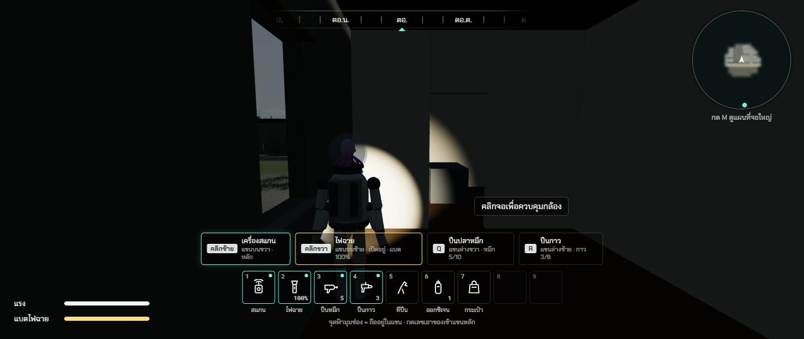
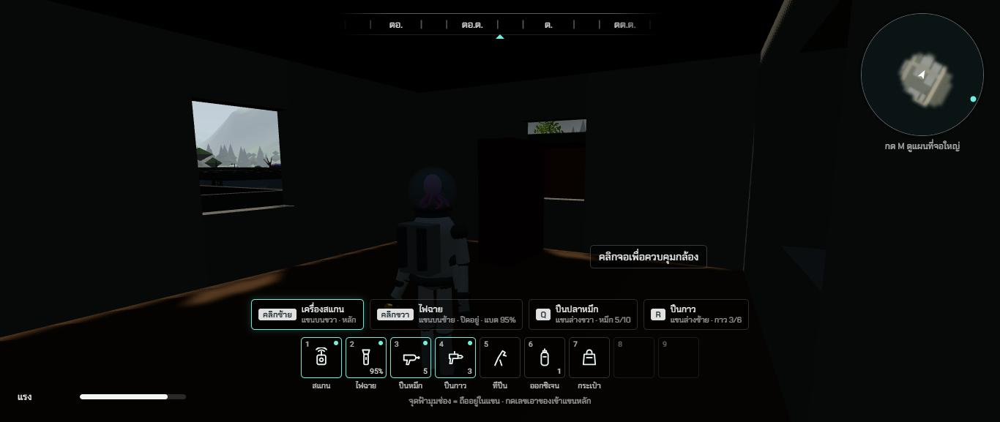
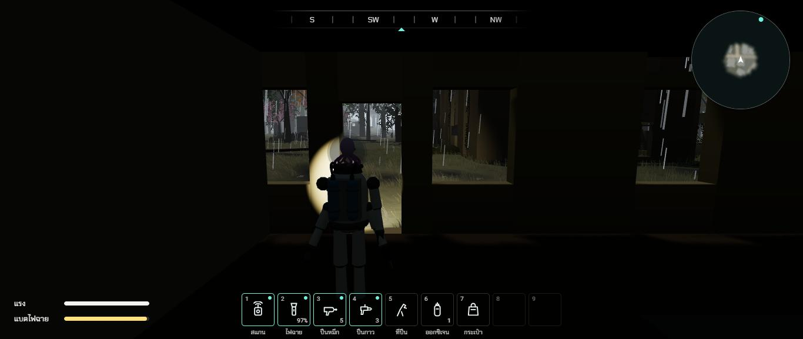
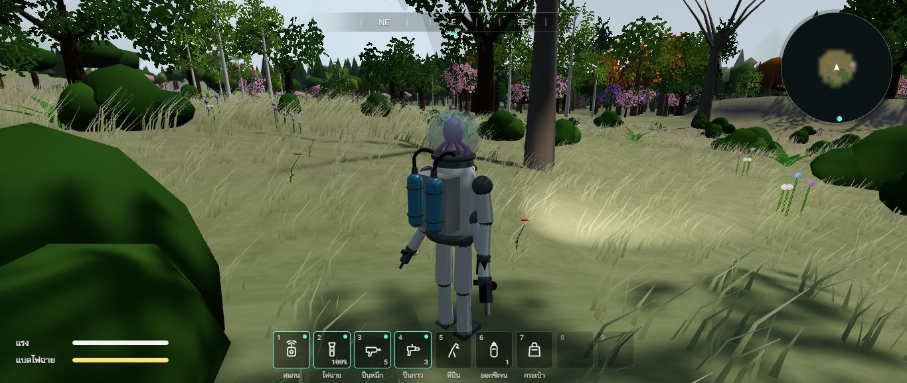
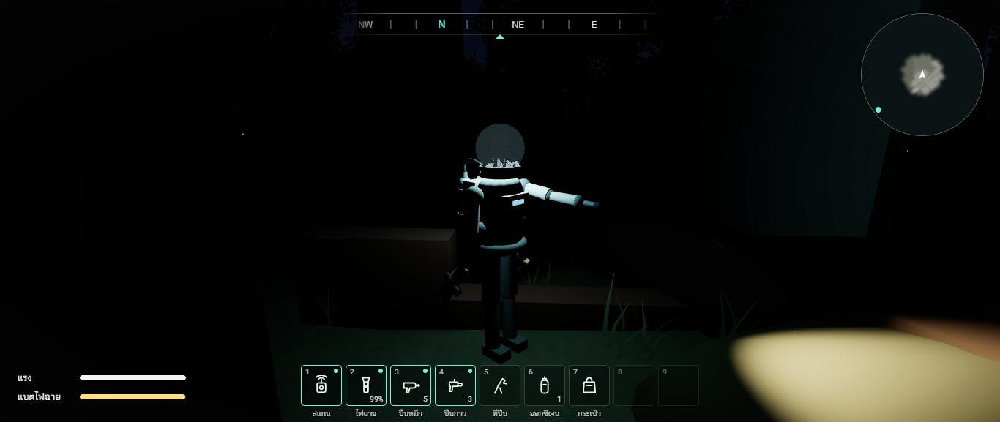

# รอบสอง ช่วง 9 · เดินเข้าตึกได้ทุกหลัง และตัวละครถือของจริง

วันที่ 23 ต.ค. 2569 · ผล **ผ่าน** (เสียงในตึกยังไม่ได้ทำ ปีนหอส่งน้ำยังไม่ได้ลอง)

## ทำอะไรไป
- **ทุกหลังเข้าได้** (`src/world/townPlan.ts` `buildingParts`) ผนังนอกมีช่องประตูกับหน้าต่างจริง ขนาดจริง (ประตูกว้าง 0.9 สูง 2.1 · ร้านค้าประตู 1.8 · สถานีดับเพลิง โกดัง ปั๊ม ประตูใหญ่ 3.6 · หน้าต่างขอบล่าง 0.9) · ห้องแบ่งด้วยผนังข้างในที่มีประตูทุกห้อง · ทุกชั้นมีพื้นของตัวเอง
- **บันได** ขั้นสูง 0.25 ลึก 0.3 ชิดผนังหลังขวา มีชานพักหัวบันได 1 ม. · ตึกสามชั้นเป็น **บันไดพับ** ช่วงแรกขึ้นไปทางหลังตึก ช่วงสองย้อนกลับมาทางหน้าตึกในช่องข้าง ๆ บันไดไม่ซ้อนกัน หัวไม่ชน · พื้นชั้นบนเว้นช่องเฉพาะเหนือขั้นบันได
- **ทางเดินโล่ง** หน้าประตูทุกบาน (นอกและในห้อง) กับทางขึ้นลงบันได ห้ามวางเฟอร์นิเจอร์ ผนังห้อง หรือกองซากขวาง
- **ข้างในตามชนิดตึก** บ้าน (เตียง ตู้ โซฟา ครัว) ร้าน (ชั้นวางเรียงแถว เคาน์เตอร์) ร้านอาหาร (เคาน์เตอร์ยาว โต๊ะ) คลินิก (เตียงคนไข้ ตู้ยา) โรงเรียน (โต๊ะเรียนเป็นแถว) โบสถ์ (ม้านั่งสองแถว แท่น) สถานีตำรวจ (โต๊ะ ห้องขังลูกกรง) สถานีดับเพลิง (รถดับเพลิงร้าง ล็อกเกอร์) โกดัง (ลังกองเป็นตาราง) · **พันปีผ่านไป** ของไม้กับผ้าผุหายเกือบหมด ที่เหลือทรุดเตี้ย สีหม่น
- **ของชิ้นเล็กในห้อง 180 ชิ้น** วางบนพื้นว่างของชั้นนั้น ไม่จมในเตียงหรือชั้นวาง เก็บได้ · โทรศัพท์ชิ้นพิเศษอยู่ในที่ทำการไปรษณีย์ กรอบรูปชิ้นพิเศษในบ้านหลังแรก (เดิมวางกลางเมือง)
- **ข้างในมืด** เข้าใต้หลังคาแล้วแสงฟ้าหรี่ลง 72% ต้องใช้ไฟฉาย · **ตัวละครรับเงา** เข้าตึกแล้วตัวมืดตามห้อง (เดิมแดดส่องตัวทะลุหลังคา ตัวสว่างอยู่กลางห้องมืด)
- **กันฝน กันหนาว** ใต้หลังคาหรือใต้พื้นชั้นบนนับเป็นที่หลบ · **ฝนตกเฉพาะนอกตึก** มองออกหน้าต่างหรือประตูยังเห็นสายฝน ในห้องแห้ง (เดิมเข้าตึกแล้วฝนข้างนอกหายหมด) ใช้ได้กับตึกที่หมุนตามแนวถนน
- **ข้างในวาดเฉพาะตึกที่อยู่ใกล้** 45 ม. จากขอบตึก · ซากที่หลังคาหายแล้ว พื้นกับผนังห้องมองเห็นจากข้างบน จึงวาดไปกับภายนอก
- **เสียงฝีเท้าในตึก** เป็นเสียงพื้นไม้ · ถนนทุกเส้นเป็นเสียงถนน
- **ตัวชนขั้นบันได** (`src/world/structures.ts`) กล่องที่สูงกว่าเท้าไม่เกินระยะก้าวขึ้น 0.6 ม. ไม่นับเป็นผนัง (เดิม 0.3 ม. ตัวละครกว้าง 0.6 ม. ชนขั้นที่สองก่อนขึ้นขั้นแรก ติดตีนบันได)
- **ตัวละครถือของจริง** (คำสั่งเพิ่มระหว่างทำ · `docs/DESIGN.md` ส่วน 0.3)
  - ของที่เก็บมาอยู่ในมือแขนที่ถือจริง (เดิมแขนว่าง) · อุปกรณ์ปลายชี้ตามแนวแขนออกจากมือ (เดิมชี้ย้อนเข้าหาไหล่)
  - **ยกแขนข้างที่ใช้** ชี้ไปข้างหน้า ไฟฉายเปิดอยู่ยกค้าง แสงออกจากหัวไฟฉายในมือ · สแกน ยิงหมึก ยกตอนกด · กาว ออกซิเจน ยกแวบหนึ่ง · ตอนปีนกับว่ายไม่ยก
  - **ถังออกซิเจนสองใบ** ติดกล่องบนหลัง มีสายรัด วาล์วหัวถัง **สายยางโค้งขึ้นข้างคอเข้าฐานโถ**
  - **ไฟในโถ** แสงฟ้าอ่อนส่องรอบตัวราว 7 ม. โถกับน้ำเรืองนิด ๆ · ปุ่ม L เปิดปิด (บอกในหน้าตั้งค่า ไม่ขึ้นบนจอ)
- เทส `tests/town.test.ts` 3 ข้อของช่วงนี้ เดินจริงด้วยกติกาเดียวกับตัวละคร (ก้าวขึ้น 0.6 ม. ชนดูจากเท้าก่อนก้าว) **ทุกหลังในเมือง** เดินจากหน้าประตูถึงพื้นชั้นล่างเกิน 85% · ขึ้นถึงชั้นบนสุดทุกหลังที่มีหลายชั้น · ขั้นบันไดไม่เกินที่ก้าวขึ้นได้ มีพื้นชั้นบนกันฝน

## เล่นทดสอบ (ในโครมของพี่กัน)
| ทดสอบ | ผล |
|---|---|
| เดินเข้าประตูหน้าสถานีตำรวจ | เข้าได้ กล้องหดเข้ามาไม่ทะลุผนัง แสงในตึกหรี่ลง (แสงฟ้า 1.05 → 0.31) ✅ |
| ขึ้นบันไดสถานีตำรวจ | ความสูงเท้า 0.15 → 0.50 → 1.00 ... → 3.00 ม. ถึงชั้นสอง ✅ |
| ทาวน์เฮาส์สามชั้น บันไดพับ | 0.15 → 3.00 → 6.00 ม. ถึงชั้นบนสุด มองออกหน้าต่างเห็นภูเขา ✅ |
| ขึ้นบันไดตึกหลายชั้น 6 หลังหลังรื้อผังเมือง | 5 หลังถึงชั้นสองภายใน 3.4 วินาที · สถานีดับเพลิงชั้นสูง 4.2 ม. บันไดยาวกว่า ถึง 3.71 ม. ตอนหมดเวลาที่ให้เดิน ✅ |
| ฝนตกขณะอยู่ในตึก (ตึกหมุน 2.0 เรเดียน) | ในห้องไม่มีสายฝน มองออกหน้าต่างเห็นฝน · โหลแก้วไม่มีหยดน้ำ · นับเป็นที่หลบ ✅ |
| เปิดไฟฉายกลางคืน | แขนบนซ้ายยกชี้ไปข้างหน้า แสงตกพื้นข้างหน้า ✅ |
| กด L กลางคืน | ไฟในโถสว่าง (1.6) ไหล่กับแขนติดแสงฟ้าอ่อน ✅ |
| มองตัวละครจากด้านหลัง | ถังออกซิเจนฟ้าสองใบ สายโค้งเข้าโถ ปืนในแขนล่างอยู่ในมือ ✅ |
| typecheck · test (168 ข้อ) · build | ผ่าน ✅ |

| ในสถานีตำรวจชั้นสอง | ชั้นสามทาวน์เฮาส์ | ฝนนอกหน้าต่าง ในห้องแห้ง |
|---|---|---|
|  |  |  |

| ถังออกซิเจนกับสายเข้าโถ | ไฟในโถกับแขนถือไฟฉายตอนกลางคืน |
|---|---|
|  |  |

## บั๊กที่เจอ
| บั๊ก | สถานะ |
|---|---|
| บันไดตึกสามชั้นชั้นบนซ้อนอยู่เหนือชั้นล่าง เดินขึ้นหัวชน | แก้แล้ว บันไดพับคนละช่อง |
| เคาน์เตอร์ครัวชิดผนังหน้าบังประตูบ้าน เข้าบ้านไม่ได้ | แก้แล้ว ทางเดินหน้าประตูห้ามวางของ |
| ผนังห้องผ่ากลางประตูหน้าสถานีตำรวจ | แก้แล้ว ผนังห้องห้ามผ่านทางเดิน ถ้าแบ่งตรงไหนก็ขวางเป็นห้องใหญ่ห้องเดียว |
| กองซากทับประตูห้อง (ไปรษณีย์) และหัวบันไดชั้นสาม | แก้แล้ว |
| **ในเกมจริงติดตีนบันได** ทั้งที่เทสในเครื่องผ่าน (เทสคิดความสูงเท้าหลังก้าว เกมคิดก่อนก้าว) | แก้แล้วทั้งเกมและเทส · เทสคิดแบบเดียวกับเกมแล้ว ถ้าเกมพังแบบเดิมเทสจะจับได้ |
| ตัวละครสว่างกลางห้องมืด | แก้แล้ว รับเงา |
| เข้าตึกแล้วฝนข้างนอกหายหมด | แก้แล้ว |
| อุปกรณ์ในมือชี้ย้อนเข้าหาไหล่ ยกแขนแล้วปลายหันกลับหาตัว | แก้แล้ว |
| สแกนทะลุผนังกับภูเขา วนหาเป้าทุกเฟรม (รายงานตรวจข้อ 121 132) | ค้าง ย้ายไปช่วง 12 (ตอนทำข้อความสแกนสัตว์พืชใหม่) |
| ปีนผนังตึกแบบเฉียง ก้าวพลาดหลังคา (ข้อ 77) · ตึกสูงเกิน 15 ม. ปีนไม่ถึงยอด (ข้อ 78) | ค้าง ช่วง 10 ตอนทำหอดูไฟป่าที่ต้องปีน · หอส่งน้ำ 23 ม. ยังไม่ได้ลองปีน |
| เสียงในตึก (ก้อง ฝีเท้าบนกระเบื้อง) | ค้าง ทำตอนช่วง 11 พร้อมเสียงก้องในถ้ำ |

## แคลร์ตัดสินเอง
- ปุ่ม L เปิดปิดไฟในโถ (L มาจาก light) ไฟในโถส่องไกลราว 7 ม. แสงฟ้าอ่อน
- ไฟฉายเปิดอยู่ แขนยกค้างตลอด (ถือไฟฉายส่องทาง)
- ในตึกแสงฟ้าหรี่ 72% · ข้างในวาดเมื่อห่างขอบตึกไม่เกิน 45 ม.
- ตึกที่หลังคาหายต้นไม้ขึ้นข้างในได้ แต่ไม่ขึ้นตรงทางเดินหน้าประตูกับช่องบันได

## รอพี่กันเคาะ
- ปุ่ม L สำหรับไฟในโถ กับความสว่างของไฟในโถ
- ท่ายกแขน ยกชี้ตรงไปข้างหน้า หรืออยากให้ยกสูงต่ำแบบไหน
