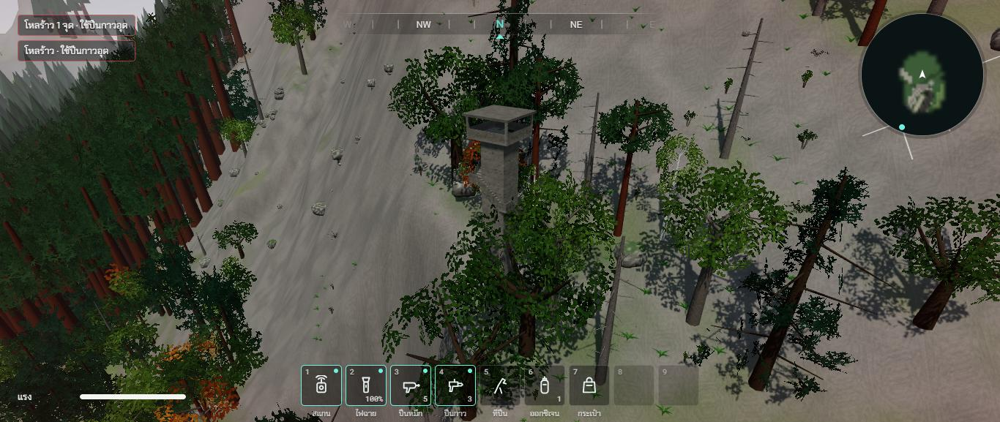
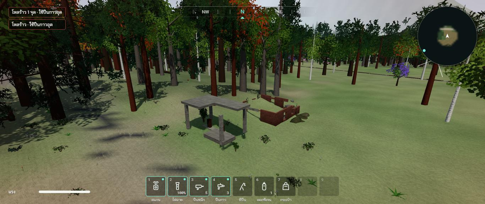
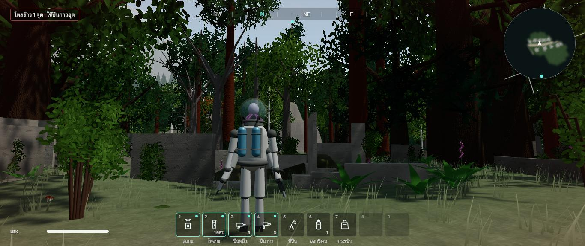
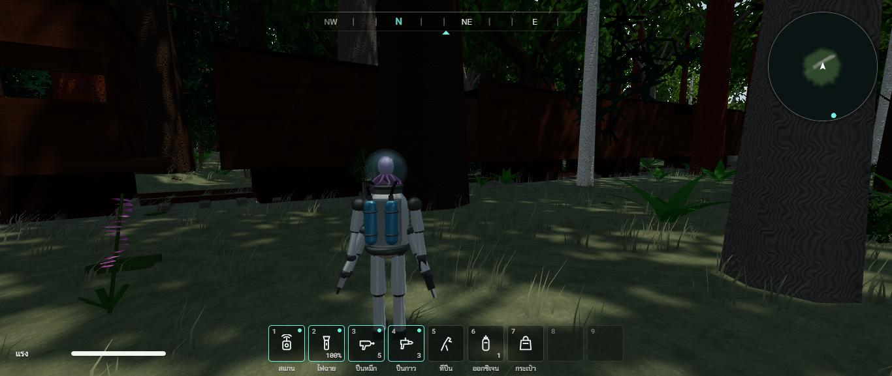

# รอบสอง ช่วง 10 · อารยธรรมที่ถูกป่ากลืน

วันที่ 23 ต.ค. 2569 · ผล **ผ่าน** (สถานีรถไฟ โรงเลื่อย ลานกางเต็นท์ ยังไม่ได้ถ่ายภาพ · ปีนหอส่งน้ำยังไม่ได้ลอง)

ทุกอย่างคิดแบบโลกหลังมนุษย์หายไปราวพันปี (`docs/DESIGN.md` ส่วน 0.1) · ตึกใช้ตัวสร้างตึกของเมือง เข้าได้ทุกหลัง · ที่เหลือเป็นกล่องชุดเดียวกับตัวชน (`src/world/ruins.ts`)

## ทำอะไรไป
- **หมู่บ้านกลางป่า** ป่าทึบฝั่งตะวันตก บ้านราว 16 หลังเรียงสองฝั่งถนนป่าเก่า ส่วนใหญ่เหลือแต่ตอผนัง มีโบสถ์หินเล็กปลายหมู่บ้าน หลังคาหาย
- **ถนนป่าเก่า** 3 เส้น จากถนนหลวงขึ้นหมู่บ้าน ต่อไปที่ทำการอุทยาน และทางเดินป่าขึ้นหอดูไฟ (`src/world/layout.ts` `FOREST_ROADS`) ดินกลบเกือบหมด ต้นไม้ขึ้นบนแนวถนนได้ตามกติกาถนนพันปี
- **ทางรถไฟร้าง** ราว 1.45 กม. จากขอบแมพตะวันตกผ่านป่าทึบ ตัดถนนหลวง มาสุดที่สถานีชายทุ่งนาเก่า · รางเหล็กสนิมขาดเป็นช่วง หมอนปูนจมดินบ้าง หินโรยทางดินกลบไปบ้าง ต้นไม้ขึ้นบางกว่าข้างทาง
- **ขบวนรถไฟร้างกลางป่า** หัวรถจักรกับตู้สินค้า 4 ตู้ สนิมทั้งคัน ตู้ที่ 4 ตกรางเยื้องออก ประตูเลื่อนเปิดค้าง **ตู้ที่ 2 กับ 4 ต้นไม้ขึ้นทะลุหลังคา** (หลังคากลางตู้พังหาย)
- **สถานีรถไฟร้าง** ตัวสถานีกับชานชาลาปูนข้างราง ป้าย PINE VALLEY STATION
- **ปั๊มน้ำมันริมถนนหลวง** หลังคาปั๊มบนเสาปูนสี่ต้น แผ่นหนึ่งพังลงมากอง หัวจ่ายสนิม ร้านในปั๊มเหลือแต่ผนัง ป้าย GAS
- **โรงเลื่อย** ริมถนนหลวงใกล้ทางแยกไปยาน โรงใหญ่สูง 6 ม. หลังคาหาย ป้าย PINE VALLEY LUMBER · ออฟฟิศเหลือแต่ตอ · ลานไม้ซุงผุเป็นเนิน โต๊ะเลื่อยสนิม
- **ที่ทำการอุทยาน** ตึกปูนยังมีหลังคา เข้าไปหลบฝนหลบหนาวได้ ป้าย RANGER STATION · ห้องน้ำเล็ก · **ลานกางเต็นท์** ในทุ่งโล่ง วงหินก่อไฟ 4 วง ขาโต๊ะปิกนิกปูน (ไม้ผุหาย) ป้ายแผนที่อุทยานล้มนอน
- **หอดูไฟป่าคอนกรีต** บนเนินสูงในป่าทึบใกล้ตีนเขา สูงราว 30 ม. พ้นยอดไม้ **เดินขึ้นได้ด้วยบันได** พันรอบแกนกลาง 9 ช่วง ช่วงละ 3 ม. ขั้นละ 0.25 ม. มีชานพักทุกมุม ราวปูนตามขอบนอก ห้องดูไฟบนยอดมีผนังเตี้ย เสาสี่มุม หลังคา (เหล็กกับไม้ไม่เหลือในพันปี จึงเป็นปูนทั้งหลัง)
- **แนวเสาไฟฟ้าแรงสูง** จากตีนเขาลงมาหาเมือง โครงเหล็กล้มนอนกับพื้นทุกต้น ยาว 30 ม. เหลือฐานปูนสี่ก้อนตรงที่เคยตั้ง ต้นไม้ขึ้นแทรกได้
- **ซากรถในป่า** ตามถนนป่าเก่าทุกเส้น บางคันต้นไม้ขึ้นทะลุหลังคา
- **ชื่อบนแผนที่ใหญ่** หมู่บ้านกลางป่า ปั๊มน้ำมันร้าง โรงเลื่อย ที่ทำการอุทยาน หอดูไฟป่า ขบวนรถไฟร้าง สถานีรถไฟร้าง (สองภาษา)
- ต้นไม้ที่ต้องขึ้นตรงจุดนั้นจริง (ทะลุตู้รถไฟ ทะลุซากรถ) ใส่เพิ่มหลังโปรยต้นไม้ปกติ (`scatterTrees` รับ `forced`)
- เทสใหม่ `tests/ruins.test.ts` 4 ข้อ ครบทุกจุด · ต้นไม้ทะลุตู้รถไฟกับซากรถในป่า · ตึกนอกเมืองไม่ล้ำถนน · **เดินจากพื้นขึ้นบันไดหอดูไฟป่าถึงห้องบนยอดได้จริง** (เดินด้วยกติกาเดียวกับตัวละคร) · รวม 182 เทส

## เล่นทดสอบ (ในโครมของพี่กัน)
| ทดสอบ | ผล |
|---|---|
| มองหอดูไฟป่าจากมุมสูง | หอคอนกรีตสี่เหลี่ยม ราวบันไดปูนพันรอบ ห้องดูไฟกับหลังคาบนยอด โผล่พ้นยอดไม้บนลาดเขา ✅ |
| ปั๊มน้ำมันริมถนนหลวง | หลังคาปั๊มบนเสาปูน มุมหนึ่งพังกองลงมา หัวจ่ายสนิม ร้านเหลือแต่ผนังอิฐ ถนนหลวงกลายเป็นทุ่งหญ้า ✅ |
| เดินในหมู่บ้านกลางป่า | ตอผนังบ้านหลายหลังอยู่ระหว่างต้นไม้ใหญ่ เฟิร์น พุ่มไม้ ✅ |
| ยืนข้างขบวนรถไฟ | ตู้สนิมเรียงกันใต้ร่มป่า ต้นเบิร์ชขึ้นข้างตู้ ✅ (ภาพมืดเพราะอยู่ใต้ร่มป่าทึบ) |
| typecheck · test (182 ข้อ) · build | ผ่าน ✅ |

| หอดูไฟป่า | ปั๊มน้ำมันร้าง |
|---|---|
|  |  |

| หมู่บ้านกลางป่า | ขบวนรถไฟร้าง |
|---|---|
|  |  |

## บั๊กที่เจอ
| บั๊ก | สถานะ |
|---|---|
| ห้องน้ำของที่ทำการอุทยานล้ำทางเดินป่า | แก้แล้ว ตึกนอกเมืองที่ล้ำถนนขยับไปตามแนวกว้างทีละ 6 ม. · เทสตรวจทุกหลัง |
| ชานชาลาทับราง | แก้แล้ว ย้ายไปข้างราง ห่างราว 1 ม. |
| หอดูไฟป่าถ้าตั้งในป่าสนยักษ์ (สูง 55 ถึง 85 ม.) จะมองไม่เห็นอะไร | ย้ายไปเนินสูงในป่าทึบ ทำให้สูงราว 30 ม. |
| ลายเปลือกไม้คดเป็นคลื่นเหมือนลายนิ้วมือ | แก้แล้ว ร่องเกือบตรง ขาดเป็นช่วง |
| วาร์ปไปหอดูไฟแล้วตัวละครไปอยู่บนหลังคาหอ ตกลงมาโหลร้าว | ไม่ใช่บั๊กของเกม เป็นตัวช่วยทดสอบที่วางตัวบนของที่สูงสุด |
| ภาพในป่าทึบมืดมาก (ใต้ขบวนรถไฟ) | ค้าง ช่วง 13 ดูแสงในป่าพร้อมระดับภาพ |
| ปีนผนังตึกเฉียงก้าวพลาดหลังคา (ข้อ 77) · ตึกสูงเกิน 15 ม. ปีนไม่ถึงยอด (ข้อ 78) | ค้าง ช่วง 14 · หอดูไฟป่าเดินบันไดขึ้นได้ ไม่ต้องปีน · หอส่งน้ำยังไม่ได้ลองปีน |

## แคลร์ตัดสินเอง
- ตำแหน่งทุกจุด (หมู่บ้านในป่าทึบตะวันตก ปั๊มกับโรงเลื่อยริมถนนหลวง อุทยานกับหอดูไฟใกล้ตีนเขา ขบวนรถไฟกลางป่า สถานีชายทุ่งนาเก่า)
- หอดูไฟป่ากับหอส่งน้ำเป็นปูน เพราะเหล็กกับไม้ไม่เหลือในพันปี
- ที่ทำการอุทยานยังมีหลังคา ให้เป็นที่หลบในป่า

## รอพี่กันเคาะ
- ความสูงหอดูไฟป่า ราว 30 ม. พอไหม
- ป้ายบนตึกนอกเมือง (RANGER STATION, PINE VALLEY LUMBER, PINE VALLEY STATION, GAS)
