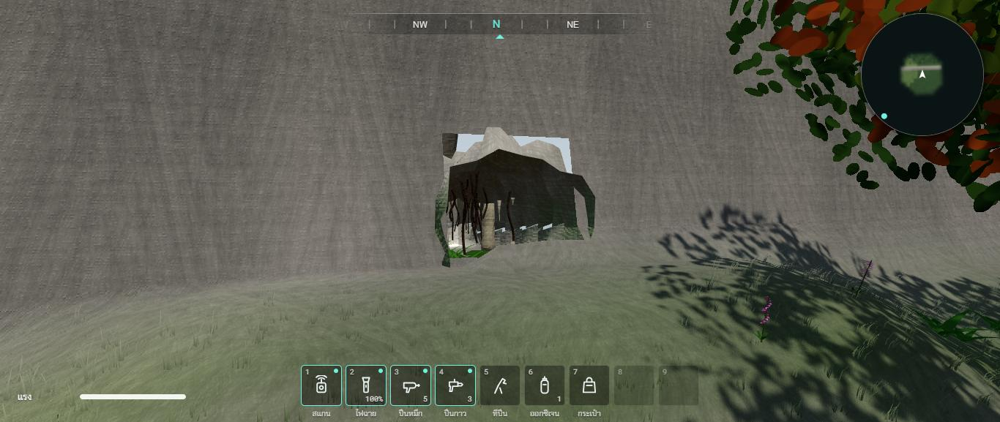
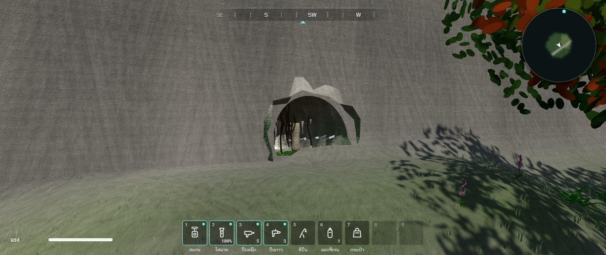
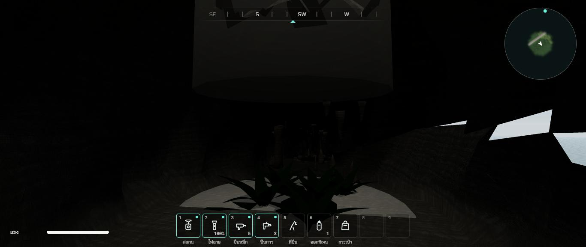

# รอบสอง ช่วง 11 · ถ้ำ 2 แห่ง

วันที่ 23 ต.ค. 2569 · ผล **ผ่านบางส่วน** (เทสผ่านครบ · ในโครมดูปากถ้ำหินปูนกับหลุมยุบแล้ว · ถ้ำเหมือง แอ่งน้ำมีปลา ค้างคาว ภาพวาดรอยมือ ยังไม่ได้ดูในโครม)
พี่กันสั่งหยุดที่ช่วงนี้แล้วพุช (*"ตามนั้น 11 พอ แล้วพุชเลย ไม่มีเวอร์ชั่น"*) · ช่วง 12 ถึง 14 ยังไม่ได้เริ่ม

ทุกอย่างคิดแบบโลกหลังมนุษย์หายไปราวพันปี (`docs/DESIGN.md` ส่วน 0.1) ไม้ผุ เหล็กสนิม ตะเกียงไม่มีไฟ

## ทำอะไรไป
- **วางของในถ้ำเป็นกติกาล้วน** `src/world/caves.ts` (`caveFeatures`) ผลเดิมทุกครั้ง · วาดใน `src/render/Caves.ts`
- **ถ้ำหินปูน** (ถ้ำแรก ตีนเทือกเขาเหนือ ลึกราว 70 ม.)
  - อุโมงค์กลมรีขรุขระสีครีมอมเทา มืดลงตามความลึก พื้นชื้นสีเข้ม
  - หินย้อยจากเพดาน หินงอกจากพื้น เสาหินที่ย้อยกับงอกมาชนกัน (รวม 70 ชิ้น)
  - มอสสีเขียวกับเฟิร์นช่วงปากถ้ำที่ยังได้แสง รากไม้ห้อยจากเพดาน 22 เส้น
  - **หลุมยุบ** ราว 40% ของความลึก เพดานเปิดเป็นปล่องหินขึ้นไปถึงผิวดินพอดี (สูงตามผิวดินจริงตรงนั้น) ลำแสงลงมาสว่างที่ปากปล่องจางลงที่พื้น วงแสงบนพื้น เฟิร์นกับมอสขึ้นตรงที่แสงตก ผนังรอบ ๆ สว่างขึ้น
  - **แอ่งน้ำใต้ดิน** ราว 70% ของความลึก ขอบหิน **ปลาถ้ำสีขาวไม่มีตา 7 ตัว** ว่ายวนช้า ๆ · ลงแอ่งไม่ได้ มีขอบกั้น เดินอ้อมได้อีกฝั่ง
  - **ค้างคาว 16 ตัว** บินวนใต้เพดานห้องลึก ปีกกระพือ
  - ภาพวาดรอยมือ (ของเดิม) ย้ายมาอยู่ห้องปลายถ้ำหินปูนที่เดียว
- **ถ้ำเหมืองเก่า** (ถ้ำสอง หน้าผาป่าตะวันตก ลึกราว 55 ม.)
  - อุโมงค์ทรงเหลี่ยม ผนังตั้งตรง เพดานแบน สีน้ำตาลเทา
  - ค้ำยันไม้ทุกราว 3 ม. เสาสองข้างกับคาน ไม้ผุดำ บางชุดคานหักร่วงลงพื้น
  - รางรถเข็นสนิมสองเส้นตามพื้น ขาดเป็นช่วง หมอนไม้ผุ · รถเข็นแร่ 2 คัน คันหนึ่งคว่ำตะแคง
  - ตะเกียงสนิมแขวนบนเสา (ไม่มีไฟ)
  - **ช่วงถล่ม** กองหินกับคานหักกองชิดผนังข้างหนึ่ง เหลือช่องให้ลอดผ่าน
  - **ค่ายพักเก่าปลายเหมือง** เตาเหล็ก โครงเตียงเหล็กสองหลัง (ผ้ากับไม้ผุหายแล้ว) ลังไม้ผุเป็นกอง
  - เห็ดเรืองแสง (ของเดิม) 34 ดอกตามผนังส่วนลึก · ก๊าซพิษ (ของเดิม) ย้ายมาอยู่ส่วนลึกของเหมือง ตั้งแต่ราว 62% ของความลึก · ถ้ำหินปูนไม่มีก๊าซแล้ว
- **ของในถ้ำชนได้** หินงอก เสาหิน ค้ำยัน รถเข็น กองหินถล่ม เตา ลัง แอ่งน้ำ · ลัง กองหิน รถเข็น ยืนบนได้
- **ข้อความสแกนใหม่สองภาษา** ปลาถ้ำ กับ ค้างคาว (`src/core/catalog.ts`) เขียนเป็นข้อเท็จจริงทั่วไป ไม่มีตัวเลข
- **แก้บั๊กถ้ำในรายงานตรวจ 8 ข้อ** (82 ถึง 87 · 110 · 115) รายละเอียดใน `docs/BUGHUNT-2026-10-23.md`
  - เดินทะลุผนังขึ้นไปยืนบนเนินไม่ได้แล้ว
  - ต้นไม้ หิน ขอนไม้ ไม่ขึ้นบนเนินเหนืออุโมงค์ · ตัวชนวงกลมรู้ความสูงโคน ของบนเนินไม่ชนกับในถ้ำ (ใช้กับหิน ตอไม้ ขอนไม้ทั้งแมพด้วย)
  - รูปากถ้ำตัดตามรูปตัดอุโมงค์จริง ไม่เห็นฟ้าทะลุ
  - หญ้าไม่ขึ้นลอยในปากถ้ำ
  - อุโมงค์ยื่นจากหน้าผาแค่ 1 ม. วาดสองด้าน เห็นเป็นซุ้มหิน
  - เขตเดินแคบลง กล้องต้องอยู่ในรูปตัดอุโมงค์จริง
  - เลิกใช้ไฟจุด 4 ดวงที่คิดแสงทั้งแมพ
  - ตัวเจาะรูพื้นดินข้ามจุดที่อยู่นอกกรอบถ้ำ
- **เทสใหม่** `tests/caves.test.ts` 6 ข้อ: ชนิดถ้ำกับก๊าซ · อุโมงค์อยู่ใต้ภูเขาจริงตลอดทาง ผนังไม่โผล่พ้นดิน · ของในถ้ำครบตามแบบ หลุมยุบเปิดถึงผิวดิน · **เดินจากปากถ้ำถึงห้องปลายถ้ำได้ทั้งสองแห่ง** ไม่ชนของ · ผนังกันตลอดทาง · ต้นไม้หินไม่ขึ้นเหนืออุโมงค์ กล้องอยู่ในโพรง · รวม 186 เทส

## เล่นทดสอบ (ในโครมของพี่กัน)
| ทดสอบ | ผล |
|---|---|
| มองปากถ้ำหินปูนจากข้างนอก ก่อนแก้รูตัด | รูในหน้าผามุมบนซ้ายเห็นฟ้าทะลุ 🔴 |
| มองปากถ้ำหินปูนหลังแก้รูตัด | ซุ้มหินโค้งปิดครบ เห็นรากไม้ห้อย หินงอก มอสที่พื้น ไม่เห็นฟ้าทะลุ ✅ |
| ยืนใต้หลุมยุบ ก่อนแก้ลำแสง | ลำแสงสีเท่ากันทั้งลำ เห็นเป็นแผ่นเทาแบนบังจอ 🔴 |
| ยืนใต้หลุมยุบ หลังแก้ลำแสง | ลำแสงจางลงที่พื้น วงแสงบนพื้น เฟิร์นขึ้นตรงที่แสงตก ✅ · แต่ผนังขวาเห็นแผ่นสีขาวคล้ายฟ้า 🔶 ค้าง |
| ถ้ำเหมือง แอ่งน้ำกับปลา ค้างคาว ภาพวาดรอยมือ ปลายถ้ำ | ยังไม่ได้ดู ⬜ (พี่กันสั่งหยุดก่อน) |
| typecheck · test (186 ข้อ) · build | ผ่าน ✅ |

| ปากถ้ำ ก่อนแก้ | ปากถ้ำ หลังแก้ |
|---|---|
|  |  |

| ใต้หลุมยุบ |
|---|
|  |

## บั๊กที่เจอ
| บั๊ก | สถานะ |
|---|---|
| รูปากถ้ำตัดเป็นกล่อง มุมบนเลยผนังอุโมงค์ เห็นฟ้าทะลุ | แก้แล้ว ตัดตามรูปตัดอุโมงค์ (วงรี · เหลี่ยม) |
| ลำแสงหลุมยุบเป็นแผ่นเทาแบน | แก้แล้ว สว่างที่ปากปล่อง จางลงที่พื้น |
| ใต้หลุมยุบ ผนังขวาเห็นแผ่นสีขาวคล้ายฟ้า | 🔶 ค้าง · แคลร์สงสัยว่าแนวอุโมงค์ที่วาด (วัดตามระยะทางจริงบนเส้นโค้ง) กับแนวที่ใช้วางของ (วัดตามลำดับจุด) ห่างกันบางช่วง ตัวตัดเพดานตรงหลุมยุบจึงกินผนังด้วย ยังไม่ได้พิสูจน์ · ทางแก้ที่คิดไว้: ให้สองแนวใช้วิธีวัดเดียวกัน แล้วตรวจตัวตัดเพดานใหม่ |
| แสงในถ้ำมืดมาก นอกวงแสงหลุมยุบแทบไม่เห็นอะไร | 🔶 ค้าง ช่วง 13 ดูแสงในถ้ำพร้อมระดับภาพ (ตอนนี้ต้องเปิดไฟฉาย) |

## แคลร์ตัดสินเอง
- ห้องหลุมยุบที่ราว 40% ห้องแอ่งน้ำราว 70% ของความลึกถ้ำหินปูน · ค่ายพักอยู่ปลายเหมือง
- ก๊าซพิษย้ายจากถ้ำหินปูนไปอยู่ส่วนลึกของเหมือง (เหมืองมีก๊าซสะสมสมเหตุผลกว่า) · ภาพวาดรอยมือเหลือที่ถ้ำหินปูนที่เดียว
- แอ่งน้ำลงไปไม่ได้ (ยังไม่มีระบบว่ายใต้ดิน) มีขอบหินกั้น
- ตะเกียงในเหมืองไม่มีไฟ เพราะพันปีแล้ว

## รอพี่กันเคาะ
- ก๊าซพิษย้ายไปอยู่เหมือง ภาพวาดรอยมืออยู่ถ้ำหินปูนที่เดียว ใช้ได้ไหม
