# รอบสอง ช่วง 12 · ระบบนิเวศ

วันที่ 23 ต.ค. 2569 · ทำบน **เครื่องคลาวด์** (พี่กันสั่ง *"อ่านข้อมูลโปรเจค แล้วทำต่อตามแผนที่วางไว้"*)
ผล **โค้ดกับเทสผ่านครบ · 🔶 ยังไม่ได้ดูในโครมของพี่กันทุกข้อ** (เครื่องคลาวด์ไม่มีการ์ดจอ · `docs/SESSION-2026-10-23-R2.md` หัวข้อ "ทำต่อบนเครื่องคลาวด์")
ภาพในรายงานนี้ถ่ายจาก **โครมไม่มีหน้าต่างบนเครื่องคลาวด์** (วาดด้วยซีพียู ใช้ได้เฉพาะบนคลาวด์ตามสกิล testing-proof 5.6) แคลร์ใช้ดูเองว่าไม่พัง ไม่นับเป็นภาพผ่าน · ชื่อไฟล์ขึ้นต้นด้วย `cloud-`

## ทำอะไรไป

### 1. กติการะบบนิเวศ `src/core/ecology.ts` (กติกาล้วน มีเทส)
- **ถิ่นตามชนิดพื้นที่** สัตว์แต่ละชนิดมีที่หากินกับที่หลบพัก (ชนิดพื้นที่ 16 แบบของภูมิประเทศ) · ตัวดุอยู่เฉพาะเขตป่าลึก
- **ตามเวลา** แบ่งวันเป็น เช้ามืด 04:30 ถึง 07:30 · กลางวัน · พลบค่ำ 17:30 ถึง 20:30 · กลางคืน · แต่ละชนิดออกมามากน้อยต่างกัน
  - กวางออกทุ่งตอนเช้ามืดกับพลบค่ำ กลางวันเดินเข้าไปหลบในป่า · หมาป่าคึกตอนกลางคืน เช้ามืด พลบค่ำ · หมีเช้ากับหัวค่ำ · กระรอกกลางวัน · กบกลางคืน · นกฮูกกลางคืน · ผีเสื้อกับผึ้งกลางวันเท่านั้น · หิ่งห้อยพลบค่ำกับกลางคืน
- **ฝนตก** สัตว์ที่หลบฝนออกมาน้อยลง กวางเดินเข้าป่า ผีเสื้อ ผึ้ง หิ่งห้อย ไม่ออก · กบออกมากขึ้น
- **หิว กระหาย** หิวแล้วล่าหรือหากิน กระหายแล้วเดินลงไปกินน้ำที่ตลิ่ง
- **ห่วงโซ่อาหาร** หมาป่าล่ากวางกับกระต่าย · จิ้งจอกล่ากระต่าย · ซากมีอีกามากิน · หมีกินลูกไม้และจับปลา
- ตัวช่วย: เลือกตัวหลงฝูง · ทิศหนีที่ไม่ชนขอบแมพ · เช็กว่าจุดเกิดอยู่นอกสายตา · ฝูงนกแบบ boids

### 2. สัตว์ใหญ่ตามระบบนิเวศ `src/app/Animals.ts` (เขียนใหม่ทั้งไฟล์)
- **เกิดเป็นฝูงในถิ่นของมัน นอกสายตา** (หลังกล้องหรือข้าง ๆ เลยมุมมอง ไกล 75 ถึง 150 ม.) หายเมื่อไกลเกิน 230 ม. หรือหมดเวลาออกหากินแล้วอยู่นอกสายตา
- **ฝูงกวาง** 3 ถึง 6 ตัว เดินตามกันแต่ละตัวมีที่ของตัวเองรอบฝูง สลับเดินกับก้มเล็มหญ้า **ตัวแรกเงยหน้าระวังภัยเป็นพัก ๆ** · ตัวหนึ่งตกใจทั้งฝูงวิ่งหนีด้วย
- **ฝูงหมาป่าล่า** 3 ถึง 6 ตัว หิวแล้ว **ย่องเข้าหา** ฝูงกวางช้า ๆ (เหยื่อเห็นผู้ล่าที่ย่องช้ากว่า) ใกล้ราว 20 ม. หรือกวางรู้ตัว ทั้งฝูงวิ่งไล่พร้อมกัน **เลือกตัวหลงฝูง** (กวางแต่ละตัวแข็งแรงไม่เท่ากัน ตัวอ่อนแอหลุดท้าย) ล้อมจากหลายทาง · ถึงตัวแล้วล้มเหยื่อได้บางครั้ง ไม่ได้เหยื่อดิ้นหลุดวิ่งเร็วขึ้นชั่วคราว · ไล่ได้ไม่เกิน 22 วินาทีแล้วหมดแรง (ล่าพลาด) พักก่อนล่าใหม่
- **ซาก** ล่าได้แล้วเหยื่อนอนตะแคง หมาป่าล้อมกิน เนื้อค่อย ๆ หมด ซากคล้ำลง อยู่ได้ราว 8 นาทีจริง · **กลางวันอีกาบินลงมารุมซาก** เกาะพื้นจิกกิน · ซากสแกนได้เป็นชนิดของสัตว์ตัวนั้น
- **จิ้งจอกล่ากระต่าย** แบบเดียวกัน
- **หมี** หิวแล้วไป **ยืนสองขากินลูกไม้** ที่ต้นโอ๊ก บีช มะม่วง แอปเปิล เชอร์รี · หมีในหุบน้ำตกลง **จับปลาที่ตีนน้ำตก** ยืนในน้ำตื้น ก้มมอง ตะปบเป็นพัก ๆ
- **ลงกินน้ำ** กวาง หมาป่า หมี จิ้งจอก หาตลิ่งใกล้สุดแล้วก้มกินน้ำ
- **กระรอก** อยู่โคนต้นสนกับไม้ใบกว้าง วิ่งบนพื้นเป็นช่วงสลับหยุดเงยหน้า เห็นคนแล้ววิ่งขึ้นต้นไม้ไปเกาะลำต้นสูงราว 7 ม. คนไปแล้ว **ลงต้นเอาหัวลง**
- **กบ** ริมน้ำกับที่ลุ่ม หนีแล้วดำน้ำหายไปพักหนึ่ง
- **นกอินทรี** ร่อนเป็นวงกว้างเหนือที่อยู่ สูงจากพื้นตรงนั้น 45 ถึง 65 ม. (เดิมความสูงตายตัว ภูเขาสูงนกเดินบนพื้น)
- **ท่าทาง** โมเดลมีท่าเล็มหญ้า ระวังภัย นอนพัก ก้มกินน้ำ กินซาก ยืนสองขา จับปลา ตายนอนตะแคง ปีนขึ้น ปีนลง เกาะพื้น · คอยื่นพ้นลำตัว (เดิมหัวกวางจมอยู่ในลำตัว)
- **วาดเบาลง** ชิ้นส่วนที่ไม่ขยับรวมเป็นเมชเดียวใส่สีต่อจุด สัตว์สี่ขาเหลือ 7 ครั้งวาดต่อตัว (เดิมราว 14) · สัตว์ไกลเกิน 90 ม. คิดทุก 3 เฟรม
- ขนาดถึงไหล่ตามของจริง (`src/config/scale.ts` `ANIMAL_SHOULDER` มีเทสเทียบโมเดล) เพิ่มกระรอก

### 3. สัตว์เล็กเป็นกลุ่ม `src/render/Critters.ts` (ใหม่)
- **นกกิ้งโครงฝูง** 18 ถึง 34 ตัว (พลบค่ำรวมฝูงใหญ่ขึ้นราว 1.6 เท่า) บินแบบ boids เหนือทุ่ง ไร่ เมือง · พลบค่ำบินวนเป็นรูปร่างแน่นขึ้น · กลางวันลงหากินบนพื้นหญ้า ตัวท้ายบินข้ามไปหน้าฝูง · คนเข้าใกล้ 14 ม. บินขึ้นพร้อมกัน
- **ผีเสื้อ** สีปีก 5 แบบ บินกระพือเป็นคลื่นไปเกาะดอกไม้ทีละดอก หุบกางปีกช้าตอนเกาะ
- **ผึ้ง** บินเร็วจากดอกไปดอกใกล้ ๆ หยุดลอยที่ดอก (ตัวจริงยาวราว 1.3 ซม. วาดใหญ่ขึ้นครึ่งหนึ่งให้พอเห็น)
- ใช้ดอกไม้ 13 ชนิดในทุ่งรอบตัว (ไม่รวมบัวสายกับพืชริมน้ำ) · วาดแบบ InstancedMesh ชนิดละไม่กี่ครั้ง · คิดทุก 2 เฟรม
- หิ่งห้อยเดิมขึ้นเฉพาะในทุ่งกับริมน้ำ ไม่ขึ้นในป่าทึบ ไม่ออกตอนฝนตก

### 4. ข้อความสแกนสามชั้นสองภาษาของทุกชนิด `src/core/catalogNature.ts` (ใหม่) กับ `src/core/catalog.ts`
- **ใหม่ 47 ชนิด** ต้นไม้ 16 (เรดวูด สปรูซ เฟอร์ เมเปิล บีช หลิวย้อย อัลเดอร์ ไทร ยางนา เต่าร้าง เฟินต้น ไผ่ยักษ์ นางพญาเสือโคร่ง จาคารันดา แอปเปิล มะม่วง) · ดอกไม้ 13 · พืชริมน้ำ 3 (ธูปฤาษี ต้นกก หญ้าหางม้า) · พุ่มไม้ 5 (เฮเซล เอลเดอร์ จูนิเปอร์ แบล็กเบอร์รี กุหลาบพันปี · กุหลาบป่าใช้ชนิดเดียวกับดอกไม้) · หิน 5 (แผ่นหินชั้น หินกลมริมน้ำ ลานหินร่วง หินโผล่ ก้อนหินมอส) · ปลา 2 (เทราต์ ปลาไน แทน "ปลา" เดิม) · สัตว์ 3 (นกกิ้งโครง กระรอก ผึ้ง)
- **ปรับของเดิม** "ต้นสน" เป็น **สนสก็อต** · "ก้อนหิน" เป็น **ก้อนหินแกรนิต** (รหัสเดิม pine กับ rock คงไว้ บันทึกเก่าใช้ต่อได้) · ชั้นความจริงของกวาง จิ้งจอก อีกา กบ หมาป่า หมี โอ๊ก เบิร์ช มีข้อเท็จจริงตามที่มา (เดิมเบิร์ชเขียนว่า "ชอบขึ้นใกล้น้ำ" ซึ่งไม่มีที่มา)
- **ชั้นความจริงใช้เฉพาะข้อเท็จจริงที่มีที่มา** ใน `docs/REFERENCES-R2.md` (เพิ่มหัวข้อ 11 สัตว์ใหม่กับพุ่มไม้ ค้นจาก Wikipedia รอบนี้) · เทสตรวจว่าตัวเลขทุกตัวในชั้นความจริงของชนิดใหม่มีอยู่ในไฟล์อ้างอิง
- ต้นไม้ หิน พุ่มไม้ ดอกไม้ พืชริมน้ำ ปลา สแกนได้เป็นชนิดของตัวเอง (`scanKindOf` `ROCK_SCAN` `plantScanKind` `SHRUB_IDS`) · หน้าคอลเลกชันมีโมเดลของทุกชนิดใหม่ (ทำสำเนาจากรูปทรงในโลก ปิดหน้าแล้วคืนหน่วยความจำได้ไม่ลบของที่โลกใช้)

### 5. หน้าจอสแกน
- **หาเป้าสแกนดูแค่ช่องรอบตัว** ต้นไม้กับหินอยู่ในตารางช่อง 32 ม. (`src/world/pointGrid.ts`) เดิมวนทั้งแมพทุกเฟรมที่กดสแกน
- **ของที่ถูกบังสแกนไม่ได้** ผนังตึก หลังคา พื้นชั้นบน ภูเขา บังได้ · อยู่ในถ้ำเห็นแต่ของในถ้ำ (`src/world/lineOfSight.ts`) · ชิ้นตรงทิศที่สุดถูกบังแล้วดูชิ้นถัดไป
- **การ์ดสแกนวางต่อใต้กองข้อความสั้นมุมซ้ายบน** ไม่ทับกันตอนมีหลายข้อความ ความสูงไม่ล้นลงไปทับแถบสถานะ
- จำนวนชิ้นที่ต้องสแกนบนการ์ดกับจุดในชั้นความจริงบอกตามจริง (ของที่มีในโลกไม่ถึง 3 ชิ้น เดิมเขียน /3 ตายตัว)
- **ป้าย "ใหม่" ในหน้ากระเป๋า** บนของที่เก็บมาหลังปิดหน้ากระเป๋าครั้งก่อน ขอบม่วงตามมอคอัปหน้า 5 · ชี้แล้วอยู่ในโทนม่วง สว่างขึ้น · โหลดบันทึกแล้วของเดิมไม่ขึ้นว่าใหม่
- **ชื่อของในช่องกระเป๋าไม่ทับไอคอน** (รายงานตรวจข้อ 40 ส่วนที่เหลือ) เดิมชื่อสองบรรทัดทับไอคอนลึกสุด 16 พิกเซล ชื่ออังกฤษสามบรรทัดทับ 25 พิกเซล · ตอนนี้ชื่อมีที่ของตัวเองใต้ไอคอน น้ำหนักย้ายขึ้นมุมขวาบนคู่กับป้าย ชื่อยาวได้สองบรรทัด เกินนั้นตัดด้วย … (ชื่อเต็มขึ้นช่องรายละเอียดตอนกดเลือก) · `src/styles/hud.css` `.gslot:has(.gname)`

## เทสใหม่ (รวมทั้งหมด 25 ไฟล์ 237 ข้อ ผ่าน)
| ไฟล์ | ตรวจอะไร |
|---|---|
| `tests/ecology.test.ts` 16 ข้อ | ชื่อชนิดพื้นที่ตรงกับภูมิประเทศ · ช่วงของวัน · กวางออกทุ่งเช้ามืด กลางวันหลบป่า · เดินสลับเล็มหญ้า · เหยื่อหนีผู้ล่า · หมาป่าย่องแล้ววิ่งไล่ ไล่นานเกินเลิก พักก่อนล่าใหม่ · ซาก · ฝน · กินน้ำ · หมีกินผลไม้กับจับปลา · กลางวันกลางคืน · ตัวหลงฝูง · หนีไม่ชนขอบ · จุดเกิดนอกสายตา · ฝูงนกไม่แตกไม่ชนกัน |
| `tests/ecosystem.test.ts` 17 ข้อ | **จำลองบนแมพจริง** ทีละ 1/30 วินาที เลขสุ่มคงที่: ไม่ทะลุลำต้นไม้ · หมาป่าไม่ขึ้นหน้าผาน้ำตก · ไม่เข้าตึก · หนีเลียบขอบแมพ · หยุดที่ระยะตี · คนบนหลังคาเลิกไล่ · ฝูงเกิดนอกสายตา · **หมาป่าล่ากวางได้ กินซาก กลางวันอีกามารุม** · หมีจับปลาที่น้ำตก · หมียืนสองขากินลูกไม้ · กระรอกขึ้นต้นไม้แล้วลงเอาหัวลง · กวางลงกินน้ำที่ทะเลสาบ · กลางวันกวางเข้าป่า · ฝูงนกกิ้งโครงเกิดนอกสายตา · กลางคืนไม่มีผีเสื้อ ฝนตกไม่มี · ผีเสื้อผึ้งอยู่รอบดอกไม้ · ฝูงนกลงพื้นแล้วบินขึ้นเมื่อคนเข้าใกล้ |
| `tests/scankinds.test.ts` 5 ข้อ | ทุกชนิดในโลกมีข้อความสแกน · รหัสไม่ซ้ำ ครบสองภาษา ฉบับอังกฤษไม่มีอักษรไทย · ตัวเลขในชั้นความจริงมีในไฟล์อ้างอิง |
| `tests/lineofsight.test.ts` 4 ข้อ | ผนังบัง · ภูเขาบัง · ในถ้ำกับนอกถ้ำ · ตารางช่องหาได้ครบเท่าวนทั้งหมด |
| `tests/animals.test.ts` · `tests/scale.test.ts` | 14 ชนิด · คนอยู่คนละชั้นไม่ไล่ · หยุดที่ระยะตี · ความสูงไหล่ตามของจริง |

## เล่นทดสอบ
| ทดสอบ | ผล |
|---|---|
| typecheck · test 237 ข้อ · build | ผ่าน ✅ |
| เปิดเกมในโครมไม่มีหน้าต่างบนคลาวด์ วาร์ป 4 จุด (ทุ่งป่าลึกเช้ามืด ทุ่งดอกไม้เที่ยง หุบน้ำตกพลบค่ำ ยานเช้า) | ไม่มีข้อผิดพลาดในหน้า · สัตว์ 6 ถึง 43 ตัวต่อจุด ฝูง 4 ถึง 17 ฝูง · นกกิ้งโครง 19 ถึง 37 ตัว · ผีเสื้อ 16 ผึ้ง 20 ในทุ่งดอกไม้ |
| เวลาคิดของสัตว์ต่อเฟรม (คลาวด์ ใช้เทียบสัดส่วน) | สัตว์ใหญ่ 0.03 ถึง 0.31 มิลลิวินาที · สัตว์เล็ก 0.03 ถึง 0.05 มิลลิวินาที · ทั้งฉากระดับต่ำ 229 ถึง 323 ครั้งวาด |
| แถวโมเดลกับท่าทาง (ภาพจากคลาวด์) | หลังแก้: หัวกวางพ้นลำตัว ก้มเล็มหญ้าถึงหญ้า เงยระวังภัย หมียืนสองขา หมาป่ากินซาก กวางตายนอนตะแคง กวางก้มกินน้ำ |
| การ์ดสแกนกับข้อความสั้น 4 ข้อความ (คลาวด์) | กองข้อความสั้นจบที่ 222 พิกเซล การ์ดเริ่มที่ 234 ไม่ทับกัน |
| ป้าย "ใหม่" (คลาวด์) | เก็บของแล้วขึ้น 1 ชิ้น ขอบม่วง · ปิดเปิดหน้ากระเป๋าใหม่แล้วไม่ขึ้น · บังคับสถานะชี้ ขอบม่วงอ่อน พื้นม่วงจาง |
| ชื่อในช่องกระเป๋า วัดจากหมึกที่ตาเห็น (คลาวด์) จอ 1200 1280 1920 สองภาษา ชื่อยาวสุด 9 ชื่อกับสั้นสุด 1 ชื่อ รวม 60 ช่อง | ก่อนแก้ ชื่อห่างไอคอน −25 ถึง +5 พิกเซล (ติดลบ = ทับ) · หลังแก้ **ห่าง 3.1 ถึง 7.9 พิกเซลทุกช่อง** · หัวสระบนวรรณยุกต์ไม่โดนตัด (เหลือที่ 0.6 ขึ้นไป) · สระล่างไม่โดนตัด · หมึกล่างสุดห่างขอบช่อง 1.9 ขึ้นไป · ช่องกระเป๋าซ้อน "เอากระเป๋าที่ซ้อนออกมา" พอดีสองบรรทัด |
| **ในโครมของพี่กัน** | ⬜ **ยังไม่ได้ดูทุกข้อ** (ดูหัวข้อ "ต้องดูในโครมของพี่กัน" ข้างล่าง) |

| สัตว์ใหญ่ (คลาวด์) | สัตว์เล็ก (คลาวด์) |
|---|---|
| 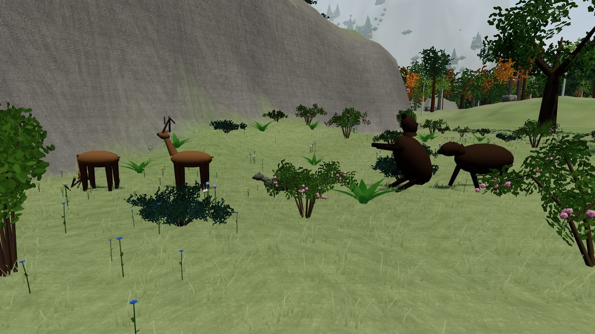 | 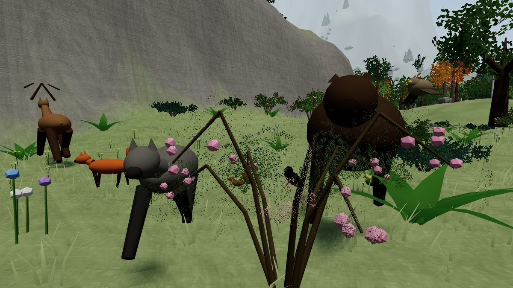 |

| ซาก หมาป่ากิน หมีจับปลา กวางกินน้ำ (คลาวด์) | ฝูงนกกิ้งโครงพลบค่ำ (คลาวด์) |
|---|---|
| 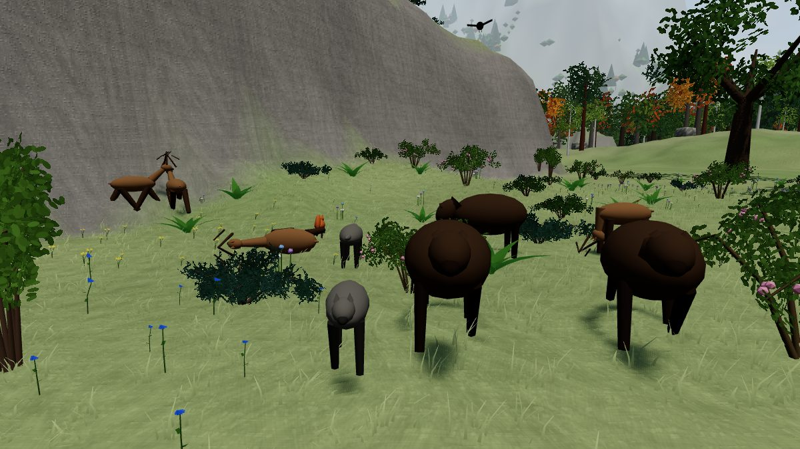 | 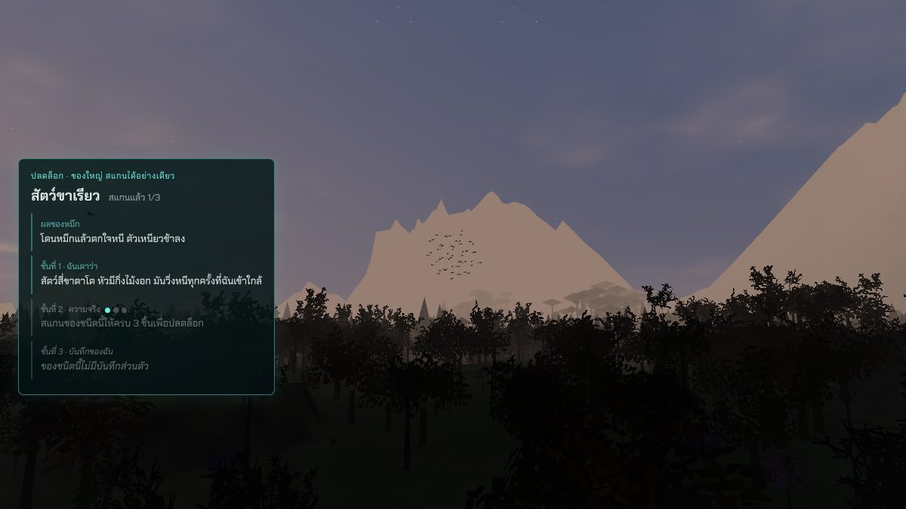 |

| การ์ดสแกนใต้ข้อความสั้น (คลาวด์) | ป้าย "ใหม่" ปกติ / ชี้ (คลาวด์) |
|---|---|
| 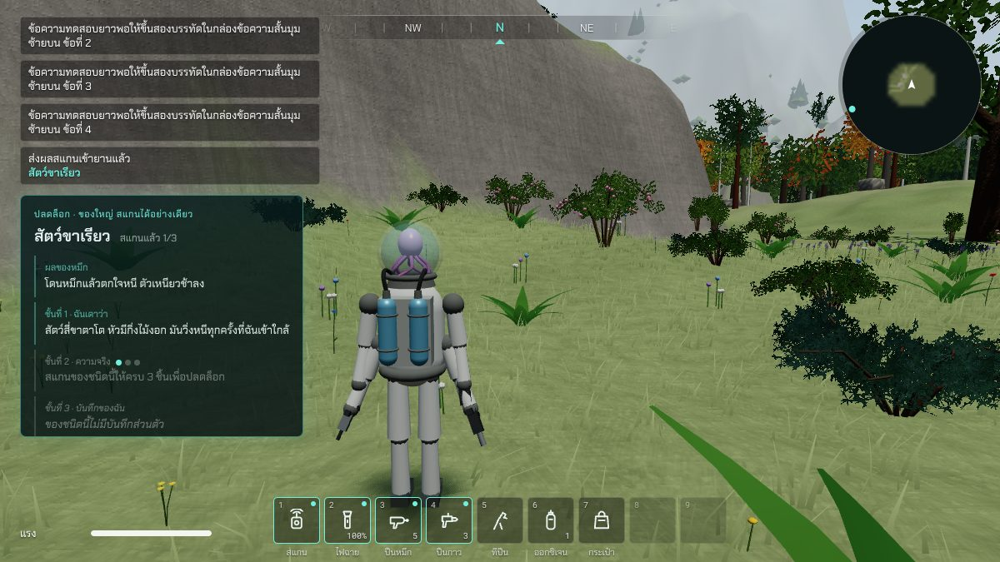 | 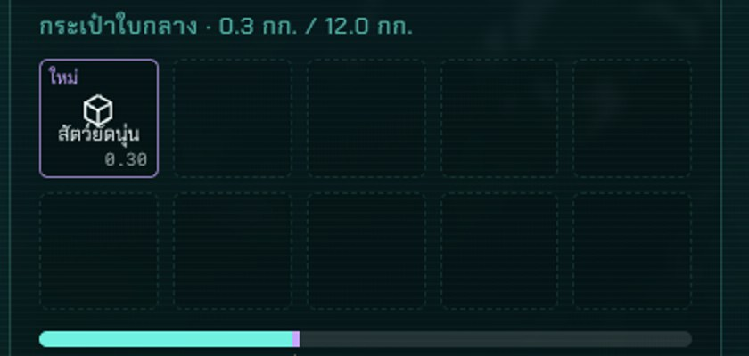 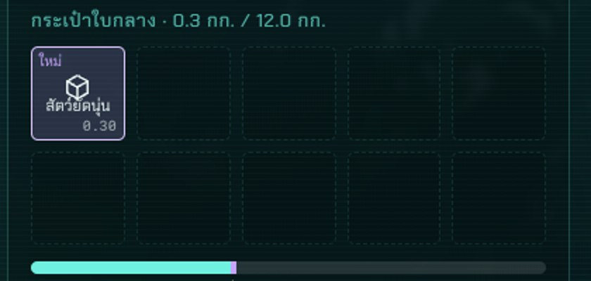 |

| ชื่อในช่องกระเป๋า ก่อนแก้ จอ 1200 (คลาวด์) | หลังแก้ จอ 1200 (คลาวด์) |
|---|---|
| 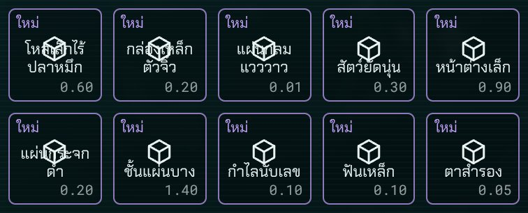 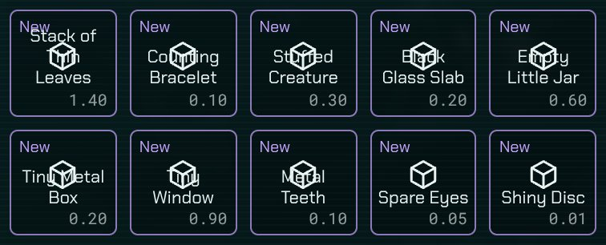 | 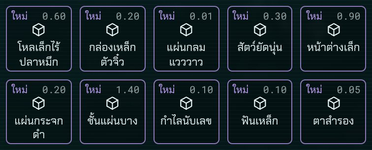 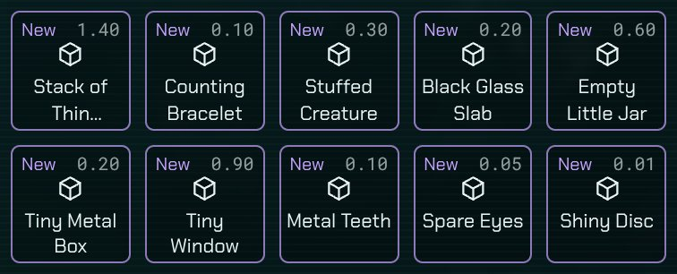 |
| ช่องกระเป๋าซ้อน หลังแก้ ไทย | อังกฤษ |
| 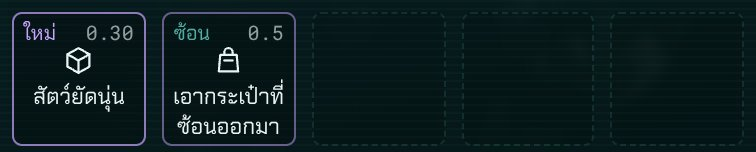 | 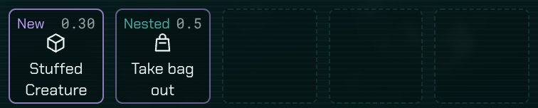 |

## บั๊กที่เจอ
| บั๊ก | สถานะ |
|---|---|
| หัวกวางจมอยู่ในลำตัว มองไม่เห็นหัว (ภาพคลาวด์ก่อนแก้) | แก้แล้ว คอเป็นท่อนยื่นจากไหล่ หัวอยู่ปลายคอ |
| ท่าก้มเล็มหญ้า ก้มกินน้ำ จับปลา หมุนคอกลับด้าน กลายเป็นเงยหน้า · หมียืนสองขากลายเป็นหัวทิ่มดิน | แก้แล้ว หมุนแกน x บวก = เงย ลบ = ก้ม |
| หมาป่าวิ่งเลยระยะตีไปทับตัวผู้เล่น (เทสจับได้ 0.59 ม.) | แก้แล้ว เบรกเร็วกว่าเร่ง |
| สัตว์หนีติดเนินชันริมขอบแมพ ยืนนิ่ง | แก้แล้ว ลองหันซ้ายขวาทีละมุมหาทางที่เดินได้ |
| หมาป่าไล่ทันกวางตอนหมดเวลาพอดี ล่าไม่เคยสำเร็จ | แก้แล้ว ย่องเข้าหาก่อนวิ่งไล่ ไล่ได้ 22 วินาที |
| นกกิ้งโครงบินลงเนินแล้วจมดิน 19 ซม. (เทสจับได้) | แก้แล้ว คิดพื้นที่จุดใหม่ |
| ที่ยืนจับปลาของหมีอยู่บนตลิ่งสูง 7 ม. ไม่ใช่ในน้ำ | แก้แล้ว เดินจากตีนน้ำตกลงไปถึงน้ำตื้น |
| ชื่อของในช่องกระเป๋า สระบนของ "สัตว์ยัดนุ่น" ชิดไอคอน (เห็นในภาพคลาวด์ มีมาก่อนช่วงนี้) · วัดต่อแล้วพบว่าชื่อสองบรรทัดทับไอคอนทุกช่อง เป็นส่วนหนึ่งของรายงานตรวจข้อ 40 ที่ยังไม่ได้แก้ | แก้แล้ว ชื่อมีที่ของตัวเองใต้ไอคอน (ทางแก้ในข้อ 5) |
| ปุ่มเอากระเป๋าซ้อนออก ฉบับอังกฤษ "Take nested bag out" ยาวเกินสองบรรทัด ถูกตัดเหลือ "Take nested ba…" | แก้แล้ว ย่อเป็น "Take bag out" (ป้ายมุมบนเขียน "Nested" อยู่แล้ว) |
| โครมไม่มีหน้าต่างบนคลาวด์ไม่เดินการเปลี่ยนสีแบบค่อยเป็นค่อยไปของปุ่ม วัดสีตอนชี้ได้ต้องปิดการเปลี่ยนสีชั่วคราว | ไม่ใช่บั๊กของเกม เป็นข้อจำกัดของเครื่องคลาวด์ |

## ต้องดูในโครมของพี่กัน (ยังไม่ได้ดูทุกข้อ)
- ฝูงกวางในทุ่งตอนเช้ามืดกับพลบค่ำ ตัวเงยหน้าระวังภัย · กลางวันเดินเข้าป่า
- หมาป่าย่องเข้าหาฝูงกวางแล้ววิ่งไล่ ล่าได้แล้วกินซาก อีกาลงมารุม
- หมียืนสองขากินลูกไม้ในป่าลึก · หมีจับปลาที่ตีนน้ำตกในหุบป่าดิบชื้น
- กระรอกวิ่งขึ้นต้นไม้ นั่งบนลำต้น ลงเอาหัวลง (กระรอกตัวเล็กมาก อาจต้องเดินเข้าใกล้)
- ฝูงนกกิ้งโครงตอนพลบค่ำ ลงหากินบนพื้นแล้วบินขึ้นพร้อมกัน · ผีเสื้อกับผึ้งในทุ่งดอกไม้
- สัตว์วิ่งชนต้นไม้แล้วหลบ ไม่วิ่งขึ้นหน้าผา ไม่เข้าตึก · สัตว์เกิดและหายนอกสายตาจริง
- สแกนต้นไม้ ดอกไม้ พุ่มไม้ หิน ปลา ทุกชนิดใหม่ ข้อความขึ้นสองภาษา · หน้าคอลเลกชันหมุนดูโมเดลชนิดใหม่
- สแกนของในตึกจากนอกตึกไม่ได้ สแกนของหลังเนินไม่ได้
- ป้าย "ใหม่" กับสีตอนชี้ในโครมจริง · การ์ดสแกนใต้ข้อความสั้น · ชื่อในช่องกระเป๋าไม่ทับไอคอน น้ำหนักอยู่มุมขวาบน
- ความลื่นบนเครื่องพี่กัน (การ์ดจอ Intel UHD 630) ตอนมีสัตว์เยอะ เช่นหุบน้ำตกพลบค่ำ 43 ตัว

## แคลร์ตัดสินเอง
- **เขตป่าลึกที่สองรอบน้ำตก** (รัศมี 150 ม.) ให้หมีลงจับปลาที่น้ำตกได้ตามแผน หมาป่าก็อยู่ในเขตนี้ด้วย · เขตแรกคือป่าทึบตะวันตกเดิม
- หมีในป่าลึกกินลูกโอ๊กกับนัทบีชจากต้นไม้ (ที่มา: หมีกินลูกโอ๊ก) หมีในหุบน้ำตกจับปลา
- นกฝูงเป็น **นกกิ้งโครง** (ฝูงใหญ่บินเป็นรูปร่างตอนพลบค่ำตามที่มา) · ผึ้งไม่ออกตอนฝนตก (ที่มาไม่ได้พูดเรื่องฝน แคลร์ตัดสินเอง ไม่ได้เขียนในข้อความสแกน)
- ล้มเหยื่อได้ราว 4 ใน 10 ครั้งที่ถึงตัว ไล่ได้ 22 วินาที ความเร็วตอนล่า 8 ม./วิ · ซากอยู่ราว 8 นาทีจริง
- ซากสแกนได้เป็นชนิดของสัตว์ตัวนั้น ไม่เพิ่มชนิด "ซาก" ในคอลเลกชัน (ล่าได้ไม่บ่อย คอลเลกชันจะไม่มีวันครบ)
- กุหลาบป่าเป็นชนิดเดียวทั้งดอกไม้และพุ่มไม้ (พืชเดียวกัน) · โรโดเดนดรอนใช้ชื่อไทย **กุหลาบพันปี**
- ชนิด "ปลา" เดิมแยกเป็นเทราต์กับปลาไน บันทึกเก่าที่เคยสแกน "ปลา" ไว้ ไม่ขึ้นในคอลเลกชันแล้ว ต้องสแกนเทราต์กับปลาไนใหม่
- **น้ำหนักในช่องกระเป๋าย้ายจากมุมขวาล่างขึ้นมุมขวาบน** เฉพาะช่องที่มีชื่อ (ของในกระเป๋า กระเป๋าซ้อน) ช่องเล็กสุด 67 พิกเซล ไม่มีที่พอให้ป้าย ไอคอน ชื่อสองบรรทัด และน้ำหนัก เรียงกันลงมาครบ · มอคอัปหน้า 5 ไม่มีชื่อในช่อง (ใช้ภาพแทนของแต่ละชิ้น ซึ่งเกมใช้ไม่ได้เพราะห้ามอีโมจิ) · ไอคอนเล็กลงจาก 22 เป็น 16.5 พิกเซลที่จอ 1200 · ช่องแขนในหน้ายานไม่มีชื่อ จึงคงแบบเดิม
- ชื่ออังกฤษที่ยาวเกินสองบรรทัด ตัดด้วย … (ตอนนี้มี "Stack of Thin Leaves" ชื่อเดียว เฉพาะจอแคบ 1200) ไม่ย่อคำ เพราะเป็นชื่อเอเลี่ยนที่ตั้งไว้แล้ว
- ฟังก์ชันวาดต้นไม้กับหินแบบเก่า (`treeGeometry` `rockGeometry` ใน `src/render/models/plants.ts`) ไม่มีที่ใช้แล้ว เก็บไว้ไม่ลบ

## รอพี่กันเคาะ
- เขตป่าลึกรอบน้ำตกมีหมาป่ากับหมี คนเดินเข้าหุบป่าดิบชื้นจะโดนไล่ ใช้ได้ไหม
- ความถี่การล่า (ตอนนี้หมาป่าหิวราวทุก 5 นาทีจริง ล่าสำเร็จราวครึ่งหนึ่ง) มากไปหรือน้อยไป
