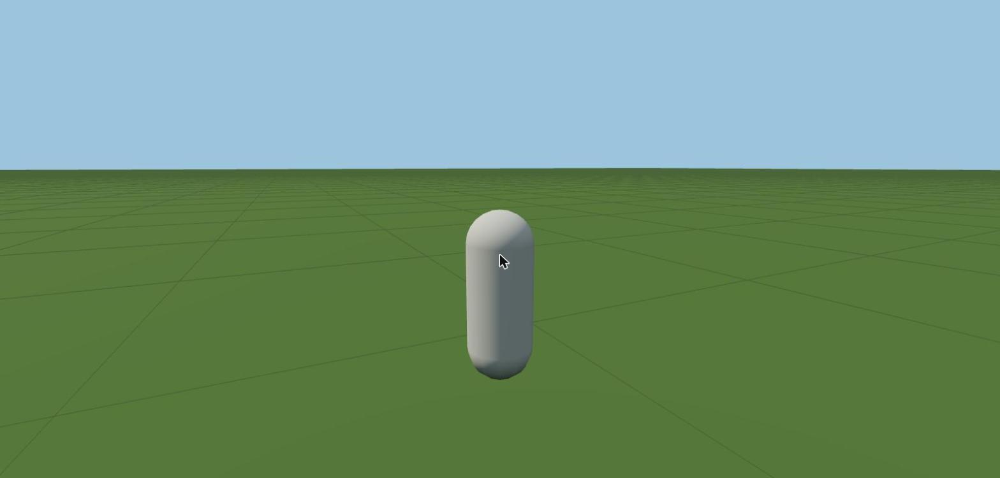

# ช่วง 0 · ตั้งโปรเจกต์ หุ่นเดินบนพื้นเรียบ

วันที่ 23 ต.ค. 2569 · ผล **ผ่าน**

## ทำอะไรไป
- ตั้งโปรเจกต์ TypeScript + three.js 0.186.1 + Vite 8 + Vitest ยกโครงจาก `demon-swarm-tower-defense`
- เพิ่มไลบรารี `three-mesh-bvh` (ไว้ใช้ชนกับเมืองและถ้ำในช่วง 8) · ฟอนต์ฝังในเว็บ Chakra Petch, Sarabun, Roboto Mono
- คัดลอกสกิลกลางเข้า `.claude/skills/`
- เขียน `CLAUDE.md` · `README.md` · `docs/ROADMAP.md` · เก็บแผนเป็น `docs/PLAN.md`
- เซิร์ฟเวอร์ทดสอบพอร์ต 3700 เปิดค้างในหน้าต่างแยก `remnant เซิร์ฟเวอร์ทดสอบ พอร์ต 3700` จากไฟล์ `C:\Users\PKH\dev-servers\remnant-3700.cmd`
- โค้ดตั้งต้น: รับปุ่ม (`app/Input.ts`) · ตัวละครเดิน วิ่ง กระโดด (`player/Player.ts`) · กล้องตามหลัง (`render/CameraRig.ts`) · ลูปหลัก (`app/App.ts`) · ค่าสมดุล (`config/game.ts`)
- ตัวตรวจกฎแบ่งชั้นโค้ด `tests/rules.test.ts`
- ตัวช่วยทดสอบ `__remnant.advance(วินาที)` เดินเวลาเกมเองทีละ 1/60 วินาที

## เล่นทดสอบ (ในโครม)
| ทดสอบ | ผล |
|---|---|
| กด W ค้าง 2 วินาที | เดินได้ 2.86 ม. (เดิน 1.5 ม./วิ หักช่วงออกตัว) ✅ |
| กด Shift + D ค้าง 2 วินาที | วิ่งได้ 8.02 ม. (วิ่ง 4.2 ม./วิ) ✅ |
| กดสเปซบาร์จริงบนคีย์บอร์ด | ลอยขึ้น 0.86 ม. แล้วตกกลับพื้น ✅ |
| คอนโซล | ไม่มีข้อผิดพลาด ✅ |
| typecheck · test · build | ผ่านทั้งหมด ✅ |

## บั๊กที่เจอ
| บั๊ก | สถานะ |
|---|---|
| โครมที่ถูกบังวาดภาพแค่ราว 2 ภาพต่อวินาที เดินทดสอบตามเวลาจริงไม่ได้ | แก้แล้ว ด้วยตัวช่วย `advance()` (ไม่ใช่บั๊กของเกม เป็นเรื่องหน้าต่างโครม) |
| คลิกจากเครื่องมือทดสอบไม่ล็อกเมาส์ไว้กลางจอ | ไม่ใช่บั๊ก เบราว์เซอร์ล็อกเมาส์ได้เฉพาะคลิกจากคนจริง · ทดสอบการหมุนกล้องด้วยการสั่งหมุนตรง |

## แคลร์ตัดสินเอง
- ความเร็วเดิน 1.5 ม./วิ · วิ่ง 4.2 ม./วิ · ความสูงกระโดด ราว 1 ม. (อิงคนจริง)
- ฟอนต์ ใช้ Chakra Petch เป็นหลักตามมอคอัป แทน Sarabun ที่เป็นฐานของเว็บงาน เพราะเป็นเกม
- จุดเริ่มเกม ห่างกลางแมพไปทางตะวันตกเฉียงใต้ (ปรับตอนวางแมพจริงในช่วง 1)

## รอพี่กันเคาะ
- ไม่มี
