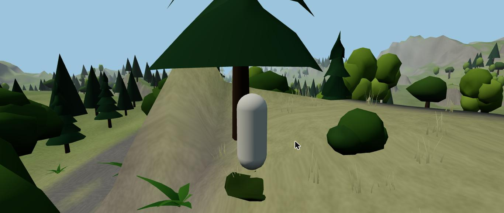
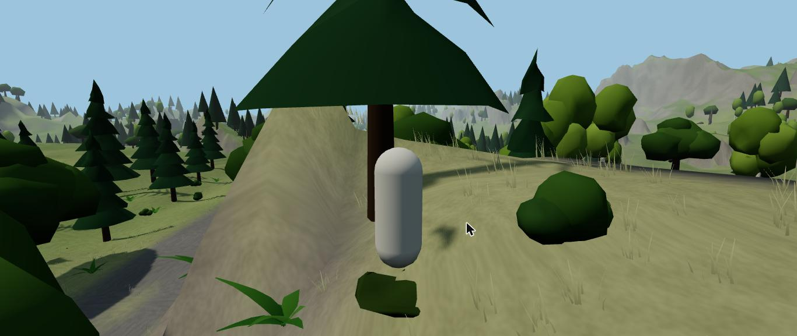
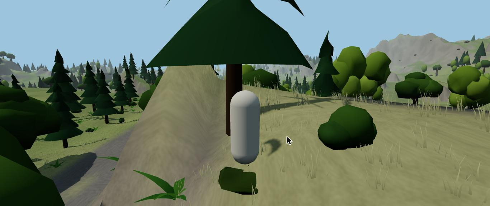
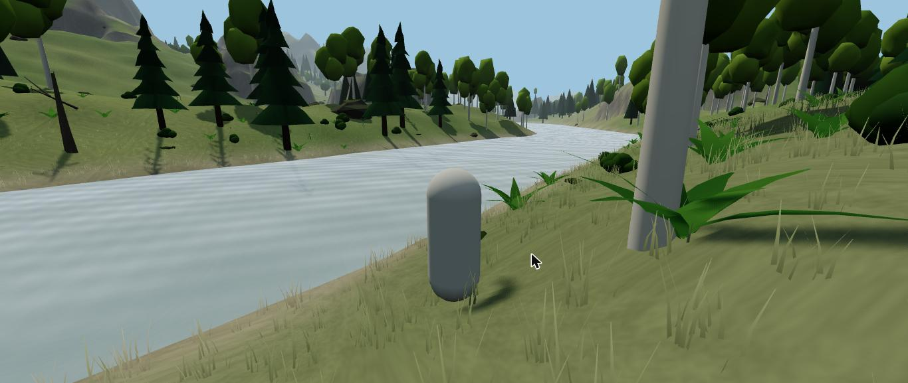
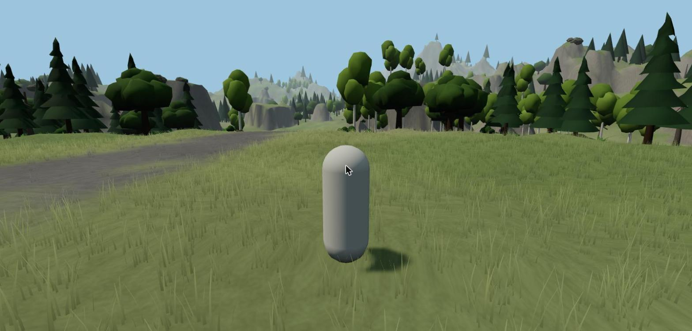

# ช่วง 1 · ภูมิประเทศ ต้นไม้ หญ้าพริ้ว ระดับภาพ

วันที่ 23 ต.ค. 2569 · ผล **ผ่าน** (มีเรื่องรอพี่กันเคาะ 1 ข้อเรื่องความเร็วบนเครื่องนี้)

## ทำอะไรไป
- **ผังโลก** `src/world/layout.ts` วางจุดสำคัญเอง: ที่จอดยาน (ตะวันตกเฉียงใต้) · เมืองในหุบเขา (กลางแมพ) · แม่น้ำไหลจากเขาทิศเหนือผ่านข้างเมืองลงทะเลสาบ (ตะวันออกเฉียงใต้) · ถนนเก่าจากยานเข้าเมืองข้ามแม่น้ำ · จุดสะพาน · ถ้ำ 2 แห่ง · ป่าลึก (ตะวันตกเฉียงเหนือ)
- **ภูมิประเทศ** `src/world/Terrain.ts` คำนวณครั้งเดียวตอนเปิดเกม (ราว 0.5 วินาที) แมพเดิมทุกครั้ง
  - ภูเขาล้อมสามด้าน เหนือ ตะวันออก ตะวันตก · ทางใต้เป็นเนินเตี้ย
  - **ที่ราบสูงขอบเป็นหน้าผา** กระจายบนเนิน ไว้ปีนขึ้นไปดูวิว (ช่วง 3 ทำการปีน)
  - หุบเขาที่ตั้งเมืองราบ · ที่จอดยานราบ · ถนนปาดเรียบ · ร่องแม่น้ำกับแอ่งทะเลสาบต่ำกว่าระดับน้ำ
- **พื้นดิน** `src/render/TerrainMesh.ts` แบ่งแผ่น 100 × 100 ม. ใกล้ละเอียด 2 ม. ไกลหยาบ 5 ม. · สีพื้นตามความสูง ความชัน ริมน้ำ ถนนยางมะตอยแตกมีหญ้าแทรก ลานคอนกรีตในเมือง · ภาพรายละเอียดพื้นผิวสร้างเอง ไม่โหลดไฟล์
- **น้ำ** `src/render/Water.ts` ผิวน้ำเป็นคลื่น สะท้อนฟ้าและแดด
- **ต้นไม้ 4 ชนิด** สน โอ๊ก เบิร์ช ต้นไม้ตาย ราว 5,300 ต้นทั้งแมพ · ใกล้ใช้แบบละเอียด ไกลใช้แบบหยาบ · **ไหวตามลม**
- **หิน** ราว 2,100 ก้อน มอสขึ้นด้านบน มากบนเนินชันกับภูเขา
- **พืชเล็ก** เฟิร์น ดอกไม้ป่าหลายสี พุ่มไม้ เห็ด มอส · ในป่าทึบเป็นเฟิร์นกับเห็ด ที่โล่งเป็นดอกไม้
- **หญ้าพริ้วไหว** `src/render/Grass.ts` กอละ 9 ใบ ไหวตามลมมีจังหวะลมกระโชก สีหญ้าตามพื้นตรงนั้น ล็อกกับพิกัดโลก เดินไปมาหญ้าต้นเดิมอยู่ที่เดิม
- **ระดับภาพ ต่ำ กลาง สูง** `src/config/quality.ts` ต่างกันที่ เงา ความแน่นหญ้า ระยะหญ้า ระยะต้นไม้ละเอียด ระยะพื้นละเอียด · ค่าเริ่มต้นกลาง
- **ลมกลาง** `src/render/wind.ts` ใช้ร่วมกันทั้งหญ้า ใบไม้ พืชเล็ก

## เล่นทดสอบ (ในโครม)
| ทดสอบ | ผล |
|---|---|
| เปิดเกม สร้างโลก | 505 มิลลิวินาที ✅ |
| วิ่งค้าง 90 วินาที | ไป 378 ม. ตัวละครไม่จมพื้น ค่าตำแหน่งไม่พัง 0 จุด ✅ |
| เวลาวาดภาพจริงบนการ์ดจอ (Intel UHD 630) 4 จุด ที่จอดยาน ป่าลึก เมือง ริมเขาเหนือ | ต่ำ 8 ถึง 11 มิลลิวินาที · กลาง 26 ถึง 32 · สูง 18 ถึง 30 (ค่าแกว่งเพราะการ์ดจอเร่งความเร็วไม่คงที่) |
| เปลี่ยนระดับภาพ 3 ระดับ | ภาพต่างกันชัด เงาหายตอนต่ำ หญ้าแน่นขึ้นตอนสูง ✅ |
| คอนโซล | ไม่มีข้อผิดพลาด ✅ |
| typecheck · test (23 ข้อ) · build | ผ่าน ✅ |

| ต่ำ | กลาง | สูง |
|---|---|---|
|  |  |  |

## บั๊กที่เจอ
| บั๊ก | สถานะ |
|---|---|
| หญ้าด้านหลังใบเป็นสีดำ (แสงกลับด้าน) | แก้แล้ว ใบบางสองหน้าใช้แสงด้านเดียวกัน ภาพก่อนแก้ `00-first-try-black-grass.jpg` |
| เนินแหลมเป็นกรวยกระจายทั่วแมพ ไม่เป็นธรรมชาติ | แก้แล้ว เปลี่ยนเป็นที่ราบสูงขอบหน้าผา |
| หินลอยบนภูเขาไกล (พื้นไกลหยาบกว่าพื้นใกล้) | แก้แล้ว หินวาดเฉพาะในระยะพื้นละเอียด และพื้นไกลละเอียดขึ้นเป็น 5 ม. |
| ต้นไม้เป็นเหลี่ยมเกินไป | แก้แล้ว รวมจุดซ้ำให้แสงเงานุ่ม |
| ก้านดอกไม้ดำ | แก้แล้ว |
| น้ำขาวเหมือนพลาสติก | แก้แล้ว ลดการสะท้อนฟ้า |
| ระดับกลางวาดภาพละ 34 มิลลิวินาทีในครั้งแรก | ลดเหลือราว 26 ด้วยวัสดุแบบเบา ลดใบหญ้า ลดขนาดเงา ลดระยะต้นไม้ละเอียด |
| ตัวละครเดินขึ้นภูเขาชันได้ทุกที่ | ยังค้าง → ช่วง 3 ทำความชันที่เดินได้กับการปีน |
| กล้องจมเข้าไปในต้นไม้ | ยังค้าง → ช่วง 3 ทำกล้องไม่ทะลุ |

## แคลร์ตัดสินเอง
- ตำแหน่งทุกจุดในผังโลก (ยาน เมือง แม่น้ำ ทะเลสาบ ถนน ถ้ำ ป่าลึก)
- ต้นไม้เพิ่มชนิด **ต้นไม้ตาย** ราว 5% ให้เข้ากับโลกล่มสลาย
- หน้าตาต้นไม้ยังเป็นทรงเหลี่ยมนุ่ม ๆ (ปั้นด้วยโค้ด) ระดับ "กึ่งสมจริงพอประมาณ"
- **เมนูเลือกระดับภาพบนจอ ย้ายไปทำในช่วง 11** พร้อมหน้าตั้งค่า (ตอนนี้ระบบเปลี่ยนระดับใช้ได้แล้ว แค่ยังไม่มีปุ่มบนจอ)
- ค่าระยะทุกตัวในระดับภาพ

## รอพี่กันเคาะ
- **เครื่องนี้ใช้การ์ดจอในตัว Intel UHD 630** ระดับกลาง (ค่าเริ่มต้นที่เคาะไว้) ได้ราว 35 ถึง 40 ภาพต่อวินาที ระดับต่ำได้เกิน 60 · จะให้ค่าเริ่มต้นยังเป็นกลางตามเดิม หรือให้เกมดูการ์ดจอแล้วเลือกต่ำให้เองบนเครื่องที่การ์ดจอในตัว
