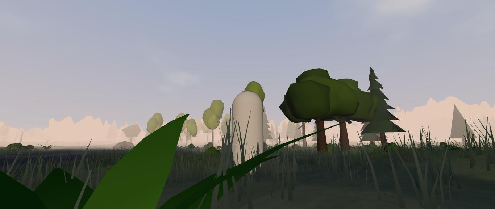
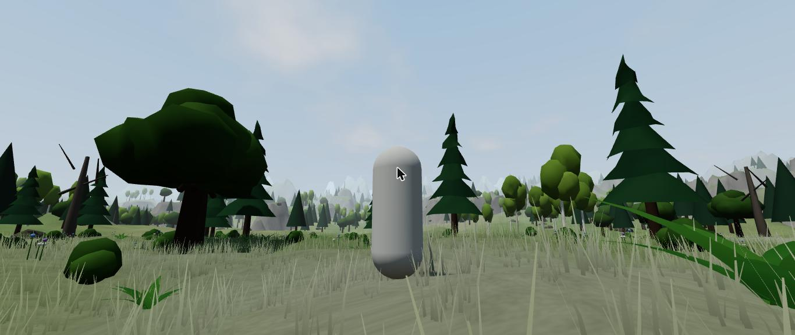
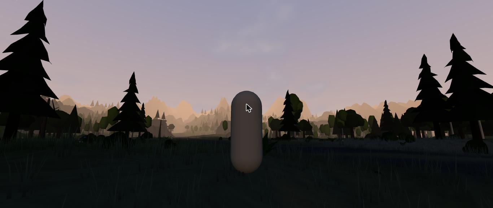
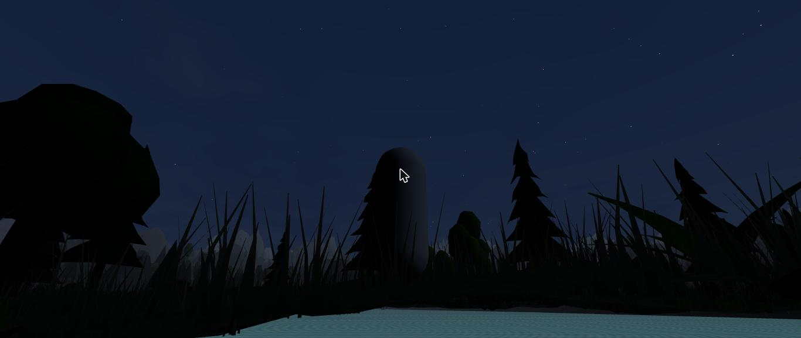
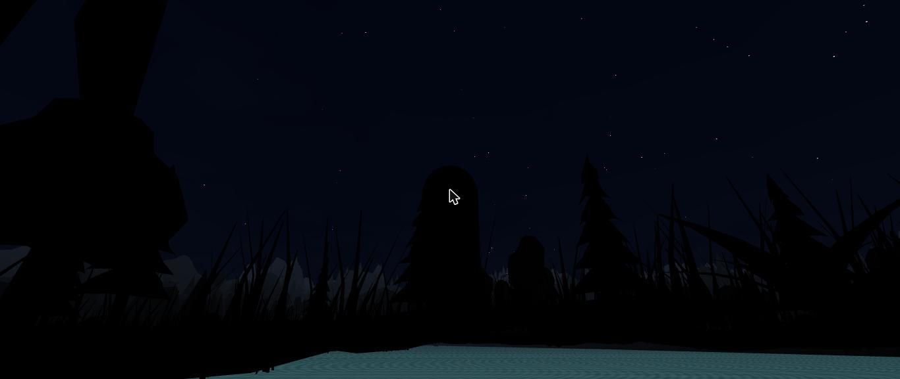

# ช่วง 2 · ท้องฟ้า กลางวันกลางคืน

วันที่ 23 ต.ค. 2569 · ผล **ผ่าน**

## ทำอะไรไป
- **เวลาในเกม** `src/core/time.ts` (กติกาล้วน มีเทส 6 ข้อ)
  - หนึ่งวันเต็ม 24 นาที · เปิดเกมใหม่เริ่ม 07:00
  - ดวงอาทิตย์ขึ้นทางตะวันออก ตกทางตะวันตก ทางเดินเอียงไปทางใต้
  - **ดวงจันทร์ข้างขึ้นข้างแรม** ครบรอบทุก 8 วันในเกม · เต็มดวงขึ้นตอนดวงอาทิตย์ตก เดือนมืดไม่มีแสงจันทร์
  - หมอกหนาที่สุดราว 06:20 จางหายก่อน 09:00
- **ท้องฟ้า** `src/render/Sky.ts`
  - สีฟ้าไล่ระดับตามเวลา กลางวัน ช่วงพระอาทิตย์ขึ้นตกเป็นสีส้มชมพู กลางคืนน้ำเงินเข้มเกือบดำ
  - ดวงอาทิตย์มีแสงฟุ้ง · ดวงจันทร์มีเงาข้างขึ้นข้างแรม · ดาวกะพริบ ชัดขึ้นเมื่อฟ้ามืด
  - **เมฆ** ลอยไปตามลม สีเปลี่ยนตามแสง
- **แสง**
  - กลางวันแสงหลักคือดวงอาทิตย์ สีอุ่นตอนเช้าเย็น
  - **กลางคืนมืดจริง** แสงหลักเปลี่ยนเป็นแสงจันทร์สีฟ้าเงิน แรงตามข้างขึ้นข้างแรม · คืนเดือนมืดเกือบดำสนิท
  - หมอกในฉากเปลี่ยนสีตามขอบฟ้า หนาขึ้นตอนเช้า
  - น้ำสะท้อนสีฟ้าและแสงแดด แสงจันทร์ มืดตามเวลา
- ตัวช่วยทดสอบ `__remnant.setClock(ชั่วโมง, วันที่)`

## เล่นทดสอบ (ในโครม)
| ทดสอบ | ผล |
|---|---|
| 06:24 หมอกเช้า | หมอกอุ่นสีส้มจาง ภูเขาไกลจางหาย ✅ |
| 13:00 กลางวัน | ฟ้าใส มีเมฆ เงาต้นไม้ชัด ✅ |
| 18:00 พระอาทิตย์ตก | ขอบฟ้าส้ม ต้นไม้เป็นเงาดำ ✅ |
| 23:30 คืนวันที่ 4 (ใกล้เต็มดวง) | ฟ้าน้ำเงิน ดาว แสงจันทร์พอเห็นทาง ✅ |
| 23:30 คืนวันที่ 8 (ใกล้เดือนมืด) | มืดเกือบสนิท เห็นแค่ดาว ✅ |
| หันกล้องหาดวงจันทร์ 3 คืน | ดวงจันทร์มีแสงฟุ้ง ข้างแรมเห็นเงาข้างหนึ่ง ✅ |
| typecheck · test (29 ข้อ) · build | ผ่าน ✅ |

| หมอกเช้า | กลางวัน | พระอาทิตย์ตก |
|---|---|---|
|  |  |  |

| คืนเดือนสว่าง | คืนเดือนมืด |
|---|---|
|  |  |

## บั๊กที่เจอ
| บั๊ก | สถานะ |
|---|---|
| ช่วงพระอาทิตย์ตกมืดเกินไป เกือบดำทั้งจอ | แก้แล้ว ให้แสงยังพอตอนดวงอาทิตย์ต่ำ ภาพก่อนแก้ `00-first-try-sunset-too-dark.jpg` |
| น้ำเรืองแสงสีฟ้าตอนกลางคืน | แก้แล้ว น้ำมืดตามความสว่างของฟ้า |
| กล้องที่หันหาตัวละครบังดวงจันทร์ตอนเงยมอง | ไม่ใช่บั๊ก · ช่วง 3 กล้องเยื้องไหล่ ตัวละครจะไม่อยู่กลางจอ |

## แคลร์ตัดสินเอง
- หนึ่งวัน 24 นาที · เปิดเกมใหม่เริ่ม 07:00 · ข้างขึ้นข้างแรมครบรอบ 8 วัน (ตามที่เสนอไว้ในสัมภาษณ์)
- ดวงจันทร์วาดใหญ่กว่าของจริงราว 3 เท่า ให้เห็นข้างขึ้นข้างแรมชัด
- กลางคืนเดือนมืดไม่ดำสนิท 100% ยังเห็นเงาต้นไม้กับดาวนิดหน่อย

## รอพี่กันเคาะ
- ไม่มี
