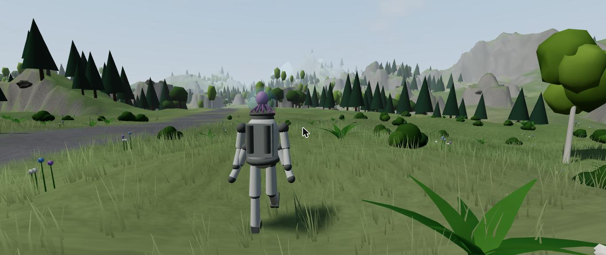
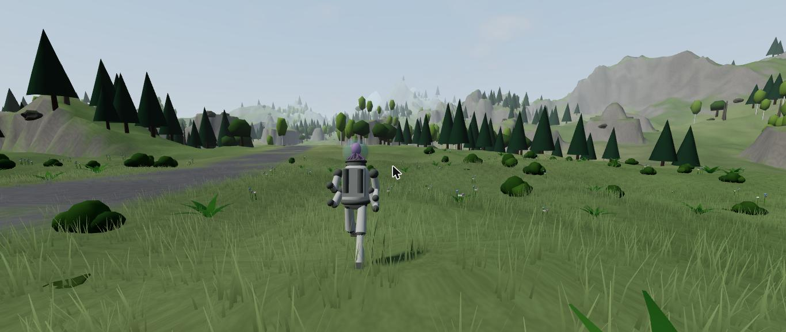
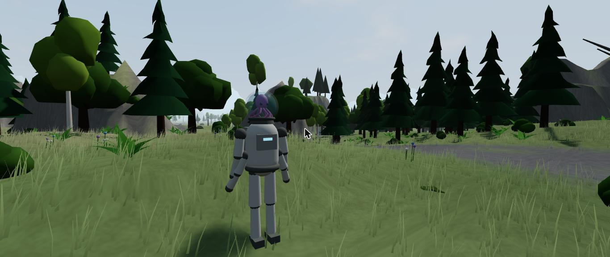
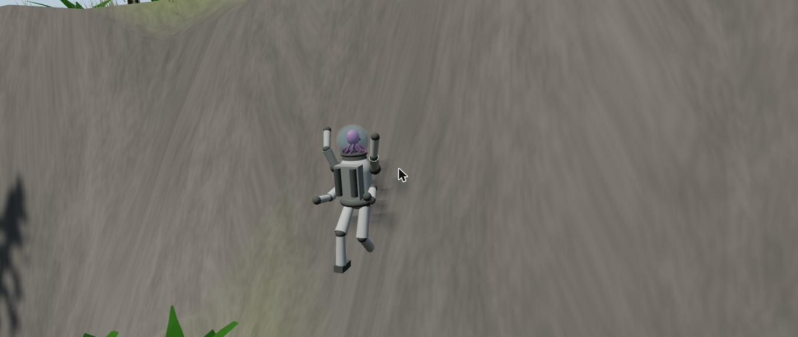
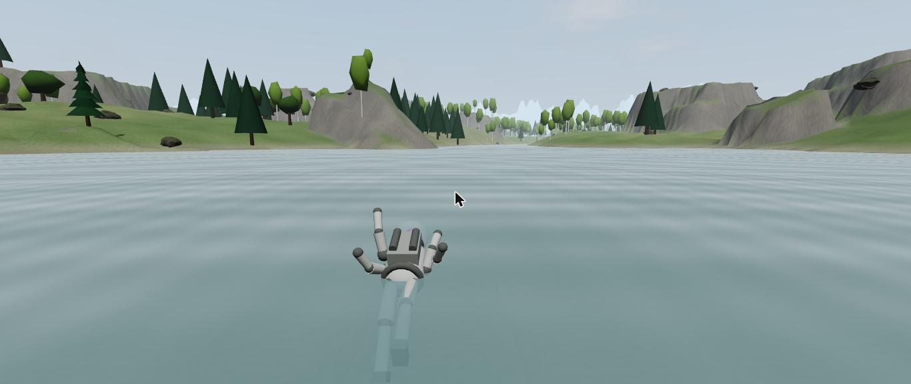
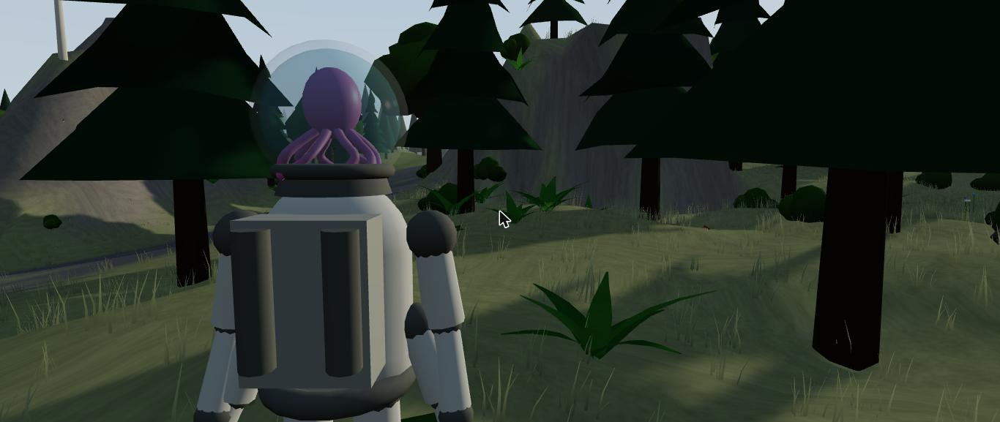
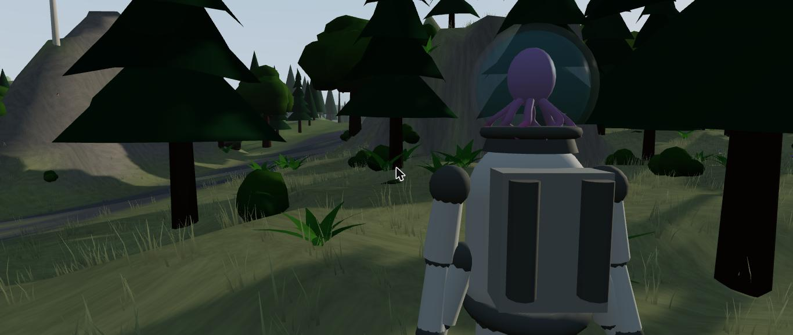

# ช่วง 3 · ตัวละคร การเคลื่อนที่ กล้องแบบ RDR2

วันที่ 23 ต.ค. 2569 · ผล **ผ่าน** · 🔔 ส่งภาพให้พี่กันดูแล้ว (ทำต่อทันที ไม่รอ)

## ทำอะไรไป
- **ตัวละคร** `src/render/models/hero.ts` ปั้นด้วยโค้ด
  - ชุดอวกาศสีขาวหม่น **4 แขน** (คู่บนที่ไหล่ คู่ล่างข้างเอว) ไฟสีฟ้าที่หน้าอก กระเป๋าหลังมีถังเครื่องกรอง
  - หัวเป็น **โหลแก้วมีน้ำ ปลาหมึกสีชมพูอมม่วง** ตา 2 ข้าง หนวด 8 เส้นไหวในน้ำตลอด ลอยขึ้นลงเบา ๆ
  - ท่าขยับด้วยโค้ด: ยืนหายใจ · เดิน · วิ่ง (โน้มตัว) · กระโดดและลอยกลางอากาศ · **ว่ายน้ำ** (นอนราบ แขน 4 ข้างพาย) · **ปีน** (แขนบนเอื้อมสลับ ขาถีบ)
- **การเคลื่อนที่** `src/player/Player.ts`
  - เดิน 1.5 ม./วิ วิ่ง 4.2 ม./วิ ลุยน้ำตื้นช้าลง
  - **เนินชันเกิน 44 องศาเดินขึ้นไม่ได้** ต้องปีน
  - **ปีน** ได้เฉพาะตอนถือที่ปีนป่าย ปีนตามผิวผนัง W ขึ้น S ลง A D เลียบผนัง สเปซกระโดดออก ถึงยอดแล้วขึ้นไปยืนเอง
  - **หลุดจากผนัง** (แรงหมด หรือปล่อยที่ปีนป่าย) แล้วไถลตกลงตามหน้าผาจนถึงพื้นราบ **จดความสูงที่ตก** ไว้ให้ช่วง 7 คิดโหลร้าว
  - **ว่ายน้ำ** น้ำลึกเกิน 1.3 ม. · ตัวนอนราบ โหลแก้วโผล่พ้นน้ำ · **แรงหมดตอนว่าย = ค่อย ๆ จม** หัวจมน้ำแล้วจดไว้ให้ช่วง 7 คิดออกซิเจน
  - ชนลำต้นไม้กับก้อนหิน (ราว 7,400 ชิ้น) `src/world/colliders.ts`
- **แรง** `src/core/stamina.ts` คิดตามการออกแรงคนจริง (เทส 5 ข้อ)
  - เดินราบไม่เหนื่อย · เดินขึ้นเนินเหนื่อยตามความชัน · วิ่งหมดแรงราว 14 วินาที · ว่ายน้ำ · ปีนหนักที่สุด · กระโดดครั้งละ 8
  - แบกของหนักเหนื่อยไวขึ้น (ช่วง 6 ผูกกับน้ำหนักกระเป๋าจริง)
  - หมดแรงแล้ววิ่งกับกระโดดไม่ได้จนฟื้นถึง 25 · หยุดพักแล้วฟื้นเร็วกว่าเดิน
- **กล้องแบบ Red Dead Redemption 2** `src/render/CameraRig.ts`
  - ตามหลัง **เยื้องไหล่ขวา ตัวละครค่อนซ้าย** · ตามแบบหน่วงนุ่ม
  - ปล่อยเมาส์นาน 1.6 วินาทีแล้วเดินต่อ กล้องค่อย ๆ หมุนกลับไปข้างหลัง
  - **วิ่งแล้วถอยห่าง มุมภาพกว้างขึ้น** (58 → 65 องศา)
  - **เล็งหรือสแกน ซูมชิดไหล่** (มุมภาพ 46 องศา) · **กด V สลับไหล่**
  - **ไม่ทะลุพื้น ลำต้นไม้ ก้อนหิน** ชิดแล้วขยับเข้าใกล้ตัว
  - **ใบไม้ที่ชิดกล้องจางหายเป็นจุด ๆ** กล้องไม่จมในพุ่มไม้
  - **โยกตามจังหวะก้าว** เดินเบา วิ่งแรงขึ้น
  - ตอนว่ายกับตอนปีนถอยห่างขึ้นให้เห็นรอบตัว

## เล่นทดสอบ (ในโครม)
| ทดสอบ | ผล |
|---|---|
| เดิน W | 1.5 ม./วิ ท่าเดินแกว่งแขน ✅ |
| วิ่ง Shift + W 2 วินาที | 4.2 ม./วิ มุมภาพ 65 แรงเหลือ 82 ✅ |
| ไม่ถือที่ปีนป่าย เดินเข้าหน้าผา | ติดอยู่ที่ตีนผา ขึ้นไม่ได้ ✅ |
| ถือที่ปีนป่าย เดินเข้าหน้าผา | เริ่มปีน ปีนถึงยอด ขึ้นไปยืนได้ แรงลดระหว่างปีน ✅ |
| แรงหมดกลางหน้าผาสูง 64 ม. | หลุด ไถลลงไป 1.7 วินาที **จดความสูงที่ตกได้ 15.5 ม.** ✅ |
| เดินลงทะเลสาบ | เปลี่ยนเป็นว่าย ตัวนอนราบ โหลแก้วโผล่พ้นน้ำ ✅ |
| แรงหมดกลางทะเลสาบ | ค่อย ๆ จม หัวจมน้ำ ✅ |
| เล็ง | ซูมชิดไหล่ขวา มุมภาพ 47 ✅ |
| **กดปุ่ม V จริงบนคีย์บอร์ด** | สลับไปไหล่ซ้าย ตัวละครย้ายไปฝั่งขวาของจอ ✅ |
| typecheck · test (39 ข้อ) · build | ผ่าน ✅ |

| เดิน | วิ่ง | ด้านหน้า |
|---|---|---|
|  |  |  |

| ปีน 4 แขน | ว่ายน้ำ | เล็งไหล่ขวา | เล็งไหล่ซ้าย |
|---|---|---|---|
|  |  |  |  |

## บั๊กที่เจอ
| บั๊ก | สถานะ |
|---|---|
| ระหว่างปีนกล้องจมเข้าไปในพุ่มใบไม้ มืดทั้งจอ | แก้แล้ว ใบไม้ชิดกล้องจางหาย ภาพก่อนแก้ `00-bug-camera-in-bush.jpg` |
| เริ่มปีนแล้วหลุดทันทีตอนแตะผนัง | แก้แล้ว |
| แรงหมดตอนปีนแล้วตัวค้างอยู่บนผนังชัน ไม่ตกลงมา | แก้แล้ว เพิ่มการไถลตกจนถึงพื้นราบ |
| ว่ายน้ำตัวจมทั้งตัว โหลแก้วไม่โผล่ | แก้แล้ว |
| หมดแรงตอนว่ายแล้วจมช้ามากจนแทบไม่จม | แก้แล้ว จม 0.45 ม./วิ |
| หน้าต่างโครมที่ถูกบังวาดภาพช้า ทดสอบตามเวลาจริงไม่ได้ | ทดสอบด้วย `advance()` เดินเวลาเองทีละ 1/60 วินาที เหมือนเล่นจริงทุกเฟรม |
| ก้อนหินที่ตีนหน้าผาบางแห่งกันไม่ให้เดินถึงผนัง | ไม่แก้ เป็นสิ่งกีดขวางจริง เดินอ้อมได้ |

## แคลร์ตัดสินเอง
- **ปุ่ม V สลับไหล่กล้อง** (ไม่ได้อยู่ในรายการปุ่มที่เคาะไว้)
- **เล็งหรือซูมชิดไหล่จะเกิดเองตอนใช้เครื่องสแกนหรือปืน** (ช่วง 5) ไม่มีปุ่มเล็งแยก เพราะคลิกขวาเป็นปุ่มของแขนบนซ้ายแล้ว
- ความชันที่เดินได้สูงสุด 44 องศา · น้ำลึกเกิน 1.3 ม. ต้องว่าย
- ค่าแรงทุกตัว: วิ่ง 7 ต่อวิ ว่าย 4.5 ปีน 10 กระโดด 8 พักฟื้น 14 ต่อวิ เดินฟื้น 7 ต่อวิ
- ตัวละครเป็นทรงหุ่นเรียบ ๆ ปั้นด้วยโค้ด ยังไม่ใช่เอเลี่ยนจริง (เรื่องค้างในเอกสารออกแบบ)
- ตอนนี้ตั้งให้ถือที่ปีนป่ายอยู่ตลอด ช่วง 5 จะผูกกับอุปกรณ์จริง

## รอพี่กันเคาะ
- ปุ่มสลับไหล่กล้องใช้ V ได้ไหม
