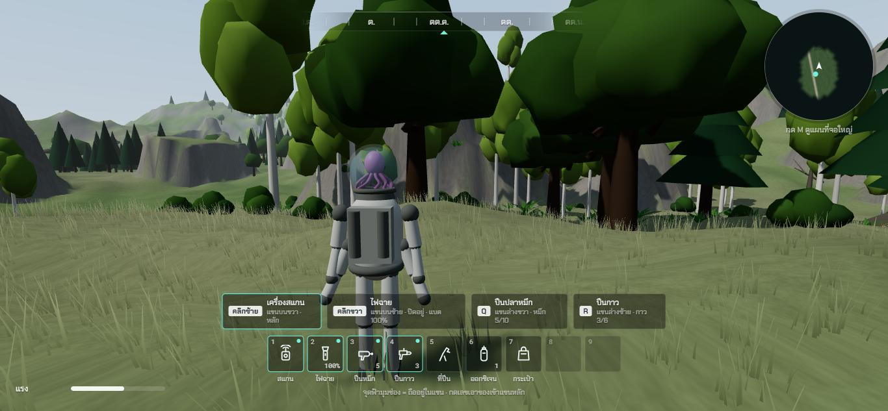
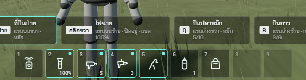
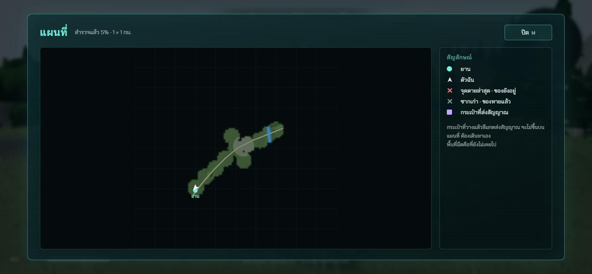

# ช่วง 4 · ส่วนบนจอ มินิแมพ แผนที่จอใหญ่

วันที่ 23 ต.ค. 2569 · ผล **ผ่าน**

## ทำอะไรไป
- **ส่วนบนจอ** `src/ui/Hud.ts` + `src/styles/hud.css` หน้าตาตามมอคอัปหน้า 2 และ 3
  - **เข็มทิศ** กลางบน ทิศที่กล้องหันอยู่ตรงกลาง ทิศเหนือสีฟ้า
  - **มินิแมพ** ขวาบน หมุนตามกล้อง เปิดเฉพาะที่เคยเดิน (เดินผ่านแล้วเปิดรอบตัว 40 ม.) มีจุดยาน ลูกศรตัวฉัน
  - **แถบแรง** ซ้ายล่าง เหลือน้อยเป็นสีส้ม หมดแรงเป็นสีแดง
  - **แถบออกซิเจน** กับ **แถบแบตไฟฉาย** โผล่เฉพาะตอนลดหรือตอนเปิดไฟฉาย (ช่วง 5 และ 7 ผูกค่าจริง)
  - **ช่อง 4 แขน** บอกปุ่ม คลิกซ้าย คลิกขวา Q R ชื่อของที่ถือ แขนไหน แขนหลักมีขอบสีฟ้า
  - **แถบล่าง 9 ช่อง** ไอคอนวาดด้วยเส้น ตัวเลขช่อง จำนวนหมึก กาว ถัง แบต จุดฟ้ามุมช่อง = ถืออยู่ในแขน
  - ข้อความสั้นมุมซ้ายบน · ป้ายกดปุ่มกลางจอ · เป้าเล็งตอนเล็ง
- **แผนที่จอใหญ่** `src/ui/BigMap.ts` กด M เปิดปิด เกมหยุดระหว่างดูแผนที่ · สัญลักษณ์ ยาน ตัวฉัน จุดตาย ซากเก่า กระเป๋า · บอกเปอร์เซ็นต์ที่สำรวจแล้ว
- **ภาพแผนที่** `src/ui/MapImage.ts` วาดจากความสูงพื้นครั้งเดียว แรเงาภูเขา น้ำ ถนน แม่น้ำ เมือง
- **แผนที่ที่เคยเดินผ่าน** `src/core/explore.ts` (เทส 2 ข้อ) บันทึกเก็บได้
- **อุปกรณ์กับ 4 แขน** `src/core/gear.ts` (เทส 4 ข้อ) แพ็กเกจเริ่มต้น น้ำหนักทุกชิ้น กดเลขเอาของเข้าแขนหลัก แขนอื่นถืออยู่สลับกัน
- **ข้อความสองภาษา** `src/ui/strings.ts` ไทยกับอังกฤษครบทุกคำในส่วนนี้
- ที่ปีนป่ายผูกกับอุปกรณ์จริงแล้ว ปีนได้เฉพาะตอนแขนข้างไหนถือที่ปีนป่าย

## เล่นทดสอบ (ในโครม)
| ทดสอบ | ผล |
|---|---|
| วิ่งออกจากยาน 9 วินาที | มินิแมพเปิดเป็นทางตามที่วิ่ง แรงลดเหลือ 56 แถบสั้นลง ✅ |
| **กดเลข 5 จริงบนคีย์บอร์ด** | ที่ปีนป่ายเข้าแขนหลัก (คลิกซ้าย) เครื่องสแกนออกจากแขน จุดฟ้าย้ายไปช่อง 5 ✅ |
| **กด M จริงบนคีย์บอร์ด** | แผนที่จอใหญ่เปิด เห็นทางที่เดินไป ถนน แม่น้ำ เมือง ยาน ลูกศรตัวฉัน ✅ |
| **คลิกปุ่ม ปิด จริงด้วยเมาส์** | แผนที่ปิด ✅ |
| typecheck · test (53 ข้อ) · build | ผ่าน ✅ |

## บั๊กที่เจอ
| บั๊ก | สถานะ |
|---|---|
| แผนที่จอใหญ่ถูกยืดและตัดขอบล่าง | แก้แล้ว ภาพก่อนแก้ `00-bug-big-map-cropped.jpg` |
| เน็ตหลุดกลางทาง โครมต่อไม่ติดชั่วคราว | ต่อใหม่ได้ ทดสอบต่อจนครบ |

## แคลร์ตัดสินเอง
- มินิแมพหมุนตามกล้อง (แบบ RDR2) ทิศข้างหน้าอยู่ด้านบนเสมอ · รัศมี 120 ม.
- เดินผ่านแล้วเปิดแผนที่รอบตัว 40 ม.
- เปิดแผนที่จอใหญ่แล้วเกมหยุดเดินเวลา
- ไอคอนอุปกรณ์วาดด้วยเส้นทั้งหมด ไม่ใช้อีโมจิ (กฎ ไอคอนที่เป็นตัวอักษรพิเศษเครื่องอื่นอาจเห็นเป็นกล่อง)

## รอพี่กันเคาะ
- ไม่มี
