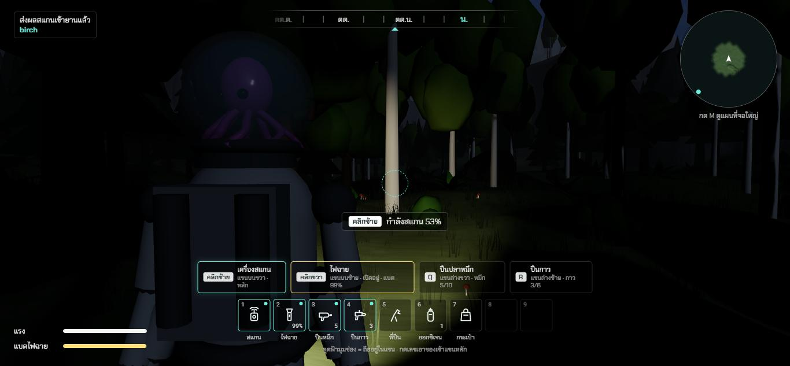

# ช่วง 5 · อุปกรณ์กับ 4 แขน

วันที่ 23 ต.ค. 2569 · ผล **ผ่าน**

## ทำอะไรไป
- **ใช้อุปกรณ์ด้วย 4 แขน** `src/app/Tools.ts` · แขนบนขวา = คลิกซ้าย · แขนบนซ้าย = คลิกขวา · แขนล่างขวา = Q · แขนล่างซ้าย = R · ใช้พร้อมกันได้
- **เครื่องสแกน** กดค้างเล็งของที่อยากสแกน 1.3 วินาที กล้องซูมชิดไหล่ มีเป้าเล็งกลางจอ ป้ายบอก "กำลังสแกน 53%" · **ปลาหมึกหันมองของที่สแกน** · ตอนนี้สแกนต้นไม้กับหินได้ (ช่วง 6 เพิ่มของมนุษย์ ช่วง 9 เพิ่มสัตว์)
- **ไฟฉาย** กดเปิดปิด ส่องไปทางที่ตัวละครหัน · **แบตลดตอนเปิด** หมดภายใน 4 นาที · **ชาร์จแดด** เต็มภายใน 3 นาที ชาร์จได้ทั้งตอนถือและตอนเก็บ · แบตหมดเปิดไม่ได้ มีข้อความบอก · แถบแบตโผล่เฉพาะตอนเปิด
- **ปืนปลาหมึก** กดยิง กดค้างยิงต่อเนื่อง ก้อนหมึกโค้งตามแรงโน้มถ่วง ตกพื้นเป็นรอยหมึกดำ จางหายใน 25 วินาที · หมึกหมดมีข้อความบอก (ช่วง 9 ผูกผลกับสัตว์)
- **ปืนกาว** กดอุดรอยร้าว ไม่มีรอยร้าวไม่เสียกาว มีข้อความบอก (ช่วง 7 ผูกกับโหลร้าว)
- **ถังออกซิเจน** กดเติมโหล ออกซิเจนเต็มอยู่แล้วไม่เสียถัง (ช่วง 7 ผูกกับออกซิเจนจริง)
- **ที่ปีนป่าย** ถือแล้วปีนได้ (ผูกไว้ตั้งแต่ช่วง 4)
- **กระเป๋า** กดแล้วบอกให้กด Tab (ช่วง 6 ทำหน้ากระเป๋า)
- **ลูกกลิ้งเมาส์** เลื่อนของในแขนหลักไปช่องถัดไปที่ไม่ว่าง
- **โมเดลอุปกรณ์ในมือ** `src/render/models/tools.ts` ถืออะไรเห็นในมือข้างนั้น
- ข้อความการใช้อุปกรณ์ครบสองภาษา

## เล่นทดสอบ (ในโครม)
| ทดสอบ | ผล |
|---|---|
| กลางคืน 22:30 กดคลิกขวา (ไฟฉาย) | ไฟเปิด ส่องป่ามืดเห็นทาง แบต 99% แถบแบตโผล่ ✅ |
| กดคลิกซ้ายค้าง (เครื่องสแกน) ระหว่างไฟฉายเปิด | **ใช้ 2 แขนพร้อมกันได้** เล็งต้นเบิร์ช สแกน 53% ระหว่างทาง สแกนเสร็จส่งเข้ายาน ✅ |
| กด Q ค้าง 1.2 วินาที (ปืนปลาหมึก) | ยิง 4 นัด หมึก 5 → 1 รอยหมึก 4 จุด ✅ |
| กด R (ปืนกาว) | ข้อความ "โหลไม่มีรอยร้าว" กาวไม่ลด ✅ |
| กดเลข 6 แล้วคลิกซ้าย (ถังออกซิเจน) | ข้อความ "ออกซิเจนในโหลเต็มอยู่แล้ว" ถังไม่ลด ✅ |
| ไฟฉายปิด แบต 20% ยืนกลางแดดเที่ยง 30 วินาที | ชาร์จขึ้นเป็น 36.7% ✅ |
| แบต 20% กลางคืน 30 วินาที | ไม่ชาร์จ 20% เท่าเดิม ✅ |
| แบต 0% กดเปิดไฟฉาย | เปิดไม่ได้ ข้อความ "แบตไฟฉายหมด รอแดดชาร์จ" ✅ |
| typecheck · test · build | ผ่าน ✅ |

## บั๊กที่เจอ
| บั๊ก | สถานะ |
|---|---|
| ชื่อฟังก์ชันปุ่มชนกันในตัวรับปุ่ม ตรวจชนิดข้อมูลไม่ผ่าน | แก้แล้ว |
| สแกนเสร็จขึ้นชื่อชนิดเป็นภาษาอังกฤษ (birch) | ยังค้าง → ช่วง 6 ทำชื่อกับข้อความสแกน 3 ชั้นสองภาษา |

## แคลร์ตัดสินเอง
- สแกนใช้เวลา 1.3 วินาที ระยะสแกน 28 ม.
- ไฟฉายหมดใน 4 นาที ชาร์จแดดเต็มใน 3 นาที
- ปืนปลาหมึกยิงได้ราว 3 นัดต่อวินาที หมึกหนึ่งนัดหนัก 0.05 กก.
- ก้อนหมึกแบบโค้งตกตามแรงโน้มถ่วง ระยะยิงไกลราว 20 ถึง 30 ม.

## รอพี่กันเคาะ
- ไม่มี
