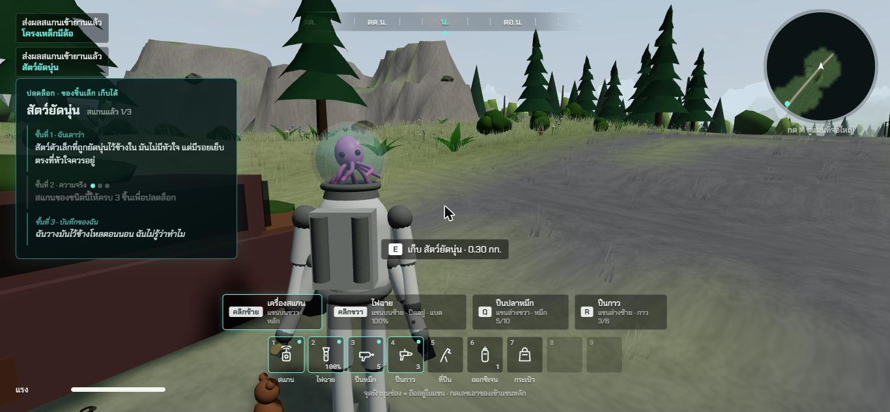
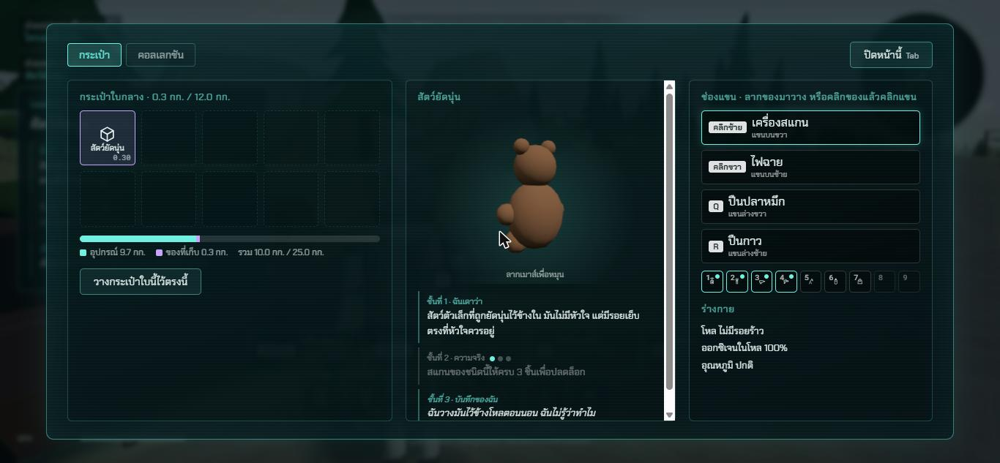
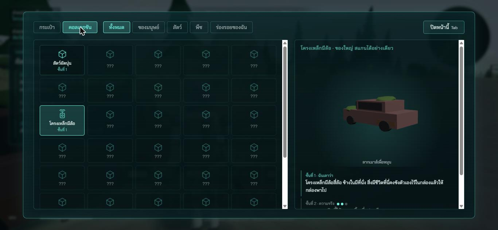
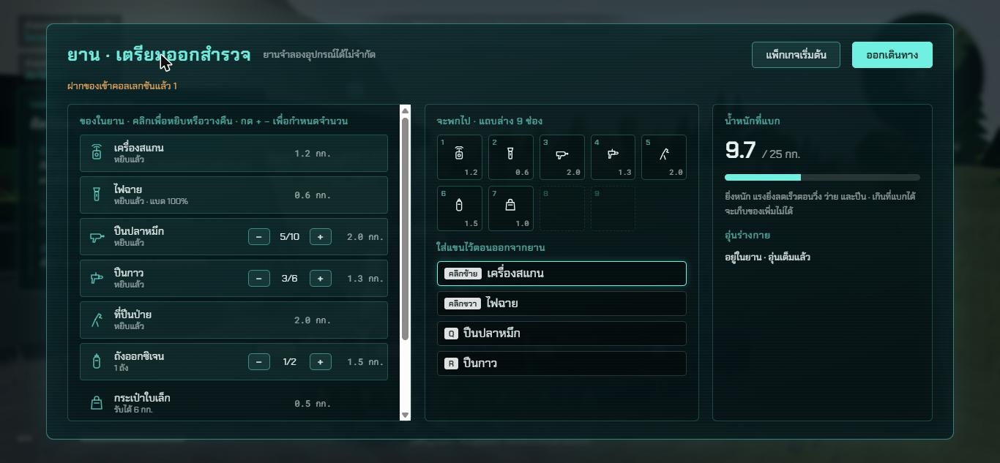

# ช่วง 6 · ของในโลก สแกน 3 ชั้น กระเป๋า น้ำหนัก ยาน คอลเลกชัน

วันที่ 23 ต.ค. 2569 · ผล **ผ่าน**

## ทำอะไรไป
- **รายการของ 41 ชนิด** `src/core/catalog.ts` ของมนุษย์ชิ้นเล็ก 10 · ของมนุษย์ชิ้นใหญ่ 8 · สัตว์ 12 · พืช 10 · ซากร่างของตัวเอง 1
  - ทุกชนิดมี **ชื่อจริง · ชื่อที่เอเลี่ยนตั้งเอง · ชั้นเดา · ชั้นความจริง** ครบสองภาษา · 8 ชนิดมี **บันทึกส่วนตัว**
  - ชั้นความจริงเขียนเป็นข้อเท็จจริงทั่วไป **ไม่ใส่ตัวเลขที่ไม่มีแหล่งอ้างอิง** (เช่น ตัดตัวเลขจำนวนรถในโลกที่เคยเขียนในตัวอย่างออก)
- **สแกน 3 ชั้น** `src/core/scanlog.ts`
  - ชั้น 1 เดา ได้ตอนสแกนครั้งแรก · ชั้น 2 ความจริง ได้ตอนสแกนชนิดเดียวกันครบ 3 ชิ้น (ชิ้นเดิมซ้ำไม่นับ) · ชั้น 3 บันทึกส่วนตัว ได้ตอนสแกนชิ้นพิเศษ **ไม่ข้ามชั้นความจริง**
  - **ชื่อบนจอเปลี่ยนตามที่รู้** ยังไม่รู้ความจริงขึ้นชื่อที่เอเลี่ยนตั้ง เช่น "สัตว์ยัดนุ่น" "โครงเหล็กมีล้อ" รู้แล้วขึ้น "ตุ๊กตาหมี" "รถยนต์"
  - **การ์ดผลสแกน** โผล่ซ้ายจอ 9 วินาที บอกชั้นที่ปลดล็อก จุดนับ 3 ชิ้น
- **ของในโลก** `src/world/props.ts` + `src/render/Props.ts` + `src/render/models/props.ts`
  - รถร้าง 8 คันตามถนน (สนิม ยางแบน มอสขึ้น) · รถบัสในเมือง · เสาไฟ 12 ต้น · ตู้ไปรษณีย์ 3 ตู้ · **ป้ายถนนภาษาอังกฤษ 7 ป้าย** บางป้ายชี้ผิดทาง
  - ของชิ้นเล็กราว 60 ชิ้น ข้างรถ ในเมือง ตามทาง · ชิ้นพิเศษ: ตุ๊กตาข้างรถคันที่ 3 · รถคันที่ 3 · ตู้ไปรษณีย์ใบแรก · โทรศัพท์และกรอบรูปในเมือง
  - **ยาน** ทรงยานลงจอดสามขา มีไฟรอบตัว ทางลาด จอดที่จุดเกิด
- **กระเป๋าและน้ำหนัก** `src/core/inventory.ts`
  - กด E เก็บของชิ้นเล็ก ป้ายบอกชื่อกับน้ำหนัก · ใส่กระเป๋าใบแรกที่ยังรับได้ เต็มแล้วถือในช่องว่างของแถบล่าง · **แบกไม่ไหวเก็บไม่ได้** ข้อความบอกให้กลับยาน
  - **น้ำหนักรวมเป็นกิโลกรัม** อุปกรณ์ + กระเป๋า + ของข้างใน · แบกได้ = ชุดอวกาศ 13 กก. + ความจุกระเป๋า · **น้ำหนักทำให้แรงลดเร็วขึ้นจริงแล้ว**
  - **ใส่กระเป๋าซ้อนกระเป๋า** และเอากระเป๋าที่ซ้อนออกมาได้
  - **วางกระเป๋าไว้ในโลก** กด E หยิบคืน กด G ส่งสัญญาณ ส่งแล้วไฟสีม่วงกะพริบและขึ้นบนแผนที่ ลืมกดไม่ขึ้นแผนที่
- **หน้ากระเป๋า** (Tab หรือ I) เกมหยุดระหว่างเปิด · ของในกระเป๋า · โมเดลหมุนได้ ลากเมาส์หมุน · ข้อความสแกน 3 ชั้น · แถบน้ำหนักแยกสีอุปกรณ์กับของที่เก็บ · ปุ่มวางกระเป๋า ใส่ซ้อน · **ช่องแขน ลากของจากแถบไปวาง หรือคลิกของแล้วคลิกแขน** · สภาพร่างกาย (ช่วง 7 ผูกค่าจริง)
- **หน้าคอลเลกชัน** ของที่ยังไม่เจอเป็น ??? · กรองหมวด ทั้งหมด ของมนุษย์ สัตว์ พืช ร่องรอยของฉัน · กดดูโมเดลหมุนกับข้อความ 3 ชั้น · บอกจำนวนที่อยู่ในยาน
- **หน้ายาน** (เดินเข้าใกล้ยานแล้วกด E) **ฝากของที่เก็บมาเข้าคอลเลกชันอัตโนมัติ** · เลือกของที่จะพก กดหยิบหรือวางคืน ปุ่ม + − กำหนดหมึก กาว ถัง · กระเป๋า 3 ขนาด · แถบล่าง 9 ช่องเต็มแล้วบอก · ช่องแขนตอนออกจากยาน · น้ำหนักที่แบก · **ปุ่มแพ็กเกจเริ่มต้น** · ปุ่มออกเดินทาง

## เล่นทดสอบ (ในโครม)
| ทดสอบ | ผล |
|---|---|
| สแกนรถ 3 คัน | คันหนึ่งเล็งแล้วไปโดนตุ๊กตาที่อยู่ใกล้กว่าแทน นับรถได้ 2 ชิ้น ชั้นความจริงยังล็อก ✅ (ถูกตามกติกา) |
| สแกนตุ๊กตาชิ้นพิเศษ | ชั้น 1 ขึ้น · ชั้น 3 บันทึกส่วนตัวปลดล็อก · **ชั้น 2 ยังล็อก ต้องสแกนให้ครบ 3 ชิ้น** ✅ |
| เดินไปใกล้ตุ๊กตา | ป้าย "E เก็บ สัตว์ยัดนุ่น · 0.30 กก." ✅ |
| **กด E จริงบนคีย์บอร์ด** | ตุ๊กตาหายจากพื้น เข้ากระเป๋าใบกลาง ✅ |
| **กด Tab จริงบนคีย์บอร์ด** | หน้ากระเป๋าเปิด ตุ๊กตาหมุนอยู่ น้ำหนักรวม 10.0 / 25.0 กก. ✅ |
| **คลิกแท็บคอลเลกชันจริงด้วยเมาส์** | เห็นตุ๊กตากับรถ ที่เหลือเป็น ??? รถหมุนได้ จุดนับ 2 จาก 3 ✅ |
| เดินไปที่ยาน **กด E จริง** | หน้ายานเปิด ฝากตุ๊กตาเข้าคอลเลกชัน ข้อความ "ฝากของเข้าคอลเลกชันแล้ว 1" ✅ |
| **คลิกปุ่ม + ของหมึกจริง** · เลือกกระเป๋าใบเล็ก · **คลิกออกเดินทางจริง** | ออกจากยานพร้อมหมึก 6 นัด กระเป๋า 2 ใบ ✅ |
| วางกระเป๋าใบหนึ่งจากหน้ากระเป๋า · **กด G จริง** | กระเป๋าส่งสัญญาณ ขึ้นบนแผนที่ ✅ |
| **กด E จริง** ที่กระเป๋า | หยิบกลับมา กระเป๋าครบ 2 ใบ ✅ |
| typecheck · test (74 ข้อ) · build | ผ่าน ✅ |

| การ์ดผลสแกนกับป้ายเก็บของ | หน้ากระเป๋า |
|---|---|
|  |  |

| คอลเลกชัน | หน้ายาน |
|---|---|
|  |  |

## บั๊กที่เจอ
| บั๊ก | สถานะ |
|---|---|
| สแกนชิ้นพิเศษแล้วเปิดชั้นความจริงให้ทันที ข้ามกติกาครบ 3 ชิ้น | แก้แล้ว แยกชั้นความจริงกับบันทึกส่วนตัว ภาพก่อนแก้ `00-bug-special-skipped-truth.jpg` |
| คำสั่งยาวเกินที่เทอร์มินัลรับได้ | เปลี่ยนเป็นเขียนสคริปต์เป็นไฟล์ก่อนรัน |
| การ์ดผลสแกนทับข้อความสั้นมุมซ้ายบน | แก้แล้ว เลื่อนลงมา |
| ไอคอนในคอลเลกชันยังเป็นรูปกล่องเหมือนกันทุกชิ้น | ยังค้าง ไม่กระทบการเล่น กดดูโมเดลจริงได้ |

## แคลร์ตัดสินเอง
- **ปุ่ม G ส่งสัญญาณกระเป๋า** (ไม่ได้อยู่ในรายการปุ่มที่เคาะ พี่กันบอกแค่ "ต้องไปกดที่กระเป๋าให้ส่งสัญญาณ")
- **เข้ายานแล้วฝากของอัตโนมัติ** ไม่ต้องกดปุ่มฝาก
- **เปิดหน้ากระเป๋าหรือหน้ายานแล้วเกมหยุด**
- ชุดอวกาศแบกได้ 13 กก. ไม่รวมกระเป๋า · กระเป๋าเล็ก 6 กลาง 12 ใหญ่ 20 กก.
- น้ำหนักของชิ้นเล็กทุกชิ้น (ตุ๊กตา 0.3 หนังสือ 1.4 ขวด 0.6 กก. ฯลฯ)
- ข้อความสแกนทุกชั้นทุกชนิด (พี่กันให้แคลร์เสนอ) และชื่อที่เอเลี่ยนตั้งเอง
- จำนวนและตำแหน่งของทุกชิ้น · ข้อความบนป้ายถนน
- ซ้ายมือในหน้ายานยกเลิกการหยิบได้ด้วยการคลิกซ้ำ

## รอพี่กันเคาะ
- ปุ่ม G ส่งสัญญาณกระเป๋า ใช้ได้ไหม
- ข้อความสแกนที่แคลร์เขียน พี่กันอ่านแล้วอยากแก้ตรงไหน (อยู่ใน `src/core/catalog.ts`)
