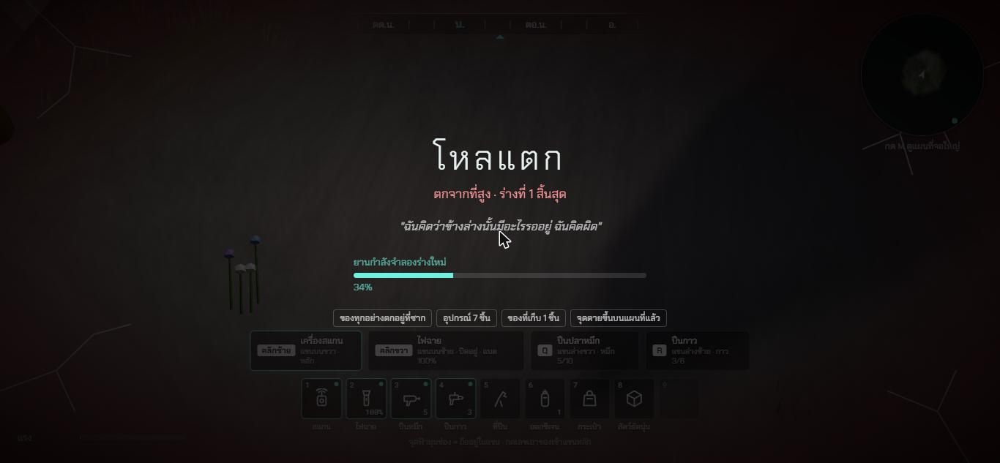
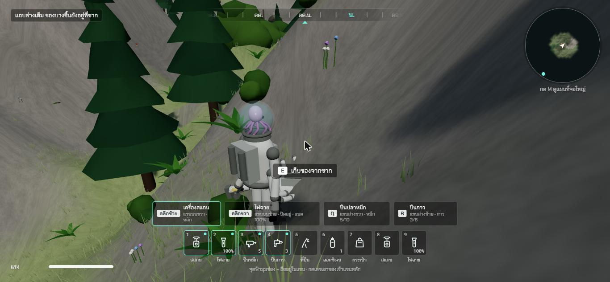
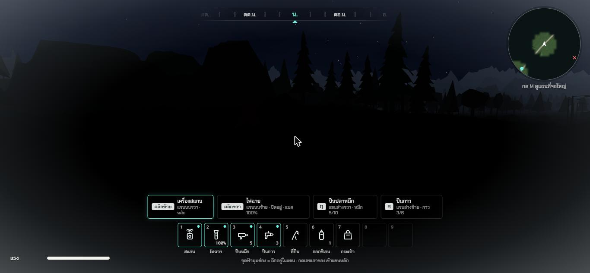
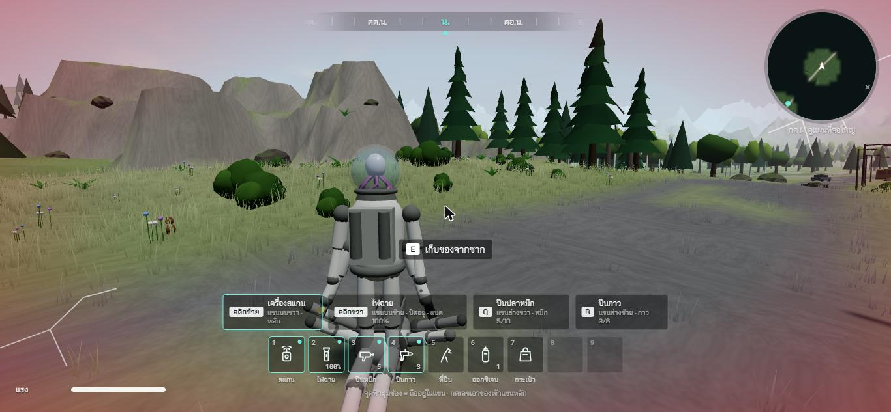

# ช่วง 7 · ร่างกาย ความตาย ซาก ร่างใหม่

วันที่ 23 ต.ค. 2569 · ผล **ผ่าน** (มีเรื่องรอพี่กันเคาะ 1 ข้อ)

## ทำอะไรไป
- **ร่างกาย** `src/core/body.ts` (เทส 7 ข้อ)
  - **ออกซิเจนในโหล** ลดเฉพาะตอนหัวจมน้ำหรืออยู่ในก๊าซพิษ หมดใน 45 วินาที · ขึ้นที่โล่งเติมเต็มใน 8 วินาที · โหลร้าวรั่วเร็วขึ้นนิดหน่อย · แถบออกซิเจนโผล่เฉพาะตอนลด
  - **ตกจากที่สูง** ต่ำกว่า 5 ม. ไม่เป็นไร · 5 ถึง 10 ม. ร้าว 1 จุด · 10 ถึง 15 ม. ร้าว 2 จุด · 15 ม. ขึ้นไปโหลแตก
  - **โหลร้าว 4 จุดแล้วแตก** · สัตว์ดุทำร้ายครั้งละ 1 จุด (ช่วง 9 ผูกกับสัตว์จริง)
  - **ความหนาว** กลางคืนหนาว ความอุ่นลดลง หนาวตายภายในราว 3 นาทีถ้าไม่อุ่น · ใกล้ยานอุ่นเต็มใน 20 วินาที (ช่วง 8 เพิ่มใต้หลังคาตึก)
- **ปืนกาวอุดรอยร้าวได้จริง** · **ถังออกซิเจนเติมโหลได้จริง** (ผูกกับร่างกายแล้ว)
- **ภาพบนจอ** `src/ui/BodyFx.ts`
  - ขอบจอแดงตามรอยร้าว แดงวาบตอนเพิ่งเจ็บ · **เส้นร้าวที่มุมจอ** เพิ่มตามจำนวนรอย
  - **น้ำแข็งเกาะขอบจอ** ลามเข้ามาตามความหนาว
  - **ปลาหมึกในโหลซีดลง** ตามรอยร้าวและออกซิเจน
- **ตาย 5 แบบ** ตกที่สูง · จมน้ำ · ก๊าซพิษในถ้ำ · สัตว์ดุ · หนาว
- **หน้าตอนตาย** หัวข้อตามสาเหตุ (โหลแตก · ปลาหมึกขาดใจ · หนาวตาย) · สาเหตุ · ร่างที่เท่าไรสิ้นสุด · ประโยคของเอเลี่ยนตามสาเหตุ · **ยานกำลังจำลองร่างใหม่** มีแถบเปอร์เซ็นต์ · บอกจำนวนอุปกรณ์และของที่ตกอยู่ที่ซาก
- **ของทุกอย่างตกอยู่ที่ซาก** รวมอุปกรณ์ · ยานจำลองร่างใหม่ที่จุดเกิด · **หน้ายานเปิดเองให้เลือกของ**
- **เดินกลับไปที่ซาก กด E เก็บของ** · เก็บของที่เก็บมากับกระเป๋าก่อน · อุปกรณ์ที่ยานให้ใหม่แล้วไม่เก็บซ้ำ · **หมึก กาว ถัง รวมเข้ากับของเดิม**
- **ตายซ้ำก่อนไปถึงซากเดิม** ซากเก่ายังอยู่ แต่ของที่ซากเก่าหายไป · ซากทุกร่าง **สแกนได้** ได้บันทึกส่วนตัว
- แผนที่ขึ้น **จุดตายล่าสุด (สีแดง)** กับ **ซากเก่า (สีเทา)**
- ข้อความทั้งหมดสองภาษา

## เล่นทดสอบ (ในโครม)
| ทดสอบ | ผล |
|---|---|
| **ตกจากหน้าผาสูง 64 ม.** (แรงหมดระหว่างปีน) | หลุด ไถลลง โหลแตก หน้าตอนตาย "โหลแตก · ตกจากที่สูง · ร่างที่ 1 สิ้นสุด" ✅ |
| รอยานจำลองร่างใหม่ | เกิดที่ยาน ร่างที่ 2 หน้ายานเปิดเอง ✅ |
| กดออกเดินทาง เดินไปที่ซาก **กด E จริง** | ป้าย "E เก็บของจากซาก" เก็บของคืนได้ ✅ |
| **จมน้ำ** แรงหมดกลางทะเลสาบ | จม แถบออกซิเจนโผล่ ตายใน 39.5 วินาที ✅ |
| **หนาว** 23:00 คืนเดือนมืด ห่างยาน | 60 วินาทีความอุ่นเหลือ 65% น้ำแข็งเกาะขอบจอ ตายรวมราว 163 วินาที ✅ |
| ตายครั้งที่ 2 ก่อนไปเก็บซากแรก | ซากแรกของหาย (เหลือ 0) ซากใหม่มีของ 7 ชิ้น ✅ |
| **สัตว์ทำร้าย** 2 ครั้ง | โหลร้าว 2 จุด ขอบจอแดง เส้นร้าวมุมจอ ปลาหมึกซีด ✅ |
| **กด R จริง (ปืนกาว)** | อุดรอยร้าว 2 → 1 ✅ |
| โดนอีก 3 ครั้ง | โหลแตก ตาย สาเหตุสัตว์ดุ ✅ |
| **ก๊าซพิษ** (จำลองอยู่ในถ้ำลึก ช่วง 8 ทำถ้ำจริง) | ตายใน 42 วินาที ✅ |
| แผนที่ | ยาน 1 · ซากเก่า 3 · จุดตายล่าสุด 1 ✅ |
| typecheck · test (84 ข้อ) · build | ผ่าน ✅ |

| หน้าตอนตาย | เก็บของจากซาก |
|---|---|
|  |  |

| หนาว น้ำแข็งเกาะขอบจอ | โหลร้าว ขอบจอแดง ปลาหมึกซีด |
|---|---|
|  |  |

## บั๊กที่เจอ
| บั๊ก | สถานะ |
|---|---|
| ระหว่างหน้าตอนตาย ยังเห็นแถบล่างของเก่าอยู่ข้างหลัง | แก้แล้ว ซ่อนส่วนบนจอระหว่างตาย |
| เก็บของจากซากแล้วแถบล่างเต็มด้วยอุปกรณ์ซ้ำ | แก้แล้ว ของสำคัญก่อน อุปกรณ์ซ้ำไม่เก็บ หมึก กาว ถังรวมกัน (เทสเพิ่ม 1 ข้อ) |

## แคลร์ตัดสินเอง
- ตัวเลขทุกตัว: ออกซิเจนหมด 45 วิ เติม 8 วิ · ตก 5 / 10 / 15 ม. · ร้าว 4 จุดแตก · หนาวตาย 170 วิ ตอนหนาวที่สุด · อุ่นใกล้ยาน 20 วิ
- ประโยคของเอเลี่ยนตอนตายแต่ละแบบ
- ยานจำลองร่างใหม่ใช้เวลา 6 วินาที
- เก็บของจากซาก อุปกรณ์ที่ยานให้ใหม่ไม่เก็บซ้ำ

## รอพี่กันเคาะ
- **กลางคืนในเกมยาวราว 9 นาที แต่หนาวตายภายในราว 3 นาที** ถ้าไม่อยู่ใกล้ยานหรือใต้หลังคา แปลว่าทุกคืนต้องหาที่หลบ (ใกล้ยาน ตึกในเมือง ถ้ำ) · ให้โหดแบบนี้ไว้ หรืออยากให้ช้าลง
