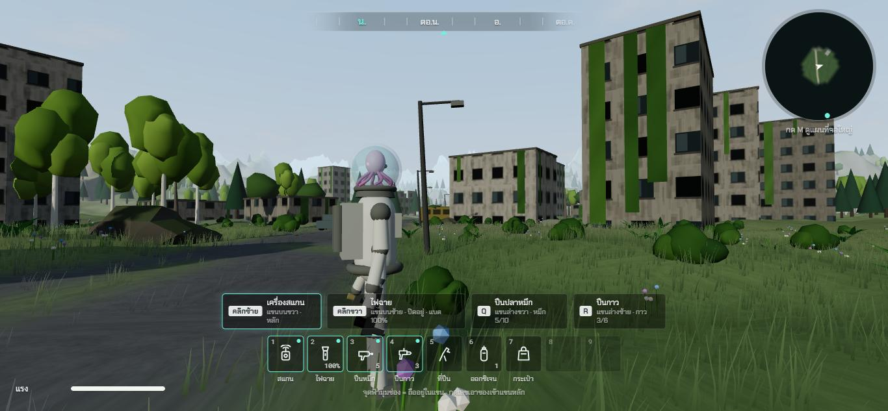
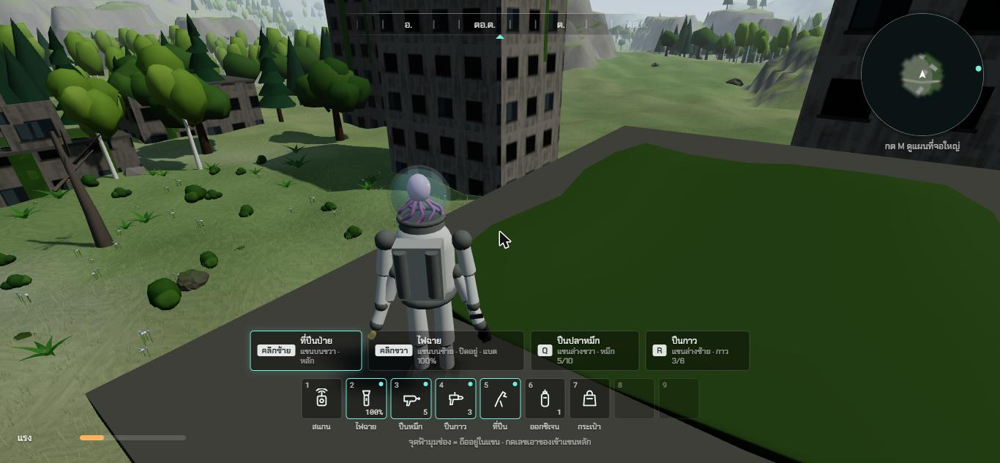
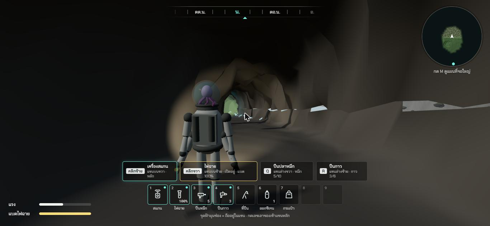
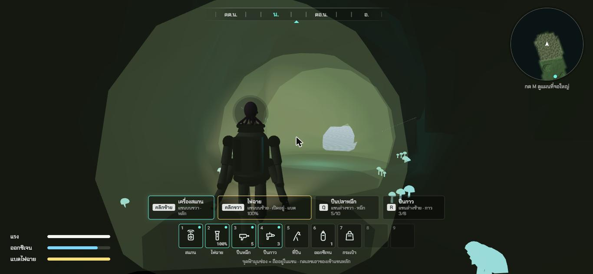
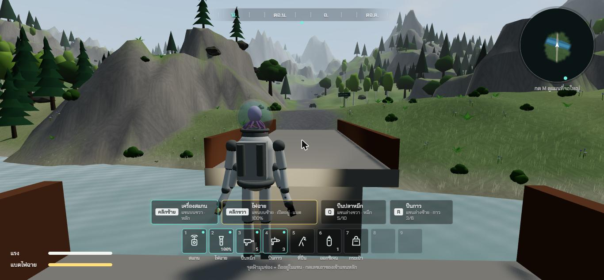

# ช่วง 8 · เมืองพัง ถ้ำ ซาก สะพานพัง

วันที่ 23 ต.ค. 2569 · ผล **ผ่าน**

## ทำอะไรไป
- **เมืองพัง** `src/world/town.ts` + `src/render/Town.ts` ตึก 16 หลังในหุบเขา
  - **ตึกทั้งหลัง** 2 ถึง 6 ชั้น หน้าต่างแตก คราบน้ำ มอสบนหลังคา · **ตึกพัง** ผนังบนพังเป็นฟันเลื่อย เศษปูนกองข้างล่าง · **ตึกโล่งมีประตู** เดินเข้าไปหลบหนาวได้
  - **เถาวัลย์ห้อยจากหลังคาไหวตามลม** · ต้นไม้ขึ้นแทรกในเมือง (จากช่วง 1) · ตึกขึ้นบนแผนที่
- **สิ่งก่อสร้างทรงกล่อง** `src/world/structures.ts` ชนผนัง · ยืนบนหลังคาและพื้นสะพาน · **หลังคาเหนือหัว = หลบหนาวได้** · กล้องไม่ทะลุผนัง
- **ปีนผนังตึก** ถือที่ปีนป่ายเดินเข้าหาผนัง ปีนขึ้นตรง ๆ ถึงยอดแล้วก้าวขึ้นหลังคา
- **ถ้ำ 2 แห่ง** `src/world/caves.ts` + `src/render/Caves.ts`
  - ปากถ้ำอยู่ที่ตีนหน้าผาของเนินหิน **อุโมงค์อยู่ใต้ภูเขาจริง** (มีเทสบังคับว่าเพดานต่ำกว่าผิวภูเขาอย่างน้อย 3 ม.)
  - อุโมงค์คดเคี้ยว พื้นแบน ผนังขรุขระ พื้นค่อย ๆ ลาดลง ห้องปลายถ้ำกว้าง · **เจาะรูปากถ้ำในพื้นดิน**
  - **ข้างในมืดจริง** แสงแดดกับแสงฟ้าหายตามความลึก เหลือไฟฉายกับ **เห็ดเรืองแสงสีฟ้า**
  - **ภาพวาดรอยมือบนผนังห้องปลายถ้ำ** (ชิ้นพิเศษ ได้บันทึกส่วนตัว)
  - **ถ้ำแรกส่วนลึกมีก๊าซพิษ** หมอกสีเขียว ออกซิเจนในโหลลด · ในถ้ำหลบหนาวได้
  - เดินในถ้ำใช้พื้นถ้ำ ผนังถ้ำเดินทะลุไม่ได้ · กล้องอยู่ในอุโมงค์
- **พื้นรวม** `src/app/WorldGround.ts` ภูมิประเทศ พื้นถ้ำ หลังคา พื้นสะพาน
- **สะพานพัง** ข้ามแม่น้ำตรงถนน พื้นสองท่อนขาดกลาง 5 ม. ราวเหล็กสนิม เสาตอม่อ
- สแกนได้เพิ่ม: ตึก · สะพาน · ภาพวาดในถ้ำ · เห็ดเรืองแสง

## เล่นทดสอบ (ในโครม)
| ทดสอบ | ผล |
|---|---|
| ยืนในเมือง 16:30 | ตึก 16 หลัง เถาวัลย์ หน้าต่างแตก เสาไฟ รถบัส ✅ |
| ถือที่ปีนป่าย เดินเข้าผนังตึกสูง 9.6 ม. | ปีนขึ้น ถึงยอดก้าวขึ้นหลังคา เหลือแรง 23 เห็นวิวเมือง ✅ |
| เดินจากหน้าถ้ำเข้าไปตามอุโมงค์ | ตัวละครเดินบนพื้นถ้ำตลอดทาง (ห่างพื้นถ้ำ 0.1 ม. ทุกจุด) ข้างบนมีภูเขาหนา 20 ม. ✅ |
| ในถ้ำ | หลบหนาวได้ ✅ · แสงแดดหายตามความลึก ไฟฉายส่องอุโมงค์ ✅ |
| เดินลึกถึงส่วนก๊าซพิษ (เดิน 37 วินาที) | ออกซิเจนเริ่มลด แถบออกซิเจนโผล่ ลดเหลือ 80% ใน 8 วินาที ✅ |
| สแกนภาพวาดรอยมือในถ้ำที่สอง | การ์ด "ผนังที่มีมือ" ได้บันทึกส่วนตัว "มือเล็กที่สุดอยู่ต่ำที่สุด ฉันคิดว่าเป็นของเด็ก" ✅ |
| เดินบนสะพานพังไปถึงช่องที่ขาด | ตกจาก 6.1 ม. ลงแม่น้ำ เปลี่ยนเป็นว่าย โหลไม่ร้าวเพราะตกลงน้ำ ✅ |
| typecheck · test (92 ข้อ) · build | ผ่าน ✅ |

| เมืองพัง | บนหลังคาหลังปีนตึก |
|---|---|
|  |  |

| ในถ้ำ ไฟฉาย | ลึกในถ้ำ ก๊าซพิษ เห็ดเรืองแสง | สะพานพัง |
|---|---|---|
|  |  |  |

## บั๊กที่เจอ
| บั๊ก | สถานะ |
|---|---|
| ภูเขาตรงถ้ำไม่สูงพอ อุโมงค์โผล่พ้นภูเขา | แก้แล้ว ปั้นเนินหน้าผาชันข้างหลังปากถ้ำใหม่ เพิ่มเทสบังคับ |
| ปีนตึก 16 ม. แรงหมดที่ 2.3 ม. | แก้แล้ว ลดแรงที่ใช้ปีนจาก 10 เป็น 6 ต่อวินาที ปีนเร็วขึ้นเป็น 0.9 ม./วิ ปีนได้ราว 15 ม. ต่อแรงเต็ม |
| ตอนปีนผนังตึก กล้องจมเข้าไปในผนัง | แก้แล้ว กล้องหมุนไปอยู่ข้างหลังตัวละครเองตอนปีน ภาพก่อนแก้ `00-bug-camera-in-wall.jpg` |
| แสงรั่วเป็นแถบขาวตรงขอบปากถ้ำ | แก้แล้ว ลดขนาดรูที่เจาะในพื้นดิน |
| ภาพวาดในถ้ำมืดมาก ต้องส่องไฟฉายถึงเห็นชัด | ไม่แก้ ตั้งใจให้ถ้ำมืดจริงตามที่เคาะไว้ |
| ก้อนหินบางก้อนโผล่ในอุโมงค์ | ยังค้าง ไม่กระทบการเดิน |

## แคลร์ตัดสินเอง
- จำนวนและขนาดตึก · ตึกโล่งหลบหนาวได้ 3 หลัง
- ถ้ำแรกลึก 70 ม. มีก๊าซพิษตั้งแต่ราว 60% ของความลึก · ถ้ำที่สองลึก 55 ม. ไม่มีก๊าซ
- ปีนผนังตึกขึ้นตรง ๆ ไม่ได้ปีนเลียบด้านข้าง
- ลดค่าแรงที่ใช้ปีนทั้งหน้าผาและตึกเป็น 6 ต่อวินาที (จาก 10 ในช่วง 3)

## รอพี่กันเคาะ
- ไม่มี
