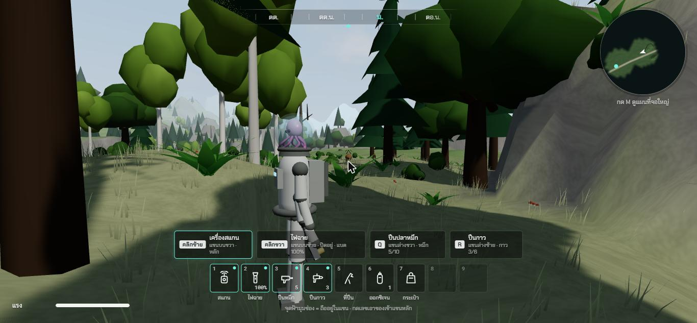
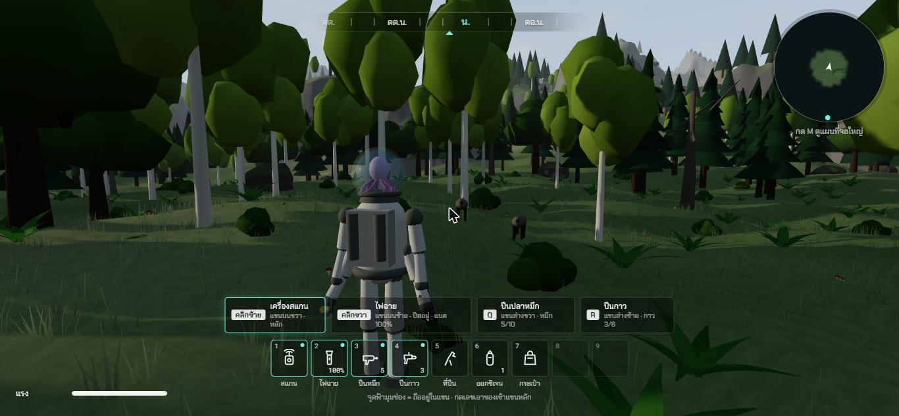
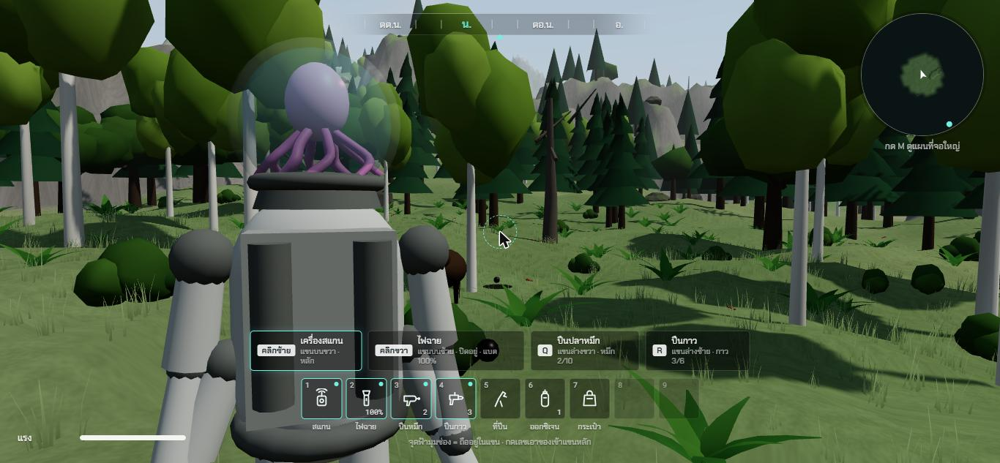

# ช่วง 9 · สัตว์ 12 ชนิด และหมึก

วันที่ 23 ต.ค. 2569 · ผล **ผ่าน**

## ทำอะไรไป
- **นิสัยสัตว์** `src/core/animals.ts` (เทส 5 ข้อ) · **โมเดลสัตว์** `src/render/models/animals.ts` · **สัตว์รอบตัว** `src/app/Animals.ts`
- 12 ชนิด แต่ละชนิดมีที่อยู่ เวลาออกหากิน ความเร็ว ระยะหนี
  | ชนิด | ที่อยู่ · เวลา | นิสัย | โดนหมึก |
  |---|---|---|---|
  | กวาง | ทุ่ง · ตลอด | เข้าใกล้ 22 ม. วิ่งหนี | ตกใจหนี |
  | กระต่าย | ทุ่ง · ตลอด | กระโดด หนีที่ 12 ม. | ตกใจหนี |
  | จิ้งจอก | ป่า · ตลอด | มองนาน หนีที่ 8 ม. | เฉย ๆ |
  | นกกา | เมือง · กลางวัน | บินวนเหนือซากเมือง | ตกใจหนี |
  | นกอินทรี | ฟ้า · กลางวัน | ลอยสูง 45 ถึง 65 ม. | เฉย ๆ |
  | ปลา | แม่น้ำ ทะเลสาบ | ว่ายใต้ผิวน้ำ ไม่ขึ้นบก | ตกใจหนี |
  | กบ | ริมน้ำ | กระโดดเตี้ย ๆ | เฉย ๆ |
  | ผีเสื้อ | ทุ่ง · กลางวัน | บินกระพือปีกเร็ว หลายสี | เฉย ๆ |
  | หิ่งห้อย | ทุ่ง · กลางคืน | จุดแสงลอยต่ำ 40 ดวง กะพริบ | เฉย ๆ |
  | นกฮูก | ป่า · กลางคืน | บินในป่า ตาเหลือง | ตกใจหนี |
  | **หมาป่า** | **ป่าลึก** · ตลอด | **ไล่ทำร้ายเป็นฝูง 3 ตัว** ในระยะ 24 ม. ไกลจากถิ่นเกิน 45 ม. เลิกไล่ | เฉย ๆ แต่ช้าลง |
  | **หมี** | **ป่าลึก** · ตลอด | **ไล่ทำร้าย** ในระยะ 18 ม. | **ดุกว่าเดิม** ไล่ไกลขึ้น เร็วขึ้น |
- **โดนหมึกทุกตัวตัวเหนียว เคลื่อนไหวช้าลงเหลือ 35% นาน 8 วินาที** สัตว์ไม่ตาย
- **ผลของหมึกต้องสแกนก่อนถึงรู้** สแกนแล้วการ์ดผลสแกนกับคอลเลกชันขึ้นบรรทัด "ผลของหมึก"
- สัตว์ดุตีโดนครั้งละ 1 รอยร้าว **โดนรุมก็โดนตีได้ทีละครั้ง เว้น 1.5 วินาที**
- สัตว์เกิดนอกสายตา 45 ถึง 105 ม. ในที่อยู่ของมัน หายเมื่อไกลเกิน 150 ม. · สัตว์บกไม่ลงน้ำลึก
- สแกนสัตว์ได้ทุกชนิด รวมหิ่งห้อย · คอลเลกชันโชว์โมเดลสัตว์หมุนได้

## เล่นทดสอบ (ในโครม)
| ทดสอบ | ผล |
|---|---|
| ยืนที่ทุ่งใกล้ยาน 3 วินาที | เกิดผีเสื้อ 8 กวาง 4 กระต่าย 5 จิ้งจอก 2 นกอินทรี 1 ✅ |
| วางกวางห่าง 14 ม. | วิ่งหนี 2 วินาทีห่างเป็น 27 ม. ✅ |
| ยืนในป่าลึก วางหมาป่า 3 ตัว | ไล่ทันที ✅ · ยืนนิ่ง 4 วินาที (ก่อนแก้) โหลแตก |
| ยิงหมึกใส่หมาป่า | เหนียว 8 วินาที ความเร็วเหลือ 1.2 ม./วิ ✅ |
| **กด Q ยิงหมึกใส่หมี** | หมีดุกว่าเดิม เหนียว 7.8 วินาที ยังไล่อยู่ ✅ |
| สแกนหมี สแกนกวาง | การ์ดขึ้น "ผลของหมึก · โดนหมึกแล้วดุร้ายกว่าเดิม ระวัง" กับ "ตกใจหนี ตัวเหนียวช้าลง" ✅ |
| กลางคืน 22:00 | หิ่งห้อยขึ้น นกฮูก 2 ตัว ✅ |
| typecheck · test · build | ผ่าน ✅ |

| กวางวิ่งหนี | หมาป่ารุม | ยิงหมึกใส่หมี |
|---|---|---|
|  |  |  |

## บั๊กที่เจอ
| บั๊ก | สถานะ |
|---|---|
| หมาป่า 3 ตัวรุม โหลแตกใน 4 วินาที โหดเกินเกมเดินเล่น | แก้แล้ว หมาป่าช้าลงจาก 5.4 เป็น 4.6 ม./วิ (เร็วกว่าคนวิ่งนิดเดียว) โดนตีได้ทีละครั้งเว้น 1.5 วินาที |
| สัตว์เป็นทรงก้อน ๆ ปั้นจากรูปทรงง่าย มองไกลเห็นเป็นจุดดำ | ยังค้าง ระดับเดโม |
| ตอนตายสัตว์หยุดนิ่ง | ไม่แก้ ตั้งใจให้ทุกอย่างหยุดระหว่างจำลองร่างใหม่ |

## แคลร์ตัดสินเอง
- ผลของหมึกแต่ละชนิด (พี่กันเคาะแค่ "บางตัวตกใจ บางตัวเฉย บางตัวดุกว่าเดิม")
- หมึกทำให้ช้าลงเหลือ 35% นาน 8 วินาที
- จำนวน ความเร็ว ระยะหนี ระยะไล่ ของทุกชนิด
- หมาป่าเป็นฝูง 3 ตัว หมี 1 ตัว อยู่เฉพาะป่าลึกทางตะวันตกเฉียงเหนือ

## รอพี่กันเคาะ
- ไม่มี
